# GitHub Issue Dependencies — Verified Report

> Historical snapshot from 2026-10-10. Counts, statuses, dependencies, and dates
> reflect that recorded operation and omit later Linux issues. For current state,
> use [GitHub issues](https://github.com/Krzys2002/Mini_Robot/issues),
> [Project #4](https://github.com/users/Krzys2002/projects/4), and the
> [planning index](../planning/README.md).

**Status: APPLIED AND VERIFIED. All 91 approved native dependencies exist.**

Verified at: 2026-10-10T14:47:49.390382+00:00.

Read-only GitHub snapshot: 2026-10-10T14:35:55.097754+00:00.

Repository: [Krzys2002/Mini_Robot](https://github.com/Krzys2002/Mini_Robot). Project: [#4](https://github.com/users/Krzys2002/projects/4), owner `Krzys2002`.

Sources: [MILESTONES.md](../planning/MILESTONES.md) and [GITHUB_ISSUES_M1_M8.md](../planning/GITHUB_ISSUES_M1_M8.md), both read completely and confirmed unchanged since import.

## Dependency configuration and verification summary

| Measure | Count |
|---|---:|
| Explicit catalog dependencies | 140 |
| Explicit dependencies after mapping catalog 10 to two existing issues | 143 |
| Existing native relationships, across the entire repository | 15 |
| Roadmap relationships selected from the source | 102 |
| Selected roadmap relationships that were pre-existing | 11 |
| New native relationships added and verified | 91 |
| Redundant direct links represented by dependency chains | 42 |
| Resulting repository relationships including preserved existing extras | 106 |
| Added EXPLICIT relationships | 91 |
| Added INFERRED relationships | 0 |
| Added UNCERTAIN relationships | 0 |
| Potential existing roadmap conflicts | 1 |
| Existing or resulting dependency cycles | 0 |

The retained roadmap set has 101 EXPLICIT relationships and one INFERRED relationship. The inferred link, camera enumeration #29 → selection UI #30, already exists; it requires no write. Existing redundant links are preserved rather than removed. The only GitHub mutations made were the 91 approved EXPLICIT native relationships. The final repository graph contains 106 links: 91 new plus 15 preserved.

Actual issue mappings were validated against all open and closed repository issues, their complete descriptions, and milestones. The import report supplies the agreed older-title matches. No issue numbers were assumed from catalog order. All 81 mapped roadmap issues are already in Project #4.

## Verified dependencies, grouped by milestone

Each row is one native relationship: the issue in the first column is blocked by the issue in the third column. EXPLICIT means directly listed in the source Dependencies section. INFERRED means technically required by the split task. UNCERTAIN means an existing relationship requires maintainer review and will be preserved.

### M1 — Application Foundation & Camera Infrastructure

| Issue | Title | Blocked by | Reason | Source |
|---|---|---|---|---|
| [#17](https://github.com/Krzys2002/Mini_Robot/issues/17) | [APP] Create Qt6/CMake application skeleton | None | Source lists no dependencies. | Catalog 1 |
| [#23](https://github.com/Krzys2002/Mini_Robot/issues/23) | [APP] Implement application logging system | [#17](https://github.com/Krzys2002/Mini_Robot/issues/17) | Requires catalog 1: [APP] Create Qt6/CMake application skeleton. Pre-existing; preserved and verified. | EXPLICIT — [catalog 2 Dependencies](../planning/GITHUB_ISSUES_M1_M8.md), line 140 |
| [#24](https://github.com/Krzys2002/Mini_Robot/issues/24) | [APP] Implement configuration loading | [#17](https://github.com/Krzys2002/Mini_Robot/issues/17) | Requires catalog 1: [APP] Create Qt6/CMake application skeleton. Pre-existing; preserved and verified. | EXPLICIT — [catalog 3 Dependencies](../planning/GITHUB_ISSUES_M1_M8.md), line 205 |
| [#24](https://github.com/Krzys2002/Mini_Robot/issues/24) | [APP] Implement configuration loading | [#23](https://github.com/Krzys2002/Mini_Robot/issues/23) | Requires catalog 2: [APP] Implement application logging system. Pre-existing; preserved and verified. | EXPLICIT — [catalog 3 Dependencies](../planning/GITHUB_ISSUES_M1_M8.md), line 205 |
| [#25](https://github.com/Krzys2002/Mini_Robot/issues/25) | [CORE] Define RobotId, Pose2D, timestamps and unit types | [#17](https://github.com/Krzys2002/Mini_Robot/issues/17) | Requires catalog 1: [APP] Create Qt6/CMake application skeleton. Pre-existing; preserved and verified. | EXPLICIT — [catalog 4 Dependencies](../planning/GITHUB_ISSUES_M1_M8.md), line 272 |
| [#26](https://github.com/Krzys2002/Mini_Robot/issues/26) | [CORE] Define ICameraSource interface | [#25](https://github.com/Krzys2002/Mini_Robot/issues/25) | Requires catalog 4: [CORE] Define RobotId, Pose2D, timestamps and unit types. Pre-existing; preserved and verified. | EXPLICIT — [catalog 5 Dependencies](../planning/GITHUB_ISSUES_M1_M8.md), line 337 |
| [#44](https://github.com/Krzys2002/Mini_Robot/issues/44) | [CORE] Define robot transport and protocol domain boundary | [#25](https://github.com/Krzys2002/Mini_Robot/issues/25) | Requires catalog 4: [CORE] Define RobotId, Pose2D, timestamps and unit types. Created and verified. | EXPLICIT — [catalog 6 Dependencies](../planning/GITHUB_ISSUES_M1_M8.md), line 400 |
| [#45](https://github.com/Krzys2002/Mini_Robot/issues/45) | [WORLD] Create authoritative WorldModel skeleton | [#25](https://github.com/Krzys2002/Mini_Robot/issues/25) | Requires catalog 4: [CORE] Define RobotId, Pose2D, timestamps and unit types. Created and verified. | EXPLICIT — [catalog 7 Dependencies](../planning/GITHUB_ISSUES_M1_M8.md), line 463 |
| [#27](https://github.com/Krzys2002/Mini_Robot/issues/27) | [SIM] Implement SimulationTransport / fake robot source | [#23](https://github.com/Krzys2002/Mini_Robot/issues/23) | Requires catalog 2: [APP] Implement application logging system. Pre-existing; preserved and verified. | EXPLICIT — [catalog 8 Dependencies](../planning/GITHUB_ISSUES_M1_M8.md), line 527 |
| [#27](https://github.com/Krzys2002/Mini_Robot/issues/27) | [SIM] Implement SimulationTransport / fake robot source | [#25](https://github.com/Krzys2002/Mini_Robot/issues/25) | Not directly listed, but required transitively by the source-defined graph; preserve existing relationship. | EXISTING / TRANSITIVE — existing GitHub dependency |
| [#27](https://github.com/Krzys2002/Mini_Robot/issues/27) | [SIM] Implement SimulationTransport / fake robot source | [#26](https://github.com/Krzys2002/Mini_Robot/issues/26) | SimulationTransport is a robot transport; neither its source contract nor its retained GitHub body requires ICameraSource. This additional camera-interface blocker is potentially unnecessary. Preserve for maintainer review. | UNCERTAIN — existing GitHub dependency |
| [#27](https://github.com/Krzys2002/Mini_Robot/issues/27) | [SIM] Implement SimulationTransport / fake robot source | [#44](https://github.com/Krzys2002/Mini_Robot/issues/44) | Requires catalog 6: [CORE] Define robot transport and protocol domain boundary. Created and verified. | EXPLICIT — [catalog 8 Dependencies](../planning/GITHUB_ISSUES_M1_M8.md), line 527 |
| [#28](https://github.com/Krzys2002/Mini_Robot/issues/28) | [TEST] Configure GoogleTest target | [#17](https://github.com/Krzys2002/Mini_Robot/issues/17) | Requires catalog 1: [APP] Create Qt6/CMake application skeleton. Pre-existing; preserved and verified. | EXPLICIT — [catalog 9 Dependencies](../planning/GITHUB_ISSUES_M1_M8.md), line 591 |
| [#29](https://github.com/Krzys2002/Mini_Robot/issues/29) | [CAMERA] Enumerate available cameras | [#17](https://github.com/Krzys2002/Mini_Robot/issues/17) | Requires catalog 1: [APP] Create Qt6/CMake application skeleton. Pre-existing; preserved and verified. | EXPLICIT — [catalog 10 Dependencies](../planning/GITHUB_ISSUES_M1_M8.md), line 655 |
| [#29](https://github.com/Krzys2002/Mini_Robot/issues/29) | [CAMERA] Enumerate available cameras | [#26](https://github.com/Krzys2002/Mini_Robot/issues/26) | Requires catalog 5: [CORE] Define ICameraSource interface. Pre-existing; preserved and verified. | EXPLICIT — [catalog 10 Dependencies](../planning/GITHUB_ISSUES_M1_M8.md), line 655 |
| [#30](https://github.com/Krzys2002/Mini_Robot/issues/30) | [CAMERA] Add camera selection UI | [#29](https://github.com/Krzys2002/Mini_Robot/issues/29) | The selection UI populates controls from discovered devices. The combined catalog task 10 is implemented by separate existing enumeration and selection issues. Pre-existing; preserved and verified. | INFERRED — [catalog 10 Dependencies](../planning/GITHUB_ISSUES_M1_M8.md), line 655 |
| [#31](https://github.com/Krzys2002/Mini_Robot/issues/31) | [CAMERA] Implement start/stop live stream | [#30](https://github.com/Krzys2002/Mini_Robot/issues/30) | Requires catalog 10: [CAMERA] Add camera selection UI. Pre-existing; preserved and verified. | EXPLICIT — [catalog 11 Dependencies](../planning/GITHUB_ISSUES_M1_M8.md), line 722 |
| [#46](https://github.com/Krzys2002/Mini_Robot/issues/46) | [CAMERA] Handle camera disconnect reconnect and source failure | [#31](https://github.com/Krzys2002/Mini_Robot/issues/31) | Requires catalog 11: [CAMERA] Implement start/stop live stream. Created and verified. | EXPLICIT — [catalog 12 Dependencies](../planning/GITHUB_ISSUES_M1_M8.md), line 786 |
| [#47](https://github.com/Krzys2002/Mini_Robot/issues/47) | [CAMERA] Add recorded-video camera source for deterministic replay | [#26](https://github.com/Krzys2002/Mini_Robot/issues/26) | Requires catalog 5: [CORE] Define ICameraSource interface. Created and verified. | EXPLICIT — [catalog 13 Dependencies](../planning/GITHUB_ISSUES_M1_M8.md), line 849 |
| [#47](https://github.com/Krzys2002/Mini_Robot/issues/47) | [CAMERA] Add recorded-video camera source for deterministic replay | [#28](https://github.com/Krzys2002/Mini_Robot/issues/28) | Requires catalog 9: [TEST] Configure GoogleTest target. Created and verified. | EXPLICIT — [catalog 13 Dependencies](../planning/GITHUB_ISSUES_M1_M8.md), line 849 |
| [#48](https://github.com/Krzys2002/Mini_Robot/issues/48) | [CI] Add macOS build and test continuous integration | [#28](https://github.com/Krzys2002/Mini_Robot/issues/28) | Requires catalog 9: [TEST] Configure GoogleTest target. Created and verified. | EXPLICIT — [catalog 14 Dependencies](../planning/GITHUB_ISSUES_M1_M8.md), line 913 |

### M2 — Vision, Calibration & Robot Localization

| Issue | Title | Blocked by | Reason | Source |
|---|---|---|---|---|
| [#49](https://github.com/Krzys2002/Mini_Robot/issues/49) | [VISION] Select AprilTag family marker size and robot-ID mapping | [#31](https://github.com/Krzys2002/Mini_Robot/issues/31) | Requires catalog 11: [CAMERA] Implement start/stop live stream. Created and verified. | EXPLICIT — [catalog 15 Dependencies](../planning/GITHUB_ISSUES_M1_M8.md), line 979 |
| [#49](https://github.com/Krzys2002/Mini_Robot/issues/49) | [VISION] Select AprilTag family marker size and robot-ID mapping | [#47](https://github.com/Krzys2002/Mini_Robot/issues/47) | Requires catalog 13: [CAMERA] Add recorded-video camera source for deterministic replay. Created and verified. | EXPLICIT — [catalog 15 Dependencies](../planning/GITHUB_ISSUES_M1_M8.md), line 979 |
| [#50](https://github.com/Krzys2002/Mini_Robot/issues/50) | [VISION] Integrate AprilTag detector into frame pipeline | [#49](https://github.com/Krzys2002/Mini_Robot/issues/49) | Requires catalog 15: [VISION] Select AprilTag family marker size and robot-ID mapping. Created and verified. | EXPLICIT — [catalog 16 Dependencies](../planning/GITHUB_ISSUES_M1_M8.md), line 1044 |
| [#51](https://github.com/Krzys2002/Mini_Robot/issues/51) | [VISION] Define marker observation robot identity center and image-space heading | [#50](https://github.com/Krzys2002/Mini_Robot/issues/50) | Requires catalog 16: [VISION] Integrate AprilTag detector into frame pipeline. Created and verified. | EXPLICIT — [catalog 17 Dependencies](../planning/GITHUB_ISSUES_M1_M8.md), line 1112 |
| [#52](https://github.com/Krzys2002/Mini_Robot/issues/52) | [VISION] Add vision debug overlay and performance diagnostics | [#51](https://github.com/Krzys2002/Mini_Robot/issues/51) | Requires catalog 17: [VISION] Define marker observation robot identity center and image-space heading. Created and verified. | EXPLICIT — [catalog 18 Dependencies](../planning/GITHUB_ISSUES_M1_M8.md), line 1179 |
| [#53](https://github.com/Krzys2002/Mini_Robot/issues/53) | [CALIB] Implement intrinsic camera calibration wizard and target capture | [#31](https://github.com/Krzys2002/Mini_Robot/issues/31) | Requires catalog 11: [CAMERA] Implement start/stop live stream. Created and verified. | EXPLICIT — [catalog 19 Dependencies](../planning/GITHUB_ISSUES_M1_M8.md), line 1243 |
| [#54](https://github.com/Krzys2002/Mini_Robot/issues/54) | [CALIB] Calculate camera intrinsics distortion and reprojection error | [#53](https://github.com/Krzys2002/Mini_Robot/issues/53) | Requires catalog 19: [CALIB] Implement intrinsic camera calibration wizard and target capture. Created and verified. | EXPLICIT — [catalog 20 Dependencies](../planning/GITHUB_ISSUES_M1_M8.md), line 1307 |
| [#55](https://github.com/Krzys2002/Mini_Robot/issues/55) | [CALIB] Persist calibration profiles per camera and resolution | [#24](https://github.com/Krzys2002/Mini_Robot/issues/24) | Requires catalog 3: [APP] Implement configuration loading. Created and verified. | EXPLICIT — [catalog 21 Dependencies](../planning/GITHUB_ISSUES_M1_M8.md), line 1373 |
| [#55](https://github.com/Krzys2002/Mini_Robot/issues/55) | [CALIB] Persist calibration profiles per camera and resolution | [#54](https://github.com/Krzys2002/Mini_Robot/issues/54) | Requires catalog 20: [CALIB] Calculate camera intrinsics distortion and reprojection error. Created and verified. | EXPLICIT — [catalog 21 Dependencies](../planning/GITHUB_ISSUES_M1_M8.md), line 1373 |
| [#56](https://github.com/Krzys2002/Mini_Robot/issues/56) | [WORLD] Define tabletop world coordinate frame and workspace calibration model | [#55](https://github.com/Krzys2002/Mini_Robot/issues/55) | Requires catalog 21: [CALIB] Persist calibration profiles per camera and resolution. Created and verified. | EXPLICIT — [catalog 22 Dependencies](../planning/GITHUB_ISSUES_M1_M8.md), line 1439 |
| [#57](https://github.com/Krzys2002/Mini_Robot/issues/57) | [WORLD] Implement camera-to-table homography calibration | [#56](https://github.com/Krzys2002/Mini_Robot/issues/56) | Requires catalog 22: [WORLD] Define tabletop world coordinate frame and workspace calibration model. Created and verified. | EXPLICIT — [catalog 23 Dependencies](../planning/GITHUB_ISSUES_M1_M8.md), line 1504 |
| [#58](https://github.com/Krzys2002/Mini_Robot/issues/58) | [WORLD] Convert marker observations to metric robot Pose2D | [#51](https://github.com/Krzys2002/Mini_Robot/issues/51) | Requires catalog 17: [VISION] Define marker observation robot identity center and image-space heading. Created and verified. | EXPLICIT — [catalog 24 Dependencies](../planning/GITHUB_ISSUES_M1_M8.md), line 1570 |
| [#58](https://github.com/Krzys2002/Mini_Robot/issues/58) | [WORLD] Convert marker observations to metric robot Pose2D | [#57](https://github.com/Krzys2002/Mini_Robot/issues/57) | Requires catalog 23: [WORLD] Implement camera-to-table homography calibration. Created and verified. | EXPLICIT — [catalog 24 Dependencies](../planning/GITHUB_ISSUES_M1_M8.md), line 1570 |
| [#59](https://github.com/Krzys2002/Mini_Robot/issues/59) | [TRACKING] Implement per-robot tracker with fresh stale and lost states | [#45](https://github.com/Krzys2002/Mini_Robot/issues/45) | Requires catalog 7: [WORLD] Create authoritative WorldModel skeleton. Created and verified. | EXPLICIT — [catalog 25 Dependencies](../planning/GITHUB_ISSUES_M1_M8.md), line 1637 |
| [#59](https://github.com/Krzys2002/Mini_Robot/issues/59) | [TRACKING] Implement per-robot tracker with fresh stale and lost states | [#58](https://github.com/Krzys2002/Mini_Robot/issues/58) | Requires catalog 24: [WORLD] Convert marker observations to metric robot Pose2D. Created and verified. | EXPLICIT — [catalog 25 Dependencies](../planning/GITHUB_ISSUES_M1_M8.md), line 1637 |
| [#60](https://github.com/Krzys2002/Mini_Robot/issues/60) | [TRACKING] Implement heading unwrapping and exponential pose smoothing | [#59](https://github.com/Krzys2002/Mini_Robot/issues/59) | Requires catalog 25: [TRACKING] Implement per-robot tracker with fresh stale and lost states. Created and verified. | EXPLICIT — [catalog 26 Dependencies](../planning/GITHUB_ISSUES_M1_M8.md), line 1703 |
| [#61](https://github.com/Krzys2002/Mini_Robot/issues/61) | [TRACKING] Estimate velocity angular velocity confidence and observation age | [#52](https://github.com/Krzys2002/Mini_Robot/issues/52) | Requires catalog 18: [VISION] Add vision debug overlay and performance diagnostics. Created and verified. | EXPLICIT — [catalog 27 Dependencies](../planning/GITHUB_ISSUES_M1_M8.md), line 1768 |
| [#61](https://github.com/Krzys2002/Mini_Robot/issues/61) | [TRACKING] Estimate velocity angular velocity confidence and observation age | [#60](https://github.com/Krzys2002/Mini_Robot/issues/60) | Requires catalog 26: [TRACKING] Implement heading unwrapping and exponential pose smoothing. Created and verified. | EXPLICIT — [catalog 27 Dependencies](../planning/GITHUB_ISSUES_M1_M8.md), line 1768 |
| [#62](https://github.com/Krzys2002/Mini_Robot/issues/62) | [TRACKING] Add optional Kalman pose filter and comparison harness | [#61](https://github.com/Krzys2002/Mini_Robot/issues/61) | Requires catalog 27: [TRACKING] Estimate velocity angular velocity confidence and observation age. Created and verified. | EXPLICIT — [catalog 28 Dependencies](../planning/GITHUB_ISSUES_M1_M8.md), line 1835 |
| [#63](https://github.com/Krzys2002/Mini_Robot/issues/63) | [TEST] Measure localization and orientation accuracy across workspace | [#60](https://github.com/Krzys2002/Mini_Robot/issues/60) | Requires catalog 26: [TRACKING] Implement heading unwrapping and exponential pose smoothing. Created and verified. | EXPLICIT — [catalog 29 Dependencies](../planning/GITHUB_ISSUES_M1_M8.md), line 1901 |

### M3 — Robot Communication & Manual Safety Control

| Issue | Title | Blocked by | Reason | Source |
|---|---|---|---|---|
| [#64](https://github.com/Krzys2002/Mini_Robot/issues/64) | [PROTOCOL] Define versioned robot command telemetry and BLE GATT contract | [#44](https://github.com/Krzys2002/Mini_Robot/issues/44) | Requires catalog 6: [CORE] Define robot transport and protocol domain boundary. Created and verified. | EXPLICIT — [catalog 30 Dependencies](../planning/GITHUB_ISSUES_M1_M8.md), line 1971 |
| [#65](https://github.com/Krzys2002/Mini_Robot/issues/65) | [BLE] Implement BLE device discovery connection and state reporting | [#64](https://github.com/Krzys2002/Mini_Robot/issues/64) | Requires catalog 30: [PROTOCOL] Define versioned robot command telemetry and BLE GATT contract. Created and verified. | EXPLICIT — [catalog 31 Dependencies](../planning/GITHUB_ISSUES_M1_M8.md), line 2035 |
| [#66](https://github.com/Krzys2002/Mini_Robot/issues/66) | [BLE] Implement BLE command writes telemetry notifications and protocol validation | [#65](https://github.com/Krzys2002/Mini_Robot/issues/65) | Requires catalog 31: [BLE] Implement BLE device discovery connection and state reporting. Created and verified. | EXPLICIT — [catalog 32 Dependencies](../planning/GITHUB_ISSUES_M1_M8.md), line 2099 |
| [#67](https://github.com/Krzys2002/Mini_Robot/issues/67) | [COMM] Implement RobotManager connection ownership and per-robot state | [#27](https://github.com/Krzys2002/Mini_Robot/issues/27) | Requires catalog 8: [SIM] Implement SimulationTransport / fake robot source. Created and verified. | EXPLICIT — [catalog 33 Dependencies](../planning/GITHUB_ISSUES_M1_M8.md), line 2165 |
| [#67](https://github.com/Krzys2002/Mini_Robot/issues/67) | [COMM] Implement RobotManager connection ownership and per-robot state | [#66](https://github.com/Krzys2002/Mini_Robot/issues/66) | Requires catalog 32: [BLE] Implement BLE command writes telemetry notifications and protocol validation. Created and verified. | EXPLICIT — [catalog 33 Dependencies](../planning/GITHUB_ISSUES_M1_M8.md), line 2165 |
| [#68](https://github.com/Krzys2002/Mini_Robot/issues/68) | [SIM] Keep simulation protocol behavior compatible with real command model | [#67](https://github.com/Krzys2002/Mini_Robot/issues/67) | Requires catalog 33: [COMM] Implement RobotManager connection ownership and per-robot state. Created and verified. | EXPLICIT — [catalog 34 Dependencies](../planning/GITHUB_ISSUES_M1_M8.md), line 2227 |
| [#69](https://github.com/Krzys2002/Mini_Robot/issues/69) | [UI] Implement manual robot control and connection panel | [#67](https://github.com/Krzys2002/Mini_Robot/issues/67) | Requires catalog 33: [COMM] Implement RobotManager connection ownership and per-robot state. Created and verified. | EXPLICIT — [catalog 35 Dependencies](../planning/GITHUB_ISSUES_M1_M8.md), line 2293 |
| [#70](https://github.com/Krzys2002/Mini_Robot/issues/70) | [SAFETY] Implement emergency stop command freshness and lost-connection safety rules | [#68](https://github.com/Krzys2002/Mini_Robot/issues/68) | Requires catalog 34: [SIM] Keep simulation protocol behavior compatible with real command model. Created and verified. | EXPLICIT — [catalog 36 Dependencies](../planning/GITHUB_ISSUES_M1_M8.md), line 2358 |
| [#71](https://github.com/Krzys2002/Mini_Robot/issues/71) | [BLE] Implement BLE reconnect recovery and repeated lifecycle testing | [#70](https://github.com/Krzys2002/Mini_Robot/issues/70) | Requires catalog 36: [SAFETY] Implement emergency stop command freshness and lost-connection safety rules. Created and verified. | EXPLICIT — [catalog 37 Dependencies](../planning/GITHUB_ISSUES_M1_M8.md), line 2426 |
| [#72](https://github.com/Krzys2002/Mini_Robot/issues/72) | [TEST] Benchmark BLE communication latency jitter loss and reconnect time | [#71](https://github.com/Krzys2002/Mini_Robot/issues/71) | Requires catalog 37: [BLE] Implement BLE reconnect recovery and repeated lifecycle testing. Created and verified. | EXPLICIT — [catalog 38 Dependencies](../planning/GITHUB_ISSUES_M1_M8.md), line 2491 |

### M4 — External-Vision Closed-Loop Robot Control

| Issue | Title | Blocked by | Reason | Source |
|---|---|---|---|---|
| [#73](https://github.com/Krzys2002/Mini_Robot/issues/73) | [CONTROL] Implement differential-drive kinematic and command conversion model | [#64](https://github.com/Krzys2002/Mini_Robot/issues/64) | Requires catalog 30: [PROTOCOL] Define versioned robot command telemetry and BLE GATT contract. Created and verified. | EXPLICIT — [catalog 39 Dependencies](../planning/GITHUB_ISSUES_M1_M8.md), line 2558 |
| [#74](https://github.com/Krzys2002/Mini_Robot/issues/74) | [CONTROL] Create supervisory control loop service and scheduler | [#61](https://github.com/Krzys2002/Mini_Robot/issues/61) | Requires catalog 27: [TRACKING] Estimate velocity angular velocity confidence and observation age. Created and verified. | EXPLICIT — [catalog 40 Dependencies](../planning/GITHUB_ISSUES_M1_M8.md), line 2624 |
| [#74](https://github.com/Krzys2002/Mini_Robot/issues/74) | [CONTROL] Create supervisory control loop service and scheduler | [#70](https://github.com/Krzys2002/Mini_Robot/issues/70) | Requires catalog 36: [SAFETY] Implement emergency stop command freshness and lost-connection safety rules. Created and verified. | EXPLICIT — [catalog 40 Dependencies](../planning/GITHUB_ISSUES_M1_M8.md), line 2624 |
| [#74](https://github.com/Krzys2002/Mini_Robot/issues/74) | [CONTROL] Create supervisory control loop service and scheduler | [#73](https://github.com/Krzys2002/Mini_Robot/issues/73) | Requires catalog 39: [CONTROL] Implement differential-drive kinematic and command conversion model. Created and verified. | EXPLICIT — [catalog 40 Dependencies](../planning/GITHUB_ISSUES_M1_M8.md), line 2624 |
| [#75](https://github.com/Krzys2002/Mini_Robot/issues/75) | [CONTROL] Implement baseline goal-point controller | [#74](https://github.com/Krzys2002/Mini_Robot/issues/74) | Requires catalog 40: [CONTROL] Create supervisory control loop service and scheduler. Created and verified. | EXPLICIT — [catalog 41 Dependencies](../planning/GITHUB_ISSUES_M1_M8.md), line 2692 |
| [#76](https://github.com/Krzys2002/Mini_Robot/issues/76) | [CONTROL] Integrate live visual pose feedback with robot commands | [#75](https://github.com/Krzys2002/Mini_Robot/issues/75) | Requires catalog 41: [CONTROL] Implement baseline goal-point controller. Created and verified. | EXPLICIT — [catalog 42 Dependencies](../planning/GITHUB_ISSUES_M1_M8.md), line 2756 |
| [#77](https://github.com/Krzys2002/Mini_Robot/issues/77) | [SAFETY] Add control saturation freshness and operational state machine | [#76](https://github.com/Krzys2002/Mini_Robot/issues/76) | Requires catalog 42: [CONTROL] Integrate live visual pose feedback with robot commands. Created and verified. | EXPLICIT — [catalog 43 Dependencies](../planning/GITHUB_ISSUES_M1_M8.md), line 2824 |
| [#78](https://github.com/Krzys2002/Mini_Robot/issues/78) | [UI] Add calibrated target-point selection and control panel | [#77](https://github.com/Krzys2002/Mini_Robot/issues/77) | Requires catalog 43: [SAFETY] Add control saturation freshness and operational state machine. Created and verified. | EXPLICIT — [catalog 44 Dependencies](../planning/GITHUB_ISSUES_M1_M8.md), line 2887 |
| [#79](https://github.com/Krzys2002/Mini_Robot/issues/79) | [MEASURE] Add controller experiment logging and export | [#76](https://github.com/Krzys2002/Mini_Robot/issues/76) | Requires catalog 42: [CONTROL] Integrate live visual pose feedback with robot commands. Created and verified. | EXPLICIT — [catalog 45 Dependencies](../planning/GITHUB_ISSUES_M1_M8.md), line 2950 |
| [#80](https://github.com/Krzys2002/Mini_Robot/issues/80) | [TEST] Benchmark closed-loop point regulation | [#77](https://github.com/Krzys2002/Mini_Robot/issues/77) | Requires catalog 43: [SAFETY] Add control saturation freshness and operational state machine. Created and verified. | EXPLICIT — [catalog 46 Dependencies](../planning/GITHUB_ISSUES_M1_M8.md), line 3015 |
| [#80](https://github.com/Krzys2002/Mini_Robot/issues/80) | [TEST] Benchmark closed-loop point regulation | [#79](https://github.com/Krzys2002/Mini_Robot/issues/79) | Requires catalog 45: [MEASURE] Add controller experiment logging and export. Created and verified. | EXPLICIT — [catalog 46 Dependencies](../planning/GITHUB_ISSUES_M1_M8.md), line 3015 |

### M5 — Operator Path Drawing, Trajectory Generation & Tracking

| Issue | Title | Blocked by | Reason | Source |
|---|---|---|---|---|
| [#81](https://github.com/Krzys2002/Mini_Robot/issues/81) | [PATH] Implement world-space mouse path editor | [#78](https://github.com/Krzys2002/Mini_Robot/issues/78) | Requires catalog 44: [UI] Add calibrated target-point selection and control panel. Created and verified. | EXPLICIT — [catalog 47 Dependencies](../planning/GITHUB_ISSUES_M1_M8.md), line 3083 |
| [#82](https://github.com/Krzys2002/Mini_Robot/issues/82) | [PATH] Define path trajectory and execution domain models | [#81](https://github.com/Krzys2002/Mini_Robot/issues/81) | Requires catalog 47: [PATH] Implement world-space mouse path editor. Created and verified. | EXPLICIT — [catalog 48 Dependencies](../planning/GITHUB_ISSUES_M1_M8.md), line 3147 |
| [#83](https://github.com/Krzys2002/Mini_Robot/issues/83) | [PATH] Implement path simplification and smoothing | [#82](https://github.com/Krzys2002/Mini_Robot/issues/82) | Requires catalog 48: [PATH] Define path trajectory and execution domain models. Created and verified. | EXPLICIT — [catalog 49 Dependencies](../planning/GITHUB_ISSUES_M1_M8.md), line 3212 |
| [#84](https://github.com/Krzys2002/Mini_Robot/issues/84) | [TRAJ] Generate bounded trajectory/reference from smoothed path | [#83](https://github.com/Krzys2002/Mini_Robot/issues/83) | Requires catalog 49: [PATH] Implement path simplification and smoothing. Created and verified. | EXPLICIT — [catalog 50 Dependencies](../planning/GITHUB_ISSUES_M1_M8.md), line 3278 |
| [#85](https://github.com/Krzys2002/Mini_Robot/issues/85) | [CONTROL] Implement Pure Pursuit baseline path follower | [#84](https://github.com/Krzys2002/Mini_Robot/issues/84) | Requires catalog 50: [TRAJ] Generate bounded trajectory/reference from smoothed path. Created and verified. | EXPLICIT — [catalog 51 Dependencies](../planning/GITHUB_ISSUES_M1_M8.md), line 3343 |
| [#86](https://github.com/Krzys2002/Mini_Robot/issues/86) | [UI] Visualize desired path trajectory progress and actual robot trace | [#85](https://github.com/Krzys2002/Mini_Robot/issues/85) | Requires catalog 51: [CONTROL] Implement Pure Pursuit baseline path follower. Created and verified. | EXPLICIT — [catalog 52 Dependencies](../planning/GITHUB_ISSUES_M1_M8.md), line 3407 |
| [#87](https://github.com/Krzys2002/Mini_Robot/issues/87) | [CONTROL] Implement path execution pause cancel resume and safe completion | [#85](https://github.com/Krzys2002/Mini_Robot/issues/85) | Requires catalog 51: [CONTROL] Implement Pure Pursuit baseline path follower. Created and verified. | EXPLICIT — [catalog 53 Dependencies](../planning/GITHUB_ISSUES_M1_M8.md), line 3472 |
| [#88](https://github.com/Krzys2002/Mini_Robot/issues/88) | [TEST] Benchmark path-following accuracy on representative shapes | [#79](https://github.com/Krzys2002/Mini_Robot/issues/79) | Requires catalog 45: [MEASURE] Add controller experiment logging and export. Created and verified. | EXPLICIT — [catalog 54 Dependencies](../planning/GITHUB_ISSUES_M1_M8.md), line 3538 |
| [#88](https://github.com/Krzys2002/Mini_Robot/issues/88) | [TEST] Benchmark path-following accuracy on representative shapes | [#86](https://github.com/Krzys2002/Mini_Robot/issues/86) | Requires catalog 52: [UI] Visualize desired path trajectory progress and actual robot trace. Created and verified. | EXPLICIT — [catalog 54 Dependencies](../planning/GITHUB_ISSUES_M1_M8.md), line 3538 |
| [#88](https://github.com/Krzys2002/Mini_Robot/issues/88) | [TEST] Benchmark path-following accuracy on representative shapes | [#87](https://github.com/Krzys2002/Mini_Robot/issues/87) | Requires catalog 53: [CONTROL] Implement path execution pause cancel resume and safe completion. Created and verified. | EXPLICIT — [catalog 54 Dependencies](../planning/GITHUB_ISSUES_M1_M8.md), line 3538 |

### M6 — Obstacles & Autonomous Single-Robot Path Planning

| Issue | Title | Blocked by | Reason | Source |
|---|---|---|---|---|
| [#89](https://github.com/Krzys2002/Mini_Robot/issues/89) | [WORLD] Add obstacle model and manual world-space obstacle editor | [#81](https://github.com/Krzys2002/Mini_Robot/issues/81) | Requires catalog 47: [PATH] Implement world-space mouse path editor. Created and verified. | EXPLICIT — [catalog 55 Dependencies](../planning/GITHUB_ISSUES_M1_M8.md), line 3607 |
| [#90](https://github.com/Krzys2002/Mini_Robot/issues/90) | [PLANNER] Implement occupancy-grid representation from workspace obstacles | [#89](https://github.com/Krzys2002/Mini_Robot/issues/89) | Requires catalog 55: [WORLD] Add obstacle model and manual world-space obstacle editor. Created and verified. | EXPLICIT — [catalog 56 Dependencies](../planning/GITHUB_ISSUES_M1_M8.md), line 3673 |
| [#91](https://github.com/Krzys2002/Mini_Robot/issues/91) | [PLANNER] Implement robot-footprint obstacle inflation and clearance model | [#90](https://github.com/Krzys2002/Mini_Robot/issues/90) | Requires catalog 56: [PLANNER] Implement occupancy-grid representation from workspace obstacles. Created and verified. | EXPLICIT — [catalog 57 Dependencies](../planning/GITHUB_ISSUES_M1_M8.md), line 3735 |
| [#92](https://github.com/Krzys2002/Mini_Robot/issues/92) | [PLANNER] Implement A* planner behind IPathPlanner | [#91](https://github.com/Krzys2002/Mini_Robot/issues/91) | Requires catalog 57: [PLANNER] Implement robot-footprint obstacle inflation and clearance model. Created and verified. | EXPLICIT — [catalog 58 Dependencies](../planning/GITHUB_ISSUES_M1_M8.md), line 3801 |
| [#93](https://github.com/Krzys2002/Mini_Robot/issues/93) | [PLANNER] Post-process A* path into executable smooth route | [#84](https://github.com/Krzys2002/Mini_Robot/issues/84) | Requires catalog 50: [TRAJ] Generate bounded trajectory/reference from smoothed path. Created and verified. | EXPLICIT — [catalog 59 Dependencies](../planning/GITHUB_ISSUES_M1_M8.md), line 3864 |
| [#93](https://github.com/Krzys2002/Mini_Robot/issues/93) | [PLANNER] Post-process A* path into executable smooth route | [#92](https://github.com/Krzys2002/Mini_Robot/issues/92) | Requires catalog 58: [PLANNER] Implement A* planner behind IPathPlanner. Created and verified. | EXPLICIT — [catalog 59 Dependencies](../planning/GITHUB_ISSUES_M1_M8.md), line 3864 |
| [#94](https://github.com/Krzys2002/Mini_Robot/issues/94) | [VISION] Implement classical tabletop obstacle detection pipeline | [#89](https://github.com/Krzys2002/Mini_Robot/issues/89) | Requires catalog 55: [WORLD] Add obstacle model and manual world-space obstacle editor. Created and verified. | EXPLICIT — [catalog 60 Dependencies](../planning/GITHUB_ISSUES_M1_M8.md), line 3929 |
| [#95](https://github.com/Krzys2002/Mini_Robot/issues/95) | [WORLD] Add temporal obstacle persistence and safe occupancy updates | [#90](https://github.com/Krzys2002/Mini_Robot/issues/90) | Requires catalog 56: [PLANNER] Implement occupancy-grid representation from workspace obstacles. Created and verified. | EXPLICIT — [catalog 61 Dependencies](../planning/GITHUB_ISSUES_M1_M8.md), line 3994 |
| [#95](https://github.com/Krzys2002/Mini_Robot/issues/95) | [WORLD] Add temporal obstacle persistence and safe occupancy updates | [#94](https://github.com/Krzys2002/Mini_Robot/issues/94) | Requires catalog 60: [VISION] Implement classical tabletop obstacle detection pipeline. Created and verified. | EXPLICIT — [catalog 61 Dependencies](../planning/GITHUB_ISSUES_M1_M8.md), line 3994 |
| [#96](https://github.com/Krzys2002/Mini_Robot/issues/96) | [TEST] Benchmark autonomous single-robot planning and obstacle navigation | [#88](https://github.com/Krzys2002/Mini_Robot/issues/88) | Requires catalog 54: [TEST] Benchmark path-following accuracy on representative shapes. Created and verified. | EXPLICIT — [catalog 62 Dependencies](../planning/GITHUB_ISSUES_M1_M8.md), line 4058 |
| [#96](https://github.com/Krzys2002/Mini_Robot/issues/96) | [TEST] Benchmark autonomous single-robot planning and obstacle navigation | [#93](https://github.com/Krzys2002/Mini_Robot/issues/93) | Requires catalog 59: [PLANNER] Post-process A* path into executable smooth route. Created and verified. | EXPLICIT — [catalog 62 Dependencies](../planning/GITHUB_ISSUES_M1_M8.md), line 4058 |

### M7 — Multi-Robot Coordination & Collision Avoidance

| Issue | Title | Blocked by | Reason | Source |
|---|---|---|---|---|
| [#97](https://github.com/Krzys2002/Mini_Robot/issues/97) | [MULTI] Scale robot registry tracking communication and UI to multiple active robots | [#87](https://github.com/Krzys2002/Mini_Robot/issues/87) | Requires catalog 53: [CONTROL] Implement path execution pause cancel resume and safe completion. Created and verified. | EXPLICIT — [catalog 63 Dependencies](../planning/GITHUB_ISSUES_M1_M8.md), line 4126 |
| [#98](https://github.com/Krzys2002/Mini_Robot/issues/98) | [MULTI] Implement per-robot task path and trajectory ownership | [#97](https://github.com/Krzys2002/Mini_Robot/issues/97) | Requires catalog 63: [MULTI] Scale robot registry tracking communication and UI to multiple active robots. Created and verified. | EXPLICIT — [catalog 64 Dependencies](../planning/GITHUB_ISSUES_M1_M8.md), line 4191 |
| [#99](https://github.com/Krzys2002/Mini_Robot/issues/99) | [COORD] Implement space-time robot collision prediction | [#91](https://github.com/Krzys2002/Mini_Robot/issues/91) | Requires catalog 57: [PLANNER] Implement robot-footprint obstacle inflation and clearance model. Created and verified. | EXPLICIT — [catalog 65 Dependencies](../planning/GITHUB_ISSUES_M1_M8.md), line 4255 |
| [#99](https://github.com/Krzys2002/Mini_Robot/issues/99) | [COORD] Implement space-time robot collision prediction | [#98](https://github.com/Krzys2002/Mini_Robot/issues/98) | Requires catalog 64: [MULTI] Implement per-robot task path and trajectory ownership. Created and verified. | EXPLICIT — [catalog 65 Dependencies](../planning/GITHUB_ISSUES_M1_M8.md), line 4255 |
| [#100](https://github.com/Krzys2002/Mini_Robot/issues/100) | [COORD] Implement reservation and right-of-way baseline | [#99](https://github.com/Krzys2002/Mini_Robot/issues/99) | Requires catalog 65: [COORD] Implement space-time robot collision prediction. Created and verified. | EXPLICIT — [catalog 66 Dependencies](../planning/GITHUB_ISSUES_M1_M8.md), line 4321 |
| [#101](https://github.com/Krzys2002/Mini_Robot/issues/101) | [COORD] Implement prioritized multi-robot planning baseline | [#92](https://github.com/Krzys2002/Mini_Robot/issues/92) | Requires catalog 58: [PLANNER] Implement A* planner behind IPathPlanner. Created and verified. | EXPLICIT — [catalog 67 Dependencies](../planning/GITHUB_ISSUES_M1_M8.md), line 4385 |
| [#101](https://github.com/Krzys2002/Mini_Robot/issues/101) | [COORD] Implement prioritized multi-robot planning baseline | [#100](https://github.com/Krzys2002/Mini_Robot/issues/100) | Requires catalog 66: [COORD] Implement reservation and right-of-way baseline. Created and verified. | EXPLICIT — [catalog 67 Dependencies](../planning/GITHUB_ISSUES_M1_M8.md), line 4385 |
| [#102](https://github.com/Krzys2002/Mini_Robot/issues/102) | [COORD] Implement Conflict-Based Search comparison planner | [#101](https://github.com/Krzys2002/Mini_Robot/issues/101) | Requires catalog 67: [COORD] Implement prioritized multi-robot planning baseline. Created and verified. | EXPLICIT — [catalog 68 Dependencies](../planning/GITHUB_ISSUES_M1_M8.md), line 4451 |
| [#103](https://github.com/Krzys2002/Mini_Robot/issues/103) | [COORD] Add optional local reciprocal collision-avoidance layer | [#101](https://github.com/Krzys2002/Mini_Robot/issues/101) | Requires catalog 67: [COORD] Implement prioritized multi-robot planning baseline. Created and verified. | EXPLICIT — [catalog 69 Dependencies](../planning/GITHUB_ISSUES_M1_M8.md), line 4516 |
| [#104](https://github.com/Krzys2002/Mini_Robot/issues/104) | [UI] Add multi-robot coordination visualization and controls | [#101](https://github.com/Krzys2002/Mini_Robot/issues/101) | Requires catalog 67: [COORD] Implement prioritized multi-robot planning baseline. Created and verified. | EXPLICIT — [catalog 70 Dependencies](../planning/GITHUB_ISSUES_M1_M8.md), line 4580 |
| [#105](https://github.com/Krzys2002/Mini_Robot/issues/105) | [TEST] Benchmark multi-robot coordination and scaling | [#104](https://github.com/Krzys2002/Mini_Robot/issues/104) | Requires catalog 70: [UI] Add multi-robot coordination visualization and controls. Created and verified. | EXPLICIT — [catalog 71 Dependencies](../planning/GITHUB_ISSUES_M1_M8.md), line 4645 |

### M8 — Cross-Platform & Advanced Sensor/Communication Extensions

| Issue | Title | Blocked by | Reason | Source |
|---|---|---|---|---|
| [#106](https://github.com/Krzys2002/Mini_Robot/issues/106) | [WINDOWS] Add Windows build CI and deployment path | [#48](https://github.com/Krzys2002/Mini_Robot/issues/48) | Requires catalog 14: [CI] Add macOS build and test continuous integration. Created and verified. | EXPLICIT — [catalog 72 Dependencies](../planning/GITHUB_ISSUES_M1_M8.md), line 4714 |
| [#107](https://github.com/Krzys2002/Mini_Robot/issues/107) | [ZIGBEE] Implement optional Zigbee transport through coordinator gateway | [#67](https://github.com/Krzys2002/Mini_Robot/issues/67) | Requires catalog 33: [COMM] Implement RobotManager connection ownership and per-robot state. Created and verified. | EXPLICIT — [catalog 73 Dependencies](../planning/GITHUB_ISSUES_M1_M8.md), line 4781 |
| [#108](https://github.com/Krzys2002/Mini_Robot/issues/108) | [CAMERA] Generalize camera calibration management for second overhead camera | [#57](https://github.com/Krzys2002/Mini_Robot/issues/57) | Requires catalog 23: [WORLD] Implement camera-to-table homography calibration. Created and verified. | EXPLICIT — [catalog 74 Dependencies](../planning/GITHUB_ISSUES_M1_M8.md), line 4848 |
| [#109](https://github.com/Krzys2002/Mini_Robot/issues/109) | [FUSION] Fuse duplicate robot observations from multiple overhead cameras | [#59](https://github.com/Krzys2002/Mini_Robot/issues/59) | Requires catalog 25: [TRACKING] Implement per-robot tracker with fresh stale and lost states. Created and verified. | EXPLICIT — [catalog 75 Dependencies](../planning/GITHUB_ISSUES_M1_M8.md), line 4915 |
| [#109](https://github.com/Krzys2002/Mini_Robot/issues/109) | [FUSION] Fuse duplicate robot observations from multiple overhead cameras | [#108](https://github.com/Krzys2002/Mini_Robot/issues/108) | Requires catalog 74: [CAMERA] Generalize camera calibration management for second overhead camera. Created and verified. | EXPLICIT — [catalog 75 Dependencies](../planning/GITHUB_ISSUES_M1_M8.md), line 4915 |
| [#110](https://github.com/Krzys2002/Mini_Robot/issues/110) | [VIDEO] Add per-robot onboard camera stream over Wi-Fi | [#97](https://github.com/Krzys2002/Mini_Robot/issues/97) | Requires catalog 63: [MULTI] Scale robot registry tracking communication and UI to multiple active robots. Created and verified. | EXPLICIT — [catalog 76 Dependencies](../planning/GITHUB_ISSUES_M1_M8.md), line 4982 |
| [#111](https://github.com/Krzys2002/Mini_Robot/issues/111) | [LIDAR] Define iPhone ARKit LiDAR companion protocol and depth-source boundary | [#56](https://github.com/Krzys2002/Mini_Robot/issues/56) | Requires catalog 22: [WORLD] Define tabletop world coordinate frame and workspace calibration model. Created and verified. | EXPLICIT — [catalog 77 Dependencies](../planning/GITHUB_ISSUES_M1_M8.md), line 5047 |
| [#112](https://github.com/Krzys2002/Mini_Robot/issues/112) | [LIDAR] Convert iPhone depth data into tabletop obstacle geometry | [#89](https://github.com/Krzys2002/Mini_Robot/issues/89) | Requires catalog 55: [WORLD] Add obstacle model and manual world-space obstacle editor. Created and verified. | EXPLICIT — [catalog 78 Dependencies](../planning/GITHUB_ISSUES_M1_M8.md), line 5113 |
| [#112](https://github.com/Krzys2002/Mini_Robot/issues/112) | [LIDAR] Convert iPhone depth data into tabletop obstacle geometry | [#111](https://github.com/Krzys2002/Mini_Robot/issues/111) | Requires catalog 77: [LIDAR] Define iPhone ARKit LiDAR companion protocol and depth-source boundary. Created and verified. | EXPLICIT — [catalog 78 Dependencies](../planning/GITHUB_ISSUES_M1_M8.md), line 5113 |
| [#113](https://github.com/Krzys2002/Mini_Robot/issues/113) | [VISION] Add optional semantic object recognition layer | [#94](https://github.com/Krzys2002/Mini_Robot/issues/94) | Requires catalog 60: [VISION] Implement classical tabletop obstacle detection pipeline. Created and verified. | EXPLICIT — [catalog 79 Dependencies](../planning/GITHUB_ISSUES_M1_M8.md), line 5180 |
| [#114](https://github.com/Krzys2002/Mini_Robot/issues/114) | [TASK] Add optional autonomous multi-robot task allocation | [#101](https://github.com/Krzys2002/Mini_Robot/issues/101) | Requires catalog 67: [COORD] Implement prioritized multi-robot planning baseline. Created and verified. | EXPLICIT — [catalog 80 Dependencies](../planning/GITHUB_ISSUES_M1_M8.md), line 5247 |

### Existing relationships outside the desktop roadmap

| Issue | Title | Blocked by | Reason | Source |
|---|---|---|---|---|
| [#15](https://github.com/Krzys2002/Mini_Robot/issues/15) | Print Variant 1 of the robot body | [#1](https://github.com/Krzys2002/Mini_Robot/issues/1) | Existing robot-body/printing dependency is outside the desktop roadmap; preserve unchanged. | Existing GitHub dependency |
| [#16](https://github.com/Krzys2002/Mini_Robot/issues/16) | Print Variant 2 of the robot body | [#2](https://github.com/Krzys2002/Mini_Robot/issues/2) | Existing robot-body/printing dependency is outside the desktop roadmap; preserve unchanged. | Existing GitHub dependency |

## Existing conflicts and warnings

- **UNCERTAIN, preserve:** [#26](https://github.com/Krzys2002/Mini_Robot/issues/26) → [#27](https://github.com/Krzys2002/Mini_Robot/issues/27). ICameraSource is a camera interface, whereas SimulationTransport uses IRobotTransport. Neither the catalog nor the retained #27 body requires camera-source work. This extra prerequisite may unnecessarily delay simulation. No deletion is proposed.
- **Existing transitive link, preserve:** [#25](https://github.com/Krzys2002/Mini_Robot/issues/25) → [#27](https://github.com/Krzys2002/Mini_Robot/issues/27). The source-defined path is [#25](https://github.com/Krzys2002/Mini_Robot/issues/25) → [#44](https://github.com/Krzys2002/Mini_Robot/issues/44) → [#27](https://github.com/Krzys2002/Mini_Robot/issues/27).
- **Existing redundant explicit links, preserve:** [#17](https://github.com/Krzys2002/Mini_Robot/issues/17) → [#24](https://github.com/Krzys2002/Mini_Robot/issues/24) and [#17](https://github.com/Krzys2002/Mini_Robot/issues/17) → [#29](https://github.com/Krzys2002/Mini_Robot/issues/29) already exist. They will not be deleted even though their prerequisite paths also exist.
- The two existing robot-body → printing links are outside the desktop roadmap and remain unchanged.
- No circular dependencies were found in existing relationships or in the final verified graph.
- No external-repository dependency was found. Both Blocked by and Blocking endpoints agree on all existing relationships.
- Closed issues remain closed. Their dependency links describe implementation order and do not reopen work. Closed prerequisites do not prevent the open dependent issue from starting.

## Source dependencies represented transitively

These 42 direct links were not added, because the final graph enforces them through a chain. Every documented source dependency remains reachable in the verified graph.

| Documented direct relationship | Retained dependency chain |
|---|---|
| [#17](https://github.com/Krzys2002/Mini_Robot/issues/17) → [#30](https://github.com/Krzys2002/Mini_Robot/issues/30) | [#17](https://github.com/Krzys2002/Mini_Robot/issues/17) → [#29](https://github.com/Krzys2002/Mini_Robot/issues/29) → [#30](https://github.com/Krzys2002/Mini_Robot/issues/30) |
| [#17](https://github.com/Krzys2002/Mini_Robot/issues/17) → [#48](https://github.com/Krzys2002/Mini_Robot/issues/48) | [#17](https://github.com/Krzys2002/Mini_Robot/issues/17) → [#28](https://github.com/Krzys2002/Mini_Robot/issues/28) → [#48](https://github.com/Krzys2002/Mini_Robot/issues/48) |
| [#25](https://github.com/Krzys2002/Mini_Robot/issues/25) → [#51](https://github.com/Krzys2002/Mini_Robot/issues/51) | [#25](https://github.com/Krzys2002/Mini_Robot/issues/25) → [#26](https://github.com/Krzys2002/Mini_Robot/issues/26) → [#47](https://github.com/Krzys2002/Mini_Robot/issues/47) → [#49](https://github.com/Krzys2002/Mini_Robot/issues/49) → [#50](https://github.com/Krzys2002/Mini_Robot/issues/50) → [#51](https://github.com/Krzys2002/Mini_Robot/issues/51) |
| [#25](https://github.com/Krzys2002/Mini_Robot/issues/25) → [#56](https://github.com/Krzys2002/Mini_Robot/issues/56) | [#25](https://github.com/Krzys2002/Mini_Robot/issues/25) → [#26](https://github.com/Krzys2002/Mini_Robot/issues/26) → [#29](https://github.com/Krzys2002/Mini_Robot/issues/29) → [#30](https://github.com/Krzys2002/Mini_Robot/issues/30) → [#31](https://github.com/Krzys2002/Mini_Robot/issues/31) → [#53](https://github.com/Krzys2002/Mini_Robot/issues/53) → [#54](https://github.com/Krzys2002/Mini_Robot/issues/54) → [#55](https://github.com/Krzys2002/Mini_Robot/issues/55) → [#56](https://github.com/Krzys2002/Mini_Robot/issues/56) |
| [#25](https://github.com/Krzys2002/Mini_Robot/issues/25) → [#73](https://github.com/Krzys2002/Mini_Robot/issues/73) | [#25](https://github.com/Krzys2002/Mini_Robot/issues/25) → [#44](https://github.com/Krzys2002/Mini_Robot/issues/44) → [#64](https://github.com/Krzys2002/Mini_Robot/issues/64) → [#73](https://github.com/Krzys2002/Mini_Robot/issues/73) |
| [#25](https://github.com/Krzys2002/Mini_Robot/issues/25) → [#82](https://github.com/Krzys2002/Mini_Robot/issues/82) | [#25](https://github.com/Krzys2002/Mini_Robot/issues/25) → [#44](https://github.com/Krzys2002/Mini_Robot/issues/44) → [#64](https://github.com/Krzys2002/Mini_Robot/issues/64) → [#73](https://github.com/Krzys2002/Mini_Robot/issues/73) → [#74](https://github.com/Krzys2002/Mini_Robot/issues/74) → [#75](https://github.com/Krzys2002/Mini_Robot/issues/75) → [#76](https://github.com/Krzys2002/Mini_Robot/issues/76) → [#77](https://github.com/Krzys2002/Mini_Robot/issues/77) → [#78](https://github.com/Krzys2002/Mini_Robot/issues/78) → [#81](https://github.com/Krzys2002/Mini_Robot/issues/81) → [#82](https://github.com/Krzys2002/Mini_Robot/issues/82) |
| [#26](https://github.com/Krzys2002/Mini_Robot/issues/26) → [#30](https://github.com/Krzys2002/Mini_Robot/issues/30) | [#26](https://github.com/Krzys2002/Mini_Robot/issues/26) → [#29](https://github.com/Krzys2002/Mini_Robot/issues/29) → [#30](https://github.com/Krzys2002/Mini_Robot/issues/30) |
| [#29](https://github.com/Krzys2002/Mini_Robot/issues/29) → [#31](https://github.com/Krzys2002/Mini_Robot/issues/31) | [#29](https://github.com/Krzys2002/Mini_Robot/issues/29) → [#30](https://github.com/Krzys2002/Mini_Robot/issues/30) → [#31](https://github.com/Krzys2002/Mini_Robot/issues/31) |
| [#31](https://github.com/Krzys2002/Mini_Robot/issues/31) → [#50](https://github.com/Krzys2002/Mini_Robot/issues/50) | [#31](https://github.com/Krzys2002/Mini_Robot/issues/31) → [#49](https://github.com/Krzys2002/Mini_Robot/issues/49) → [#50](https://github.com/Krzys2002/Mini_Robot/issues/50) |
| [#45](https://github.com/Krzys2002/Mini_Robot/issues/45) → [#89](https://github.com/Krzys2002/Mini_Robot/issues/89) | [#45](https://github.com/Krzys2002/Mini_Robot/issues/45) → [#59](https://github.com/Krzys2002/Mini_Robot/issues/59) → [#60](https://github.com/Krzys2002/Mini_Robot/issues/60) → [#61](https://github.com/Krzys2002/Mini_Robot/issues/61) → [#74](https://github.com/Krzys2002/Mini_Robot/issues/74) → [#75](https://github.com/Krzys2002/Mini_Robot/issues/75) → [#76](https://github.com/Krzys2002/Mini_Robot/issues/76) → [#77](https://github.com/Krzys2002/Mini_Robot/issues/77) → [#78](https://github.com/Krzys2002/Mini_Robot/issues/78) → [#81](https://github.com/Krzys2002/Mini_Robot/issues/81) → [#89](https://github.com/Krzys2002/Mini_Robot/issues/89) |
| [#47](https://github.com/Krzys2002/Mini_Robot/issues/47) → [#50](https://github.com/Krzys2002/Mini_Robot/issues/50) | [#47](https://github.com/Krzys2002/Mini_Robot/issues/47) → [#49](https://github.com/Krzys2002/Mini_Robot/issues/49) → [#50](https://github.com/Krzys2002/Mini_Robot/issues/50) |
| [#47](https://github.com/Krzys2002/Mini_Robot/issues/47) → [#62](https://github.com/Krzys2002/Mini_Robot/issues/62) | [#47](https://github.com/Krzys2002/Mini_Robot/issues/47) → [#49](https://github.com/Krzys2002/Mini_Robot/issues/49) → [#50](https://github.com/Krzys2002/Mini_Robot/issues/50) → [#51](https://github.com/Krzys2002/Mini_Robot/issues/51) → [#52](https://github.com/Krzys2002/Mini_Robot/issues/52) → [#61](https://github.com/Krzys2002/Mini_Robot/issues/61) → [#62](https://github.com/Krzys2002/Mini_Robot/issues/62) |
| [#55](https://github.com/Krzys2002/Mini_Robot/issues/55) → [#57](https://github.com/Krzys2002/Mini_Robot/issues/57) | [#55](https://github.com/Krzys2002/Mini_Robot/issues/55) → [#56](https://github.com/Krzys2002/Mini_Robot/issues/56) → [#57](https://github.com/Krzys2002/Mini_Robot/issues/57) |
| [#55](https://github.com/Krzys2002/Mini_Robot/issues/55) → [#108](https://github.com/Krzys2002/Mini_Robot/issues/108) | [#55](https://github.com/Krzys2002/Mini_Robot/issues/55) → [#56](https://github.com/Krzys2002/Mini_Robot/issues/56) → [#57](https://github.com/Krzys2002/Mini_Robot/issues/57) → [#108](https://github.com/Krzys2002/Mini_Robot/issues/108) |
| [#57](https://github.com/Krzys2002/Mini_Robot/issues/57) → [#81](https://github.com/Krzys2002/Mini_Robot/issues/81) | [#57](https://github.com/Krzys2002/Mini_Robot/issues/57) → [#58](https://github.com/Krzys2002/Mini_Robot/issues/58) → [#59](https://github.com/Krzys2002/Mini_Robot/issues/59) → [#60](https://github.com/Krzys2002/Mini_Robot/issues/60) → [#61](https://github.com/Krzys2002/Mini_Robot/issues/61) → [#74](https://github.com/Krzys2002/Mini_Robot/issues/74) → [#75](https://github.com/Krzys2002/Mini_Robot/issues/75) → [#76](https://github.com/Krzys2002/Mini_Robot/issues/76) → [#77](https://github.com/Krzys2002/Mini_Robot/issues/77) → [#78](https://github.com/Krzys2002/Mini_Robot/issues/78) → [#81](https://github.com/Krzys2002/Mini_Robot/issues/81) |
| [#57](https://github.com/Krzys2002/Mini_Robot/issues/57) → [#94](https://github.com/Krzys2002/Mini_Robot/issues/94) | [#57](https://github.com/Krzys2002/Mini_Robot/issues/57) → [#58](https://github.com/Krzys2002/Mini_Robot/issues/58) → [#59](https://github.com/Krzys2002/Mini_Robot/issues/59) → [#60](https://github.com/Krzys2002/Mini_Robot/issues/60) → [#61](https://github.com/Krzys2002/Mini_Robot/issues/61) → [#74](https://github.com/Krzys2002/Mini_Robot/issues/74) → [#75](https://github.com/Krzys2002/Mini_Robot/issues/75) → [#76](https://github.com/Krzys2002/Mini_Robot/issues/76) → [#77](https://github.com/Krzys2002/Mini_Robot/issues/77) → [#78](https://github.com/Krzys2002/Mini_Robot/issues/78) → [#81](https://github.com/Krzys2002/Mini_Robot/issues/81) → [#89](https://github.com/Krzys2002/Mini_Robot/issues/89) → [#94](https://github.com/Krzys2002/Mini_Robot/issues/94) |
| [#58](https://github.com/Krzys2002/Mini_Robot/issues/58) → [#63](https://github.com/Krzys2002/Mini_Robot/issues/63) | [#58](https://github.com/Krzys2002/Mini_Robot/issues/58) → [#59](https://github.com/Krzys2002/Mini_Robot/issues/59) → [#60](https://github.com/Krzys2002/Mini_Robot/issues/60) → [#63](https://github.com/Krzys2002/Mini_Robot/issues/63) |
| [#58](https://github.com/Krzys2002/Mini_Robot/issues/58) → [#76](https://github.com/Krzys2002/Mini_Robot/issues/76) | [#58](https://github.com/Krzys2002/Mini_Robot/issues/58) → [#59](https://github.com/Krzys2002/Mini_Robot/issues/59) → [#60](https://github.com/Krzys2002/Mini_Robot/issues/60) → [#61](https://github.com/Krzys2002/Mini_Robot/issues/61) → [#74](https://github.com/Krzys2002/Mini_Robot/issues/74) → [#75](https://github.com/Krzys2002/Mini_Robot/issues/75) → [#76](https://github.com/Krzys2002/Mini_Robot/issues/76) |
| [#59](https://github.com/Krzys2002/Mini_Robot/issues/59) → [#63](https://github.com/Krzys2002/Mini_Robot/issues/63) | [#59](https://github.com/Krzys2002/Mini_Robot/issues/59) → [#60](https://github.com/Krzys2002/Mini_Robot/issues/60) → [#63](https://github.com/Krzys2002/Mini_Robot/issues/63) |
| [#59](https://github.com/Krzys2002/Mini_Robot/issues/59) → [#97](https://github.com/Krzys2002/Mini_Robot/issues/97) | [#59](https://github.com/Krzys2002/Mini_Robot/issues/59) → [#60](https://github.com/Krzys2002/Mini_Robot/issues/60) → [#61](https://github.com/Krzys2002/Mini_Robot/issues/61) → [#74](https://github.com/Krzys2002/Mini_Robot/issues/74) → [#75](https://github.com/Krzys2002/Mini_Robot/issues/75) → [#76](https://github.com/Krzys2002/Mini_Robot/issues/76) → [#77](https://github.com/Krzys2002/Mini_Robot/issues/77) → [#78](https://github.com/Krzys2002/Mini_Robot/issues/78) → [#81](https://github.com/Krzys2002/Mini_Robot/issues/81) → [#82](https://github.com/Krzys2002/Mini_Robot/issues/82) → [#83](https://github.com/Krzys2002/Mini_Robot/issues/83) → [#84](https://github.com/Krzys2002/Mini_Robot/issues/84) → [#85](https://github.com/Krzys2002/Mini_Robot/issues/85) → [#87](https://github.com/Krzys2002/Mini_Robot/issues/87) → [#97](https://github.com/Krzys2002/Mini_Robot/issues/97) |
| [#64](https://github.com/Krzys2002/Mini_Robot/issues/64) → [#66](https://github.com/Krzys2002/Mini_Robot/issues/66) | [#64](https://github.com/Krzys2002/Mini_Robot/issues/64) → [#65](https://github.com/Krzys2002/Mini_Robot/issues/65) → [#66](https://github.com/Krzys2002/Mini_Robot/issues/66) |
| [#64](https://github.com/Krzys2002/Mini_Robot/issues/64) → [#68](https://github.com/Krzys2002/Mini_Robot/issues/68) | [#64](https://github.com/Krzys2002/Mini_Robot/issues/64) → [#65](https://github.com/Krzys2002/Mini_Robot/issues/65) → [#66](https://github.com/Krzys2002/Mini_Robot/issues/66) → [#67](https://github.com/Krzys2002/Mini_Robot/issues/67) → [#68](https://github.com/Krzys2002/Mini_Robot/issues/68) |
| [#64](https://github.com/Krzys2002/Mini_Robot/issues/64) → [#107](https://github.com/Krzys2002/Mini_Robot/issues/107) | [#64](https://github.com/Krzys2002/Mini_Robot/issues/64) → [#65](https://github.com/Krzys2002/Mini_Robot/issues/65) → [#66](https://github.com/Krzys2002/Mini_Robot/issues/66) → [#67](https://github.com/Krzys2002/Mini_Robot/issues/67) → [#107](https://github.com/Krzys2002/Mini_Robot/issues/107) |
| [#66](https://github.com/Krzys2002/Mini_Robot/issues/66) → [#70](https://github.com/Krzys2002/Mini_Robot/issues/70) | [#66](https://github.com/Krzys2002/Mini_Robot/issues/66) → [#67](https://github.com/Krzys2002/Mini_Robot/issues/67) → [#68](https://github.com/Krzys2002/Mini_Robot/issues/68) → [#70](https://github.com/Krzys2002/Mini_Robot/issues/70) |
| [#66](https://github.com/Krzys2002/Mini_Robot/issues/66) → [#72](https://github.com/Krzys2002/Mini_Robot/issues/72) | [#66](https://github.com/Krzys2002/Mini_Robot/issues/66) → [#67](https://github.com/Krzys2002/Mini_Robot/issues/67) → [#68](https://github.com/Krzys2002/Mini_Robot/issues/68) → [#70](https://github.com/Krzys2002/Mini_Robot/issues/70) → [#71](https://github.com/Krzys2002/Mini_Robot/issues/71) → [#72](https://github.com/Krzys2002/Mini_Robot/issues/72) |
| [#66](https://github.com/Krzys2002/Mini_Robot/issues/66) → [#76](https://github.com/Krzys2002/Mini_Robot/issues/76) | [#66](https://github.com/Krzys2002/Mini_Robot/issues/66) → [#67](https://github.com/Krzys2002/Mini_Robot/issues/67) → [#68](https://github.com/Krzys2002/Mini_Robot/issues/68) → [#70](https://github.com/Krzys2002/Mini_Robot/issues/70) → [#74](https://github.com/Krzys2002/Mini_Robot/issues/74) → [#75](https://github.com/Krzys2002/Mini_Robot/issues/75) → [#76](https://github.com/Krzys2002/Mini_Robot/issues/76) |
| [#67](https://github.com/Krzys2002/Mini_Robot/issues/67) → [#70](https://github.com/Krzys2002/Mini_Robot/issues/70) | [#67](https://github.com/Krzys2002/Mini_Robot/issues/67) → [#68](https://github.com/Krzys2002/Mini_Robot/issues/68) → [#70](https://github.com/Krzys2002/Mini_Robot/issues/70) |
| [#67](https://github.com/Krzys2002/Mini_Robot/issues/67) → [#74](https://github.com/Krzys2002/Mini_Robot/issues/74) | [#67](https://github.com/Krzys2002/Mini_Robot/issues/67) → [#68](https://github.com/Krzys2002/Mini_Robot/issues/68) → [#70](https://github.com/Krzys2002/Mini_Robot/issues/70) → [#74](https://github.com/Krzys2002/Mini_Robot/issues/74) |
| [#67](https://github.com/Krzys2002/Mini_Robot/issues/67) → [#97](https://github.com/Krzys2002/Mini_Robot/issues/97) | [#67](https://github.com/Krzys2002/Mini_Robot/issues/67) → [#68](https://github.com/Krzys2002/Mini_Robot/issues/68) → [#70](https://github.com/Krzys2002/Mini_Robot/issues/70) → [#74](https://github.com/Krzys2002/Mini_Robot/issues/74) → [#75](https://github.com/Krzys2002/Mini_Robot/issues/75) → [#76](https://github.com/Krzys2002/Mini_Robot/issues/76) → [#77](https://github.com/Krzys2002/Mini_Robot/issues/77) → [#78](https://github.com/Krzys2002/Mini_Robot/issues/78) → [#81](https://github.com/Krzys2002/Mini_Robot/issues/81) → [#82](https://github.com/Krzys2002/Mini_Robot/issues/82) → [#83](https://github.com/Krzys2002/Mini_Robot/issues/83) → [#84](https://github.com/Krzys2002/Mini_Robot/issues/84) → [#85](https://github.com/Krzys2002/Mini_Robot/issues/85) → [#87](https://github.com/Krzys2002/Mini_Robot/issues/87) → [#97](https://github.com/Krzys2002/Mini_Robot/issues/97) |
| [#70](https://github.com/Krzys2002/Mini_Robot/issues/70) → [#76](https://github.com/Krzys2002/Mini_Robot/issues/76) | [#70](https://github.com/Krzys2002/Mini_Robot/issues/70) → [#74](https://github.com/Krzys2002/Mini_Robot/issues/74) → [#75](https://github.com/Krzys2002/Mini_Robot/issues/75) → [#76](https://github.com/Krzys2002/Mini_Robot/issues/76) |
| [#73](https://github.com/Krzys2002/Mini_Robot/issues/73) → [#91](https://github.com/Krzys2002/Mini_Robot/issues/91) | [#73](https://github.com/Krzys2002/Mini_Robot/issues/73) → [#74](https://github.com/Krzys2002/Mini_Robot/issues/74) → [#75](https://github.com/Krzys2002/Mini_Robot/issues/75) → [#76](https://github.com/Krzys2002/Mini_Robot/issues/76) → [#77](https://github.com/Krzys2002/Mini_Robot/issues/77) → [#78](https://github.com/Krzys2002/Mini_Robot/issues/78) → [#81](https://github.com/Krzys2002/Mini_Robot/issues/81) → [#89](https://github.com/Krzys2002/Mini_Robot/issues/89) → [#90](https://github.com/Krzys2002/Mini_Robot/issues/90) → [#91](https://github.com/Krzys2002/Mini_Robot/issues/91) |
| [#76](https://github.com/Krzys2002/Mini_Robot/issues/76) → [#78](https://github.com/Krzys2002/Mini_Robot/issues/78) | [#76](https://github.com/Krzys2002/Mini_Robot/issues/76) → [#77](https://github.com/Krzys2002/Mini_Robot/issues/77) → [#78](https://github.com/Krzys2002/Mini_Robot/issues/78) |
| [#77](https://github.com/Krzys2002/Mini_Robot/issues/77) → [#85](https://github.com/Krzys2002/Mini_Robot/issues/85) | [#77](https://github.com/Krzys2002/Mini_Robot/issues/77) → [#78](https://github.com/Krzys2002/Mini_Robot/issues/78) → [#81](https://github.com/Krzys2002/Mini_Robot/issues/81) → [#82](https://github.com/Krzys2002/Mini_Robot/issues/82) → [#83](https://github.com/Krzys2002/Mini_Robot/issues/83) → [#84](https://github.com/Krzys2002/Mini_Robot/issues/84) → [#85](https://github.com/Krzys2002/Mini_Robot/issues/85) |
| [#77](https://github.com/Krzys2002/Mini_Robot/issues/77) → [#87](https://github.com/Krzys2002/Mini_Robot/issues/87) | [#77](https://github.com/Krzys2002/Mini_Robot/issues/77) → [#78](https://github.com/Krzys2002/Mini_Robot/issues/78) → [#81](https://github.com/Krzys2002/Mini_Robot/issues/81) → [#82](https://github.com/Krzys2002/Mini_Robot/issues/82) → [#83](https://github.com/Krzys2002/Mini_Robot/issues/83) → [#84](https://github.com/Krzys2002/Mini_Robot/issues/84) → [#85](https://github.com/Krzys2002/Mini_Robot/issues/85) → [#87](https://github.com/Krzys2002/Mini_Robot/issues/87) |
| [#81](https://github.com/Krzys2002/Mini_Robot/issues/81) → [#86](https://github.com/Krzys2002/Mini_Robot/issues/86) | [#81](https://github.com/Krzys2002/Mini_Robot/issues/81) → [#82](https://github.com/Krzys2002/Mini_Robot/issues/82) → [#83](https://github.com/Krzys2002/Mini_Robot/issues/83) → [#84](https://github.com/Krzys2002/Mini_Robot/issues/84) → [#85](https://github.com/Krzys2002/Mini_Robot/issues/85) → [#86](https://github.com/Krzys2002/Mini_Robot/issues/86) |
| [#82](https://github.com/Krzys2002/Mini_Robot/issues/82) → [#98](https://github.com/Krzys2002/Mini_Robot/issues/98) | [#82](https://github.com/Krzys2002/Mini_Robot/issues/82) → [#83](https://github.com/Krzys2002/Mini_Robot/issues/83) → [#84](https://github.com/Krzys2002/Mini_Robot/issues/84) → [#85](https://github.com/Krzys2002/Mini_Robot/issues/85) → [#87](https://github.com/Krzys2002/Mini_Robot/issues/87) → [#97](https://github.com/Krzys2002/Mini_Robot/issues/97) → [#98](https://github.com/Krzys2002/Mini_Robot/issues/98) |
| [#84](https://github.com/Krzys2002/Mini_Robot/issues/84) → [#99](https://github.com/Krzys2002/Mini_Robot/issues/99) | [#84](https://github.com/Krzys2002/Mini_Robot/issues/84) → [#85](https://github.com/Krzys2002/Mini_Robot/issues/85) → [#87](https://github.com/Krzys2002/Mini_Robot/issues/87) → [#97](https://github.com/Krzys2002/Mini_Robot/issues/97) → [#98](https://github.com/Krzys2002/Mini_Robot/issues/98) → [#99](https://github.com/Krzys2002/Mini_Robot/issues/99) |
| [#92](https://github.com/Krzys2002/Mini_Robot/issues/92) → [#96](https://github.com/Krzys2002/Mini_Robot/issues/96) | [#92](https://github.com/Krzys2002/Mini_Robot/issues/92) → [#93](https://github.com/Krzys2002/Mini_Robot/issues/93) → [#96](https://github.com/Krzys2002/Mini_Robot/issues/96) |
| [#97](https://github.com/Krzys2002/Mini_Robot/issues/97) → [#104](https://github.com/Krzys2002/Mini_Robot/issues/104) | [#97](https://github.com/Krzys2002/Mini_Robot/issues/97) → [#98](https://github.com/Krzys2002/Mini_Robot/issues/98) → [#99](https://github.com/Krzys2002/Mini_Robot/issues/99) → [#100](https://github.com/Krzys2002/Mini_Robot/issues/100) → [#101](https://github.com/Krzys2002/Mini_Robot/issues/101) → [#104](https://github.com/Krzys2002/Mini_Robot/issues/104) |
| [#98](https://github.com/Krzys2002/Mini_Robot/issues/98) → [#114](https://github.com/Krzys2002/Mini_Robot/issues/114) | [#98](https://github.com/Krzys2002/Mini_Robot/issues/98) → [#99](https://github.com/Krzys2002/Mini_Robot/issues/99) → [#100](https://github.com/Krzys2002/Mini_Robot/issues/100) → [#101](https://github.com/Krzys2002/Mini_Robot/issues/101) → [#114](https://github.com/Krzys2002/Mini_Robot/issues/114) |
| [#99](https://github.com/Krzys2002/Mini_Robot/issues/99) → [#103](https://github.com/Krzys2002/Mini_Robot/issues/103) | [#99](https://github.com/Krzys2002/Mini_Robot/issues/99) → [#100](https://github.com/Krzys2002/Mini_Robot/issues/100) → [#101](https://github.com/Krzys2002/Mini_Robot/issues/101) → [#103](https://github.com/Krzys2002/Mini_Robot/issues/103) |
| [#101](https://github.com/Krzys2002/Mini_Robot/issues/101) → [#105](https://github.com/Krzys2002/Mini_Robot/issues/105) | [#101](https://github.com/Krzys2002/Mini_Robot/issues/101) → [#104](https://github.com/Krzys2002/Mini_Robot/issues/104) → [#105](https://github.com/Krzys2002/Mini_Robot/issues/105) |

## Dependency graph

An arrow A → B means A blocks B. This graph shows all 91 verified additions and all 15 preserved existing links. The #26 → #27 link is existing and uncertain; its presence here is not a recommendation to add it.

```mermaid
flowchart TD
    I1["#1 Create new version variant 1 for a robot body"]
    I2["#2 Create new version variant 2 for a robot body"]
    I15["#15 Print Variant 1 of the robot body"]
    I16["#16 Print Variant 2 of the robot body"]
    I17["#17 [APP] Create Qt6/CMake application skeleton"]
    I23["#23 [APP] Implement application logging system"]
    I24["#24 [APP] Implement configuration loading"]
    I25["#25 [CORE] Define RobotId, Pose2D, timestamps and unit types"]
    I26["#26 [CORE] Define ICameraSource interface"]
    I27["#27 [SIM] Implement SimulationTransport / fake robot source"]
    I28["#28 [TEST] Configure GoogleTest target"]
    I29["#29 [CAMERA] Enumerate available cameras"]
    I30["#30 [CAMERA] Add camera selection UI"]
    I31["#31 [CAMERA] Implement start/stop live stream"]
    I44["#44 [CORE] Define robot transport and protocol domain boundary"]
    I45["#45 [WORLD] Create authoritative WorldModel skeleton"]
    I46["#46 [CAMERA] Handle camera disconnect reconnect and source failure"]
    I47["#47 [CAMERA] Add recorded-video camera source for deterministic replay"]
    I48["#48 [CI] Add macOS build and test continuous integration"]
    I49["#49 [VISION] Select AprilTag family marker size and robot-ID mapping"]
    I50["#50 [VISION] Integrate AprilTag detector into frame pipeline"]
    I51["#51 [VISION] Define marker observation robot identity center and image-space heading"]
    I52["#52 [VISION] Add vision debug overlay and performance diagnostics"]
    I53["#53 [CALIB] Implement intrinsic camera calibration wizard and target capture"]
    I54["#54 [CALIB] Calculate camera intrinsics distortion and reprojection error"]
    I55["#55 [CALIB] Persist calibration profiles per camera and resolution"]
    I56["#56 [WORLD] Define tabletop world coordinate frame and workspace calibration model"]
    I57["#57 [WORLD] Implement camera-to-table homography calibration"]
    I58["#58 [WORLD] Convert marker observations to metric robot Pose2D"]
    I59["#59 [TRACKING] Implement per-robot tracker with fresh stale and lost states"]
    I60["#60 [TRACKING] Implement heading unwrapping and exponential pose smoothing"]
    I61["#61 [TRACKING] Estimate velocity angular velocity confidence and observation age"]
    I62["#62 [TRACKING] Add optional Kalman pose filter and comparison harness"]
    I63["#63 [TEST] Measure localization and orientation accuracy across workspace"]
    I64["#64 [PROTOCOL] Define versioned robot command telemetry and BLE GATT contract"]
    I65["#65 [BLE] Implement BLE device discovery connection and state reporting"]
    I66["#66 [BLE] Implement BLE command writes telemetry notifications and protocol validation"]
    I67["#67 [COMM] Implement RobotManager connection ownership and per-robot state"]
    I68["#68 [SIM] Keep simulation protocol behavior compatible with real command model"]
    I69["#69 [UI] Implement manual robot control and connection panel"]
    I70["#70 [SAFETY] Implement emergency stop command freshness and lost-connection safety rules"]
    I71["#71 [BLE] Implement BLE reconnect recovery and repeated lifecycle testing"]
    I72["#72 [TEST] Benchmark BLE communication latency jitter loss and reconnect time"]
    I73["#73 [CONTROL] Implement differential-drive kinematic and command conversion model"]
    I74["#74 [CONTROL] Create supervisory control loop service and scheduler"]
    I75["#75 [CONTROL] Implement baseline goal-point controller"]
    I76["#76 [CONTROL] Integrate live visual pose feedback with robot commands"]
    I77["#77 [SAFETY] Add control saturation freshness and operational state machine"]
    I78["#78 [UI] Add calibrated target-point selection and control panel"]
    I79["#79 [MEASURE] Add controller experiment logging and export"]
    I80["#80 [TEST] Benchmark closed-loop point regulation"]
    I81["#81 [PATH] Implement world-space mouse path editor"]
    I82["#82 [PATH] Define path trajectory and execution domain models"]
    I83["#83 [PATH] Implement path simplification and smoothing"]
    I84["#84 [TRAJ] Generate bounded trajectory/reference from smoothed path"]
    I85["#85 [CONTROL] Implement Pure Pursuit baseline path follower"]
    I86["#86 [UI] Visualize desired path trajectory progress and actual robot trace"]
    I87["#87 [CONTROL] Implement path execution pause cancel resume and safe completion"]
    I88["#88 [TEST] Benchmark path-following accuracy on representative shapes"]
    I89["#89 [WORLD] Add obstacle model and manual world-space obstacle editor"]
    I90["#90 [PLANNER] Implement occupancy-grid representation from workspace obstacles"]
    I91["#91 [PLANNER] Implement robot-footprint obstacle inflation and clearance model"]
    I92["#92 [PLANNER] Implement A* planner behind IPathPlanner"]
    I93["#93 [PLANNER] Post-process A* path into executable smooth route"]
    I94["#94 [VISION] Implement classical tabletop obstacle detection pipeline"]
    I95["#95 [WORLD] Add temporal obstacle persistence and safe occupancy updates"]
    I96["#96 [TEST] Benchmark autonomous single-robot planning and obstacle navigation"]
    I97["#97 [MULTI] Scale robot registry tracking communication and UI to multiple active robots"]
    I98["#98 [MULTI] Implement per-robot task path and trajectory ownership"]
    I99["#99 [COORD] Implement space-time robot collision prediction"]
    I100["#100 [COORD] Implement reservation and right-of-way baseline"]
    I101["#101 [COORD] Implement prioritized multi-robot planning baseline"]
    I102["#102 [COORD] Implement Conflict-Based Search comparison planner"]
    I103["#103 [COORD] Add optional local reciprocal collision-avoidance layer"]
    I104["#104 [UI] Add multi-robot coordination visualization and controls"]
    I105["#105 [TEST] Benchmark multi-robot coordination and scaling"]
    I106["#106 [WINDOWS] Add Windows build CI and deployment path"]
    I107["#107 [ZIGBEE] Implement optional Zigbee transport through coordinator gateway"]
    I108["#108 [CAMERA] Generalize camera calibration management for second overhead camera"]
    I109["#109 [FUSION] Fuse duplicate robot observations from multiple overhead cameras"]
    I110["#110 [VIDEO] Add per-robot onboard camera stream over Wi-Fi"]
    I111["#111 [LIDAR] Define iPhone ARKit LiDAR companion protocol and depth-source boundary"]
    I112["#112 [LIDAR] Convert iPhone depth data into tabletop obstacle geometry"]
    I113["#113 [VISION] Add optional semantic object recognition layer"]
    I114["#114 [TASK] Add optional autonomous multi-robot task allocation"]

    I1 --> I15
    I2 --> I16
    I17 --> I23
    I17 --> I24
    I17 --> I25
    I17 --> I28
    I17 --> I29
    I23 --> I24
    I23 --> I27
    I24 --> I55
    I25 --> I26
    I25 --> I27
    I25 --> I44
    I25 --> I45
    I26 --> I27
    I26 --> I29
    I26 --> I47
    I27 --> I67
    I28 --> I47
    I28 --> I48
    I29 --> I30
    I30 --> I31
    I31 --> I46
    I31 --> I49
    I31 --> I53
    I44 --> I27
    I44 --> I64
    I45 --> I59
    I47 --> I49
    I48 --> I106
    I49 --> I50
    I50 --> I51
    I51 --> I52
    I51 --> I58
    I52 --> I61
    I53 --> I54
    I54 --> I55
    I55 --> I56
    I56 --> I57
    I56 --> I111
    I57 --> I58
    I57 --> I108
    I58 --> I59
    I59 --> I60
    I59 --> I109
    I60 --> I61
    I60 --> I63
    I61 --> I62
    I61 --> I74
    I64 --> I65
    I64 --> I73
    I65 --> I66
    I66 --> I67
    I67 --> I68
    I67 --> I69
    I67 --> I107
    I68 --> I70
    I70 --> I71
    I70 --> I74
    I71 --> I72
    I73 --> I74
    I74 --> I75
    I75 --> I76
    I76 --> I77
    I76 --> I79
    I77 --> I78
    I77 --> I80
    I78 --> I81
    I79 --> I80
    I79 --> I88
    I81 --> I82
    I81 --> I89
    I82 --> I83
    I83 --> I84
    I84 --> I85
    I84 --> I93
    I85 --> I86
    I85 --> I87
    I86 --> I88
    I87 --> I88
    I87 --> I97
    I88 --> I96
    I89 --> I90
    I89 --> I94
    I89 --> I112
    I90 --> I91
    I90 --> I95
    I91 --> I92
    I91 --> I99
    I92 --> I93
    I92 --> I101
    I93 --> I96
    I94 --> I95
    I94 --> I113
    I97 --> I98
    I97 --> I110
    I98 --> I99
    I99 --> I100
    I100 --> I101
    I101 --> I102
    I101 --> I103
    I101 --> I104
    I101 --> I114
    I104 --> I105
    I108 --> I109
    I111 --> I112
```

## Milestone prerequisites and parallel work

| Milestone | Capability prerequisite from milestone document | Issue-level interpretation |
|---|---|---|
| M1 | Foundation | Use its explicit task dependencies. |
| M2 | M1 complete | Camera-dependent work uses the specific required camera tasks; no all-M1-to-all-M2 links. |
| M3 | M1 complete; M2 recommended for integrated UI | Protocol and transport work can proceed alongside vision once its own prerequisites are ready. |
| M4 | M2 and M3 complete | Perception, communication, and model paths converge in the control service. |
| M5 | M4 complete | Path work follows the explicit target/control prerequisites. |
| M6 | M5 complete | Obstacles and planning follow their explicit geometry/path prerequisites. |
| M7 | M5 complete; M6 strongly recommended | Identity/task work uses specific earlier services; collision planning explicitly requires footprint/grid planning. |
| M8 | Earlier core features as applicable to each extension | Windows, Zigbee, cameras, video, LiDAR, recognition, and task allocation use their own prerequisites. |

The milestone policy permits earlier issue work when dependencies are satisfied. Therefore milestone completion statements are retained as capability-stage context, not converted into blanket issue blockers. Recommended prerequisites are not treated as mandatory native dependencies.

### Open roadmap issues with no unresolved blockers after configuration

These issues can be implemented in parallel now, based on the current closed/open states and all retained dependencies:

- [#23](https://github.com/Krzys2002/Mini_Robot/issues/23) — [APP] Implement application logging system.
- [#26](https://github.com/Krzys2002/Mini_Robot/issues/26) — [CORE] Define ICameraSource interface.
- [#28](https://github.com/Krzys2002/Mini_Robot/issues/28) — [TEST] Configure GoogleTest target.
- [#44](https://github.com/Krzys2002/Mini_Robot/issues/44) — [CORE] Define robot transport and protocol domain boundary.
- [#45](https://github.com/Krzys2002/Mini_Robot/issues/45) — [WORLD] Create authoritative WorldModel skeleton.

### Other parallel branches

- After camera/replay prerequisites: tag selection #49 and intrinsic calibration capture #53 can proceed independently.
- Protocol/BLE work #64–#66 can proceed alongside the M2 perception/calibration branches once #44 is complete.
- After RobotManager #67: simulation compatibility #68 and manual controls #69 can proceed in parallel.
- After visual-control integration #76: operational safety #77 and experiment logging #79 are independent branches.
- After path following #85: visualization #86 and execution lifecycle #87 can proceed in parallel.
- After obstacle editing #89: occupancy grid #90 and obstacle detection #94 can proceed in parallel.
- After prioritized coordination #101: CBS #102, reciprocal avoidance #103, coordination UI #104, and task allocation #114 can proceed in parallel.
- Windows support #106 can start after macOS CI #48; it is not blocked on completion of all M1–M7 issues.

### Topological work waves

Each wave is an independent set when earlier waves are complete. This is a dependency ordering, not a deadline schedule or a milestone barrier. It includes closed tasks for completeness and preserves the uncertain existing #26 → #27 relationship.

| Wave | Issues that may run in parallel |
|---|---|
| 0 | [#17](https://github.com/Krzys2002/Mini_Robot/issues/17) |
| 1 | [#23](https://github.com/Krzys2002/Mini_Robot/issues/23), [#25](https://github.com/Krzys2002/Mini_Robot/issues/25), [#28](https://github.com/Krzys2002/Mini_Robot/issues/28) |
| 2 | [#24](https://github.com/Krzys2002/Mini_Robot/issues/24), [#26](https://github.com/Krzys2002/Mini_Robot/issues/26), [#44](https://github.com/Krzys2002/Mini_Robot/issues/44), [#45](https://github.com/Krzys2002/Mini_Robot/issues/45), [#48](https://github.com/Krzys2002/Mini_Robot/issues/48) |
| 3 | [#27](https://github.com/Krzys2002/Mini_Robot/issues/27), [#29](https://github.com/Krzys2002/Mini_Robot/issues/29), [#47](https://github.com/Krzys2002/Mini_Robot/issues/47), [#64](https://github.com/Krzys2002/Mini_Robot/issues/64), [#106](https://github.com/Krzys2002/Mini_Robot/issues/106) |
| 4 | [#30](https://github.com/Krzys2002/Mini_Robot/issues/30), [#65](https://github.com/Krzys2002/Mini_Robot/issues/65), [#73](https://github.com/Krzys2002/Mini_Robot/issues/73) |
| 5 | [#31](https://github.com/Krzys2002/Mini_Robot/issues/31), [#66](https://github.com/Krzys2002/Mini_Robot/issues/66) |
| 6 | [#46](https://github.com/Krzys2002/Mini_Robot/issues/46), [#49](https://github.com/Krzys2002/Mini_Robot/issues/49), [#53](https://github.com/Krzys2002/Mini_Robot/issues/53), [#67](https://github.com/Krzys2002/Mini_Robot/issues/67) |
| 7 | [#50](https://github.com/Krzys2002/Mini_Robot/issues/50), [#54](https://github.com/Krzys2002/Mini_Robot/issues/54), [#68](https://github.com/Krzys2002/Mini_Robot/issues/68), [#69](https://github.com/Krzys2002/Mini_Robot/issues/69), [#107](https://github.com/Krzys2002/Mini_Robot/issues/107) |
| 8 | [#51](https://github.com/Krzys2002/Mini_Robot/issues/51), [#55](https://github.com/Krzys2002/Mini_Robot/issues/55), [#70](https://github.com/Krzys2002/Mini_Robot/issues/70) |
| 9 | [#52](https://github.com/Krzys2002/Mini_Robot/issues/52), [#56](https://github.com/Krzys2002/Mini_Robot/issues/56), [#71](https://github.com/Krzys2002/Mini_Robot/issues/71) |
| 10 | [#57](https://github.com/Krzys2002/Mini_Robot/issues/57), [#72](https://github.com/Krzys2002/Mini_Robot/issues/72), [#111](https://github.com/Krzys2002/Mini_Robot/issues/111) |
| 11 | [#58](https://github.com/Krzys2002/Mini_Robot/issues/58), [#108](https://github.com/Krzys2002/Mini_Robot/issues/108) |
| 12 | [#59](https://github.com/Krzys2002/Mini_Robot/issues/59) |
| 13 | [#60](https://github.com/Krzys2002/Mini_Robot/issues/60), [#109](https://github.com/Krzys2002/Mini_Robot/issues/109) |
| 14 | [#61](https://github.com/Krzys2002/Mini_Robot/issues/61), [#63](https://github.com/Krzys2002/Mini_Robot/issues/63) |
| 15 | [#62](https://github.com/Krzys2002/Mini_Robot/issues/62), [#74](https://github.com/Krzys2002/Mini_Robot/issues/74) |
| 16 | [#75](https://github.com/Krzys2002/Mini_Robot/issues/75) |
| 17 | [#76](https://github.com/Krzys2002/Mini_Robot/issues/76) |
| 18 | [#77](https://github.com/Krzys2002/Mini_Robot/issues/77), [#79](https://github.com/Krzys2002/Mini_Robot/issues/79) |
| 19 | [#78](https://github.com/Krzys2002/Mini_Robot/issues/78), [#80](https://github.com/Krzys2002/Mini_Robot/issues/80) |
| 20 | [#81](https://github.com/Krzys2002/Mini_Robot/issues/81) |
| 21 | [#82](https://github.com/Krzys2002/Mini_Robot/issues/82), [#89](https://github.com/Krzys2002/Mini_Robot/issues/89) |
| 22 | [#83](https://github.com/Krzys2002/Mini_Robot/issues/83), [#90](https://github.com/Krzys2002/Mini_Robot/issues/90), [#94](https://github.com/Krzys2002/Mini_Robot/issues/94), [#112](https://github.com/Krzys2002/Mini_Robot/issues/112) |
| 23 | [#84](https://github.com/Krzys2002/Mini_Robot/issues/84), [#91](https://github.com/Krzys2002/Mini_Robot/issues/91), [#95](https://github.com/Krzys2002/Mini_Robot/issues/95), [#113](https://github.com/Krzys2002/Mini_Robot/issues/113) |
| 24 | [#85](https://github.com/Krzys2002/Mini_Robot/issues/85), [#92](https://github.com/Krzys2002/Mini_Robot/issues/92) |
| 25 | [#86](https://github.com/Krzys2002/Mini_Robot/issues/86), [#87](https://github.com/Krzys2002/Mini_Robot/issues/87), [#93](https://github.com/Krzys2002/Mini_Robot/issues/93) |
| 26 | [#88](https://github.com/Krzys2002/Mini_Robot/issues/88), [#97](https://github.com/Krzys2002/Mini_Robot/issues/97) |
| 27 | [#96](https://github.com/Krzys2002/Mini_Robot/issues/96), [#98](https://github.com/Krzys2002/Mini_Robot/issues/98), [#110](https://github.com/Krzys2002/Mini_Robot/issues/110) |
| 28 | [#99](https://github.com/Krzys2002/Mini_Robot/issues/99) |
| 29 | [#100](https://github.com/Krzys2002/Mini_Robot/issues/100) |
| 30 | [#101](https://github.com/Krzys2002/Mini_Robot/issues/101) |
| 31 | [#102](https://github.com/Krzys2002/Mini_Robot/issues/102), [#103](https://github.com/Krzys2002/Mini_Robot/issues/103), [#104](https://github.com/Krzys2002/Mini_Robot/issues/104), [#114](https://github.com/Krzys2002/Mini_Robot/issues/114) |
| 32 | [#105](https://github.com/Krzys2002/Mini_Robot/issues/105) |

## Issues with no blockers

- [#17](https://github.com/Krzys2002/Mini_Robot/issues/17) — [APP] Create Qt6/CMake application skeleton (closed).

Other open roadmap issues depend on at least one predecessor. The ready-now list above distinguishes prerequisites that are already closed from unresolved blockers. Unrelated daily-report issues are not given invented roadmap dependencies.

## Native API operations and execution safeguards

Verified against [GitHub’s official REST issue-dependency API documentation](https://docs.github.com/en/rest/issues/issue-dependencies?apiVersion=2026-03-10) and successful read-only requests to this repository:

- Read native blockers: `GET /repos/Krzys2002/Mini_Robot/issues/{issue_number}/dependencies/blocked_by`.
- Read reciprocal native links: `GET /repos/Krzys2002/Mini_Robot/issues/{issue_number}/dependencies/blocking`.
- After approval, blockers were added using `POST /repos/Krzys2002/Mini_Robot/issues/{blocked_issue_number}/dependencies/blocked_by` with `{"issue_id": <blocker numeric REST id>}`. The payload used the actual issue ID, not its issue number.
- The blocker’s native Blocking relationship is the reciprocal view of the same link, not a second relationship to create.
- Use `gh api` with `X-GitHub-Api-Version: 2026-03-10` and paginated reads.

Before each write, both issues and their repository were verified, native relationships were re-read, duplicate links were checked, and the dependent issue’s live Blocking graph was traversed to ensure the proposed edge could not introduce a cycle. Additions were processed sequentially, with independent reads batched. Existing relationships were preserved and individual errors were recorded while processing continued.

After all writes, fresh paginated reads retrieved both dependency directions for all 102 repository issues and all Project #4 items. All 596 verification checks passed: every approved link is present, the reciprocal direction is correct, no links are duplicated, the graph is acyclic, all existing relationships are preserved, and original source files and unrelated issue/milestone/Project fields are unchanged. No issues, milestones, comments, labels, assignees, deadlines, Project status/priority values, or open/closed states were changed. Only native dependency summaries and issue activity timestamps changed as expected.

## Failed operations and unresolved items

- All GitHub API writes succeeded; every approved relationship was subsequently confirmed by fresh reads in both directions.
- The local creation-response checker initially expected the blocker issue object and logged 91 postcondition errors after successful POST requests. The checker was corrected to verify native relationships directly. Independent before/after graph comparison confirmed all 91 additions; these local validation errors are recovered, with no unresolved failed relationship and no repeated POST request.
- All 596 verification checks passed. No API retrieval errors or unrelated field changes were found.
- The existing #26 → #27 prerequisite remains the only unresolved roadmap conflict; it was preserved as approved.

Recovered local response-validation errors, recorded per relationship

| Relationship | Recorded local error | Final result |
|---|---|---|
| [#25](https://github.com/Krzys2002/Mini_Robot/issues/25) → [#44](https://github.com/Krzys2002/Mini_Robot/issues/44) | Unexpected dependency creation response for #25 -> #44 | Native relationship verified in both directions |
| [#25](https://github.com/Krzys2002/Mini_Robot/issues/25) → [#45](https://github.com/Krzys2002/Mini_Robot/issues/45) | Unexpected dependency creation response for #25 -> #45 | Native relationship verified in both directions |
| [#44](https://github.com/Krzys2002/Mini_Robot/issues/44) → [#27](https://github.com/Krzys2002/Mini_Robot/issues/27) | Unexpected dependency creation response for #44 -> #27 | Native relationship verified in both directions |
| [#31](https://github.com/Krzys2002/Mini_Robot/issues/31) → [#46](https://github.com/Krzys2002/Mini_Robot/issues/46) | Unexpected dependency creation response for #31 -> #46 | Native relationship verified in both directions |
| [#26](https://github.com/Krzys2002/Mini_Robot/issues/26) → [#47](https://github.com/Krzys2002/Mini_Robot/issues/47) | Unexpected dependency creation response for #26 -> #47 | Native relationship verified in both directions |
| [#28](https://github.com/Krzys2002/Mini_Robot/issues/28) → [#47](https://github.com/Krzys2002/Mini_Robot/issues/47) | Unexpected dependency creation response for #28 -> #47 | Native relationship verified in both directions |
| [#28](https://github.com/Krzys2002/Mini_Robot/issues/28) → [#48](https://github.com/Krzys2002/Mini_Robot/issues/48) | Unexpected dependency creation response for #28 -> #48 | Native relationship verified in both directions |
| [#31](https://github.com/Krzys2002/Mini_Robot/issues/31) → [#49](https://github.com/Krzys2002/Mini_Robot/issues/49) | Unexpected dependency creation response for #31 -> #49 | Native relationship verified in both directions |
| [#47](https://github.com/Krzys2002/Mini_Robot/issues/47) → [#49](https://github.com/Krzys2002/Mini_Robot/issues/49) | Unexpected dependency creation response for #47 -> #49 | Native relationship verified in both directions |
| [#49](https://github.com/Krzys2002/Mini_Robot/issues/49) → [#50](https://github.com/Krzys2002/Mini_Robot/issues/50) | Unexpected dependency creation response for #49 -> #50 | Native relationship verified in both directions |
| [#50](https://github.com/Krzys2002/Mini_Robot/issues/50) → [#51](https://github.com/Krzys2002/Mini_Robot/issues/51) | Unexpected dependency creation response for #50 -> #51 | Native relationship verified in both directions |
| [#51](https://github.com/Krzys2002/Mini_Robot/issues/51) → [#52](https://github.com/Krzys2002/Mini_Robot/issues/52) | Unexpected dependency creation response for #51 -> #52 | Native relationship verified in both directions |
| [#31](https://github.com/Krzys2002/Mini_Robot/issues/31) → [#53](https://github.com/Krzys2002/Mini_Robot/issues/53) | Unexpected dependency creation response for #31 -> #53 | Native relationship verified in both directions |
| [#53](https://github.com/Krzys2002/Mini_Robot/issues/53) → [#54](https://github.com/Krzys2002/Mini_Robot/issues/54) | Unexpected dependency creation response for #53 -> #54 | Native relationship verified in both directions |
| [#24](https://github.com/Krzys2002/Mini_Robot/issues/24) → [#55](https://github.com/Krzys2002/Mini_Robot/issues/55) | Unexpected dependency creation response for #24 -> #55 | Native relationship verified in both directions |
| [#54](https://github.com/Krzys2002/Mini_Robot/issues/54) → [#55](https://github.com/Krzys2002/Mini_Robot/issues/55) | Unexpected dependency creation response for #54 -> #55 | Native relationship verified in both directions |
| [#55](https://github.com/Krzys2002/Mini_Robot/issues/55) → [#56](https://github.com/Krzys2002/Mini_Robot/issues/56) | Unexpected dependency creation response for #55 -> #56 | Native relationship verified in both directions |
| [#56](https://github.com/Krzys2002/Mini_Robot/issues/56) → [#57](https://github.com/Krzys2002/Mini_Robot/issues/57) | Unexpected dependency creation response for #56 -> #57 | Native relationship verified in both directions |
| [#51](https://github.com/Krzys2002/Mini_Robot/issues/51) → [#58](https://github.com/Krzys2002/Mini_Robot/issues/58) | Unexpected dependency creation response for #51 -> #58 | Native relationship verified in both directions |
| [#57](https://github.com/Krzys2002/Mini_Robot/issues/57) → [#58](https://github.com/Krzys2002/Mini_Robot/issues/58) | Unexpected dependency creation response for #57 -> #58 | Native relationship verified in both directions |
| [#45](https://github.com/Krzys2002/Mini_Robot/issues/45) → [#59](https://github.com/Krzys2002/Mini_Robot/issues/59) | Unexpected dependency creation response for #45 -> #59 | Native relationship verified in both directions |
| [#58](https://github.com/Krzys2002/Mini_Robot/issues/58) → [#59](https://github.com/Krzys2002/Mini_Robot/issues/59) | Unexpected dependency creation response for #58 -> #59 | Native relationship verified in both directions |
| [#59](https://github.com/Krzys2002/Mini_Robot/issues/59) → [#60](https://github.com/Krzys2002/Mini_Robot/issues/60) | Unexpected dependency creation response for #59 -> #60 | Native relationship verified in both directions |
| [#52](https://github.com/Krzys2002/Mini_Robot/issues/52) → [#61](https://github.com/Krzys2002/Mini_Robot/issues/61) | Unexpected dependency creation response for #52 -> #61 | Native relationship verified in both directions |
| [#60](https://github.com/Krzys2002/Mini_Robot/issues/60) → [#61](https://github.com/Krzys2002/Mini_Robot/issues/61) | Unexpected dependency creation response for #60 -> #61 | Native relationship verified in both directions |
| [#61](https://github.com/Krzys2002/Mini_Robot/issues/61) → [#62](https://github.com/Krzys2002/Mini_Robot/issues/62) | Unexpected dependency creation response for #61 -> #62 | Native relationship verified in both directions |
| [#60](https://github.com/Krzys2002/Mini_Robot/issues/60) → [#63](https://github.com/Krzys2002/Mini_Robot/issues/63) | Unexpected dependency creation response for #60 -> #63 | Native relationship verified in both directions |
| [#44](https://github.com/Krzys2002/Mini_Robot/issues/44) → [#64](https://github.com/Krzys2002/Mini_Robot/issues/64) | Unexpected dependency creation response for #44 -> #64 | Native relationship verified in both directions |
| [#64](https://github.com/Krzys2002/Mini_Robot/issues/64) → [#65](https://github.com/Krzys2002/Mini_Robot/issues/65) | Unexpected dependency creation response for #64 -> #65 | Native relationship verified in both directions |
| [#65](https://github.com/Krzys2002/Mini_Robot/issues/65) → [#66](https://github.com/Krzys2002/Mini_Robot/issues/66) | Unexpected dependency creation response for #65 -> #66 | Native relationship verified in both directions |
| [#27](https://github.com/Krzys2002/Mini_Robot/issues/27) → [#67](https://github.com/Krzys2002/Mini_Robot/issues/67) | Unexpected dependency creation response for #27 -> #67 | Native relationship verified in both directions |
| [#66](https://github.com/Krzys2002/Mini_Robot/issues/66) → [#67](https://github.com/Krzys2002/Mini_Robot/issues/67) | Unexpected dependency creation response for #66 -> #67 | Native relationship verified in both directions |
| [#67](https://github.com/Krzys2002/Mini_Robot/issues/67) → [#68](https://github.com/Krzys2002/Mini_Robot/issues/68) | Unexpected dependency creation response for #67 -> #68 | Native relationship verified in both directions |
| [#67](https://github.com/Krzys2002/Mini_Robot/issues/67) → [#69](https://github.com/Krzys2002/Mini_Robot/issues/69) | Unexpected dependency creation response for #67 -> #69 | Native relationship verified in both directions |
| [#68](https://github.com/Krzys2002/Mini_Robot/issues/68) → [#70](https://github.com/Krzys2002/Mini_Robot/issues/70) | Unexpected dependency creation response for #68 -> #70 | Native relationship verified in both directions |
| [#70](https://github.com/Krzys2002/Mini_Robot/issues/70) → [#71](https://github.com/Krzys2002/Mini_Robot/issues/71) | Unexpected dependency creation response for #70 -> #71 | Native relationship verified in both directions |
| [#71](https://github.com/Krzys2002/Mini_Robot/issues/71) → [#72](https://github.com/Krzys2002/Mini_Robot/issues/72) | Unexpected dependency creation response for #71 -> #72 | Native relationship verified in both directions |
| [#64](https://github.com/Krzys2002/Mini_Robot/issues/64) → [#73](https://github.com/Krzys2002/Mini_Robot/issues/73) | Unexpected dependency creation response for #64 -> #73 | Native relationship verified in both directions |
| [#61](https://github.com/Krzys2002/Mini_Robot/issues/61) → [#74](https://github.com/Krzys2002/Mini_Robot/issues/74) | Unexpected dependency creation response for #61 -> #74 | Native relationship verified in both directions |
| [#70](https://github.com/Krzys2002/Mini_Robot/issues/70) → [#74](https://github.com/Krzys2002/Mini_Robot/issues/74) | Unexpected dependency creation response for #70 -> #74 | Native relationship verified in both directions |
| [#73](https://github.com/Krzys2002/Mini_Robot/issues/73) → [#74](https://github.com/Krzys2002/Mini_Robot/issues/74) | Unexpected dependency creation response for #73 -> #74 | Native relationship verified in both directions |
| [#74](https://github.com/Krzys2002/Mini_Robot/issues/74) → [#75](https://github.com/Krzys2002/Mini_Robot/issues/75) | Unexpected dependency creation response for #74 -> #75 | Native relationship verified in both directions |
| [#75](https://github.com/Krzys2002/Mini_Robot/issues/75) → [#76](https://github.com/Krzys2002/Mini_Robot/issues/76) | Unexpected dependency creation response for #75 -> #76 | Native relationship verified in both directions |
| [#76](https://github.com/Krzys2002/Mini_Robot/issues/76) → [#77](https://github.com/Krzys2002/Mini_Robot/issues/77) | Unexpected dependency creation response for #76 -> #77 | Native relationship verified in both directions |
| [#77](https://github.com/Krzys2002/Mini_Robot/issues/77) → [#78](https://github.com/Krzys2002/Mini_Robot/issues/78) | Unexpected dependency creation response for #77 -> #78 | Native relationship verified in both directions |
| [#76](https://github.com/Krzys2002/Mini_Robot/issues/76) → [#79](https://github.com/Krzys2002/Mini_Robot/issues/79) | Unexpected dependency creation response for #76 -> #79 | Native relationship verified in both directions |
| [#77](https://github.com/Krzys2002/Mini_Robot/issues/77) → [#80](https://github.com/Krzys2002/Mini_Robot/issues/80) | Unexpected dependency creation response for #77 -> #80 | Native relationship verified in both directions |
| [#79](https://github.com/Krzys2002/Mini_Robot/issues/79) → [#80](https://github.com/Krzys2002/Mini_Robot/issues/80) | Unexpected dependency creation response for #79 -> #80 | Native relationship verified in both directions |
| [#78](https://github.com/Krzys2002/Mini_Robot/issues/78) → [#81](https://github.com/Krzys2002/Mini_Robot/issues/81) | Unexpected dependency creation response for #78 -> #81 | Native relationship verified in both directions |
| [#81](https://github.com/Krzys2002/Mini_Robot/issues/81) → [#82](https://github.com/Krzys2002/Mini_Robot/issues/82) | Unexpected dependency creation response for #81 -> #82 | Native relationship verified in both directions |
| [#82](https://github.com/Krzys2002/Mini_Robot/issues/82) → [#83](https://github.com/Krzys2002/Mini_Robot/issues/83) | Unexpected dependency creation response for #82 -> #83 | Native relationship verified in both directions |
| [#83](https://github.com/Krzys2002/Mini_Robot/issues/83) → [#84](https://github.com/Krzys2002/Mini_Robot/issues/84) | Unexpected dependency creation response for #83 -> #84 | Native relationship verified in both directions |
| [#84](https://github.com/Krzys2002/Mini_Robot/issues/84) → [#85](https://github.com/Krzys2002/Mini_Robot/issues/85) | Unexpected dependency creation response for #84 -> #85 | Native relationship verified in both directions |
| [#85](https://github.com/Krzys2002/Mini_Robot/issues/85) → [#86](https://github.com/Krzys2002/Mini_Robot/issues/86) | Unexpected dependency creation response for #85 -> #86 | Native relationship verified in both directions |
| [#85](https://github.com/Krzys2002/Mini_Robot/issues/85) → [#87](https://github.com/Krzys2002/Mini_Robot/issues/87) | Unexpected dependency creation response for #85 -> #87 | Native relationship verified in both directions |
| [#79](https://github.com/Krzys2002/Mini_Robot/issues/79) → [#88](https://github.com/Krzys2002/Mini_Robot/issues/88) | Unexpected dependency creation response for #79 -> #88 | Native relationship verified in both directions |
| [#86](https://github.com/Krzys2002/Mini_Robot/issues/86) → [#88](https://github.com/Krzys2002/Mini_Robot/issues/88) | Unexpected dependency creation response for #86 -> #88 | Native relationship verified in both directions |
| [#87](https://github.com/Krzys2002/Mini_Robot/issues/87) → [#88](https://github.com/Krzys2002/Mini_Robot/issues/88) | Unexpected dependency creation response for #87 -> #88 | Native relationship verified in both directions |
| [#81](https://github.com/Krzys2002/Mini_Robot/issues/81) → [#89](https://github.com/Krzys2002/Mini_Robot/issues/89) | Unexpected dependency creation response for #81 -> #89 | Native relationship verified in both directions |
| [#89](https://github.com/Krzys2002/Mini_Robot/issues/89) → [#90](https://github.com/Krzys2002/Mini_Robot/issues/90) | Unexpected dependency creation response for #89 -> #90 | Native relationship verified in both directions |
| [#90](https://github.com/Krzys2002/Mini_Robot/issues/90) → [#91](https://github.com/Krzys2002/Mini_Robot/issues/91) | Unexpected dependency creation response for #90 -> #91 | Native relationship verified in both directions |
| [#91](https://github.com/Krzys2002/Mini_Robot/issues/91) → [#92](https://github.com/Krzys2002/Mini_Robot/issues/92) | Unexpected dependency creation response for #91 -> #92 | Native relationship verified in both directions |
| [#84](https://github.com/Krzys2002/Mini_Robot/issues/84) → [#93](https://github.com/Krzys2002/Mini_Robot/issues/93) | Unexpected dependency creation response for #84 -> #93 | Native relationship verified in both directions |
| [#92](https://github.com/Krzys2002/Mini_Robot/issues/92) → [#93](https://github.com/Krzys2002/Mini_Robot/issues/93) | Unexpected dependency creation response for #92 -> #93 | Native relationship verified in both directions |
| [#89](https://github.com/Krzys2002/Mini_Robot/issues/89) → [#94](https://github.com/Krzys2002/Mini_Robot/issues/94) | Unexpected dependency creation response for #89 -> #94 | Native relationship verified in both directions |
| [#90](https://github.com/Krzys2002/Mini_Robot/issues/90) → [#95](https://github.com/Krzys2002/Mini_Robot/issues/95) | Unexpected dependency creation response for #90 -> #95 | Native relationship verified in both directions |
| [#94](https://github.com/Krzys2002/Mini_Robot/issues/94) → [#95](https://github.com/Krzys2002/Mini_Robot/issues/95) | Unexpected dependency creation response for #94 -> #95 | Native relationship verified in both directions |
| [#88](https://github.com/Krzys2002/Mini_Robot/issues/88) → [#96](https://github.com/Krzys2002/Mini_Robot/issues/96) | Unexpected dependency creation response for #88 -> #96 | Native relationship verified in both directions |
| [#93](https://github.com/Krzys2002/Mini_Robot/issues/93) → [#96](https://github.com/Krzys2002/Mini_Robot/issues/96) | Unexpected dependency creation response for #93 -> #96 | Native relationship verified in both directions |
| [#87](https://github.com/Krzys2002/Mini_Robot/issues/87) → [#97](https://github.com/Krzys2002/Mini_Robot/issues/97) | Unexpected dependency creation response for #87 -> #97 | Native relationship verified in both directions |
| [#97](https://github.com/Krzys2002/Mini_Robot/issues/97) → [#98](https://github.com/Krzys2002/Mini_Robot/issues/98) | Unexpected dependency creation response for #97 -> #98 | Native relationship verified in both directions |
| [#91](https://github.com/Krzys2002/Mini_Robot/issues/91) → [#99](https://github.com/Krzys2002/Mini_Robot/issues/99) | Unexpected dependency creation response for #91 -> #99 | Native relationship verified in both directions |
| [#98](https://github.com/Krzys2002/Mini_Robot/issues/98) → [#99](https://github.com/Krzys2002/Mini_Robot/issues/99) | Unexpected dependency creation response for #98 -> #99 | Native relationship verified in both directions |
| [#99](https://github.com/Krzys2002/Mini_Robot/issues/99) → [#100](https://github.com/Krzys2002/Mini_Robot/issues/100) | Unexpected dependency creation response for #99 -> #100 | Native relationship verified in both directions |
| [#92](https://github.com/Krzys2002/Mini_Robot/issues/92) → [#101](https://github.com/Krzys2002/Mini_Robot/issues/101) | Unexpected dependency creation response for #92 -> #101 | Native relationship verified in both directions |
| [#100](https://github.com/Krzys2002/Mini_Robot/issues/100) → [#101](https://github.com/Krzys2002/Mini_Robot/issues/101) | Unexpected dependency creation response for #100 -> #101 | Native relationship verified in both directions |
| [#101](https://github.com/Krzys2002/Mini_Robot/issues/101) → [#102](https://github.com/Krzys2002/Mini_Robot/issues/102) | Unexpected dependency creation response for #101 -> #102 | Native relationship verified in both directions |
| [#101](https://github.com/Krzys2002/Mini_Robot/issues/101) → [#103](https://github.com/Krzys2002/Mini_Robot/issues/103) | Unexpected dependency creation response for #101 -> #103 | Native relationship verified in both directions |
| [#101](https://github.com/Krzys2002/Mini_Robot/issues/101) → [#104](https://github.com/Krzys2002/Mini_Robot/issues/104) | Unexpected dependency creation response for #101 -> #104 | Native relationship verified in both directions |
| [#104](https://github.com/Krzys2002/Mini_Robot/issues/104) → [#105](https://github.com/Krzys2002/Mini_Robot/issues/105) | Unexpected dependency creation response for #104 -> #105 | Native relationship verified in both directions |
| [#48](https://github.com/Krzys2002/Mini_Robot/issues/48) → [#106](https://github.com/Krzys2002/Mini_Robot/issues/106) | Unexpected dependency creation response for #48 -> #106 | Native relationship verified in both directions |
| [#67](https://github.com/Krzys2002/Mini_Robot/issues/67) → [#107](https://github.com/Krzys2002/Mini_Robot/issues/107) | Unexpected dependency creation response for #67 -> #107 | Native relationship verified in both directions |
| [#57](https://github.com/Krzys2002/Mini_Robot/issues/57) → [#108](https://github.com/Krzys2002/Mini_Robot/issues/108) | Unexpected dependency creation response for #57 -> #108 | Native relationship verified in both directions |
| [#59](https://github.com/Krzys2002/Mini_Robot/issues/59) → [#109](https://github.com/Krzys2002/Mini_Robot/issues/109) | Unexpected dependency creation response for #59 -> #109 | Native relationship verified in both directions |
| [#108](https://github.com/Krzys2002/Mini_Robot/issues/108) → [#109](https://github.com/Krzys2002/Mini_Robot/issues/109) | Unexpected dependency creation response for #108 -> #109 | Native relationship verified in both directions |
| [#97](https://github.com/Krzys2002/Mini_Robot/issues/97) → [#110](https://github.com/Krzys2002/Mini_Robot/issues/110) | Unexpected dependency creation response for #97 -> #110 | Native relationship verified in both directions |
| [#56](https://github.com/Krzys2002/Mini_Robot/issues/56) → [#111](https://github.com/Krzys2002/Mini_Robot/issues/111) | Unexpected dependency creation response for #56 -> #111 | Native relationship verified in both directions |
| [#89](https://github.com/Krzys2002/Mini_Robot/issues/89) → [#112](https://github.com/Krzys2002/Mini_Robot/issues/112) | Unexpected dependency creation response for #89 -> #112 | Native relationship verified in both directions |
| [#111](https://github.com/Krzys2002/Mini_Robot/issues/111) → [#112](https://github.com/Krzys2002/Mini_Robot/issues/112) | Unexpected dependency creation response for #111 -> #112 | Native relationship verified in both directions |
| [#94](https://github.com/Krzys2002/Mini_Robot/issues/94) → [#113](https://github.com/Krzys2002/Mini_Robot/issues/113) | Unexpected dependency creation response for #94 -> #113 | Native relationship verified in both directions |
| [#101](https://github.com/Krzys2002/Mini_Robot/issues/101) → [#114](https://github.com/Krzys2002/Mini_Robot/issues/114) | Unexpected dependency creation response for #101 -> #114 | Native relationship verified in both directions |

## Source integrity

| Source | SHA-256 |
|---|---|
| `docs/MILESTONES.md` | `7ba2e09cd2bbfc6d1d41ecbb35a5d51c548eb039d502f49a9055b7f55d2d5d0b` |
| `docs/GITHUB_ISSUES_M1_M8.md` | `75d2216703a4f654a14c27dad3e85742f6fe0f8bc3efb9167c595efd67a7d50d` |
