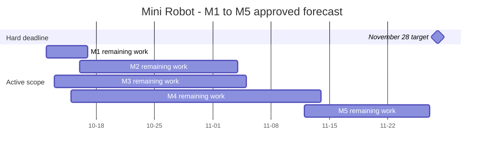
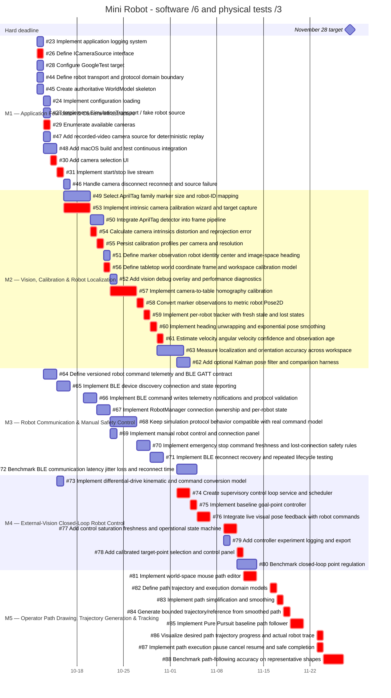

# GitHub Project Gantt — Applied M1–M5 Schedule

> Historical snapshot from 2026-10-10. Counts, statuses, dependencies, and dates
> reflect that recorded operation and omit later Linux issues. For current state,
> use [GitHub issues](https://github.com/Krzys2002/Mini_Robot/issues),
> [Project #4](https://github.com/users/Krzys2002/projects/4), and the
> [planning index](../planning/README.md).

**APPLIED AND VERIFIED. M6–M8 excluded. Hard deadline: 2026-11-28, Europe/Warsaw.**

25 nominal h/person/week, 75% effective capacity and 10% contingency; software effort divided by six cumulatively, physical tests/setup divided by three. Bars show calendar spans, with the day after each inclusive Deadline as the chart end. Weekends are included visually but have zero planned capacity. Main dates finish November 26; November 11 nonworking sensitivity moves completion to November 27. Completed #17/#25 retain their data and are omitted from future bars. `crit` marks the native dependency-only critical path, not Issue Priority or Status. See the [complete schedule and verified changes](GITHUB_PROJECT_SCHEDULE.md).

## Milestone forecast

## All 53 unfinished issues

All 53 issue deadlines and five milestone deadlines fit November 28. No changes to GitHub were made.

Verified against GitHub after application on 2026-10-10T18:14:32.446434+02:00. Bars represent approved plans, not completed work. No changes were pushed.
