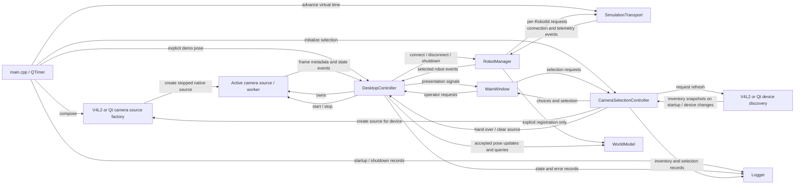

# Current architecture by milestone

This document maps the implemented desktop source to the
[M1–M8 roadmap](../planning/MILESTONES.md). **M1 is partially implemented**;
M2 calibration capture and M4 kinematics are implemented in part; other later capabilities remain planned. A foundation type or interface does not
establish completion of the capability that will eventually use it. This is a
source-based architecture assessment, not a live GitHub issue-status report.

Early Ubuntu compatibility is part of M1 under
[AGENTS.md](../../AGENTS.md) and the [Linux catalog](../planning/linux_compatibility_issues.md).
Windows remains a project target with deployment work assigned to M8.

## Milestone status

| Milestone | Current source state | Remaining capability |
| --- | --- | --- |
| M1 — Application Foundation & Camera Infrastructure | Partial: C++20/Qt/CMake shell, common types, camera/transport contracts, deterministic fakes, authoritative robot pose storage, system camera discovery, selection, and native stream control, application logging, configuration loading, recorded-video replay, tests, macOS and Ubuntu CI. | USB discovery/hotplug and physical capture acceptance, pixel preview, source recovery implementation, and manual GUI checks with physical input on Ubuntu and macOS. |
| M2 — Vision, Calibration & Robot Localization | Partial: [chessboard capture](calibration-capture.md), worker detector, quality/diversity gates, review wizard and [intrinsic calculation/quality reporting](intrinsic-calibration.md); [AprilTag family/print profiles and identity mapping](../vision/apriltag-selection.md) specified, with printable sheets and opt-in offline verification tools; [AprilTag frame detection](../vision/apriltag-detection.md) with timestamped multi-tag observations and a bounded worker; [robot marker observations](../vision/robot-observation.md) with RobotId mapping, projective centers and provisional image-space headings. | Printed-tag live/recorded acceptance, profile persistence, workspace calibration, image-to-world conversion, tracking, freshness/quality estimates and localization measurements. |
| M3 — Robot Communication & Manual Safety Control | Partial: [version 1 protocol/GATT contract](../protocol/README.md) and opt-in [Qt BLE discovery/connection lifecycle](ble-connection.md), with Robot Info/GATT readiness validation, [command/telemetry codec](ble-messages.md), bounded dispatch, adapter E-stop primitive and fake-radio tests. | Firmware, physical BLE acceptance, manual motion controls, domain E-stop/clear, reconnect policy, and hardware communication measurements. |
| M4 — External-Vision Closed-Loop Robot Control | Pure [differential-drive kinematics](differential-drive.md), inverse conversion and bounded wheel targets implemented; a stored demo pose is not closed-loop feedback. | Supervisory scheduler/controller, target selection, body-command limits, tracking/connection safety transitions, and control experiments. |
| M5 — Operator Path Drawing, Trajectory Generation & Tracking | Planned; no path or trajectory domain types exist. | World-space editor, simplification/smoothing, timing, Pure Pursuit, execution controls, and tracking metrics. |
| M6 — Obstacles & Autonomous Single-Robot Path Planning | Planned; WorldModel currently stores robots only. | Obstacle/workspace storage, occupancy grid, footprint inflation, A*, route post-processing, obstacle observations, and planner evaluation. |
| M7 — Multi-Robot Coordination & Collision Avoidance | Planned; independent registry entries and fake transport sessions are foundation support. | Multi-robot tracking/task execution, collision prediction, reservations/prioritized planning, coordination UI, and experiments; optional CBS/ORCA. |
| M8 — Cross-Platform & Advanced Sensor/Communication Extensions | Planned; portable boundaries exist, but Windows deployment is unverified. | Windows CI/deployment/device validation and optional Zigbee, multiple-camera fusion, onboard video, depth/LiDAR, semantics, and task allocation. |

## M1 — Implemented foundation

### Modules and dependencies

The [source map](source-map.md) links every implemented header/source and lists
exact target dependencies from [src/CMakeLists.txt](../../src/CMakeLists.txt).
The current layers are:

- `micro_robot_common`: header-only identity, units, pose, and steady-clock types.
- `micro_robot_camera_api` / `micro_robot_transport_api`: Qt-free asynchronous
  interfaces and event values, including the separate camera and
  [robot](robot-communication.md#robot-discovery) discovery boundaries and the
  source factory, depending only on common types.
- `micro_robot_camera_selection`: Qt-free rules deciding which discovered devices
  are selectable, depending on the camera API.
- `micro_robot_camera_discovery`: concrete Qt Multimedia system-inventory and capture adapters,
  depending on the camera API and linked only by composition code.
- `micro_robot_camera_v4l2`: Linux V4L2 inventory and OpenCV V4L2 capture adapters
  (Qt Core for event delivery), built when `MICRO_ROBOT_CAMERA_BACKEND=V4L2`.
- `micro_robot_camera_replay`: OpenCV local-file decoding behind the camera API,
  driven on an acquisition worker/test thread by supplied virtual time.
- `micro_robot_calibration`: Qt/OpenCV-free capture state, target, observation
  quality/diversity policy, intrinsic result values, solver contract and validation.
- `micro_robot_calibration_opencv`: replaceable chessboard detector and intrinsic solver
  selected by composition, without camera ownership. `CalibrationController` schedules
  one detection or solving job on its worker; `CalibrationWizard` renders frames,
  corners and reprojection quality and forwards requests.
- `micro_robot_vision_api`: Qt/OpenCV-free timestamped marker observations and detector interface.
- `micro_robot_vision_observation`: Qt/OpenCV-free tag-to-RobotId mapping, rejection of
  unknown/duplicate markers, pixel center and provisional image-space heading.
- `micro_robot_vision_opencv`: AprilTag 36h11 detection, isolated OpenCV conversion and failure handling.
  `VisionController` runs it on one worker with one newest pending frame; widgets show status only.
- `micro_robot_world`: private robot registry and timestamp-aware pose storage,
  depending only on common types.
- `micro_robot_logging`: Qt-free, thread-safe application logger with per-module
  channels and stream/file sinks, depending only on common types.
- `micro_robot_robot_manager`: Qt-free [session service](robot-manager.md), injected
  transport ownership/coordination and RobotId command/telemetry routing.
- `micro_robot_configuration`: Qt-free INI loading and validation, depending on
  common types, camera API value types, and logging; the composition root injects typed settings.
- `micro_robot_simulation`: deterministic implementations of the camera,
  camera-factory, and transport interfaces, with optional injected logging; no Qt,
  physical hardware, or network dependency.
- `micro_robot_ble_contract`: Qt-free Robot Info/identity/GATT capability validation
  and version 1 command/notification codec.
- `micro_robot_ble_lifecycle` (opt-in): Qt Core connection policy behind
  `IRobotTransport`, injected radio boundary, discovery inventory, phase reporting,
  cancellation, timeouts, weak subscriptions, bounded command dispatch, notification
  validation, result correlation and E-stop retry/reassertion.
- `micro_robot_ble_qt` (opt-in): Qt Bluetooth scanner/Central/service adapter;
  native objects remain private. Composition selects it with `--ble`, retaining
  simulation by default. Native command writes recheck freshness at API handoff;
  incoming notifications receive a steady-clock timestamp.
- `micro_robot_desktop_controller`: Qt Core adapters using interface references;
  DesktopController coordinates the demo/model through RobotManager and owns the active camera source,
  while CameraSelectionController presents device inventories and creates the
  selected source through the factory, without a Qt Multimedia dependency.
- `micro_robot_ui`: Qt Widgets presentation and operator request signals.
- `micro_robot_desktop`: composition root selecting the native camera factory, simulated
  transport, and real system device-inventory adapter. The build selects the
  [camera backend](camera-backends.md): V4L2 on Linux, Qt Multimedia elsewhere.

Controllers receive interface references; widgets receive the controllers. The
operator selects a device, but neither layer knows the capture backend or depends
on simulation classes.
[Platform boundaries](platform-boundaries.md) records the OS-dependency audit and
layer rules; configuration and CTest reject OS APIs, unallowed libraries, and
concrete-backend dependencies in platform-independent targets.
The composition root owns the [logger](logging.md) and injects a module channel
into the controller; there is no global logger.

### Current runtime data flow



[main.cpp](../../src/app/main.cpp) owns the backends, model, controller, window,
and the configured simulation timer (100 ms by default). Startup registers the
configured robot ID (1 by default) with an unknown pose, with no camera
selected and the transport disconnected. While connected, composition supplies
a static pose (0.25 m, 0.15 m, 0 rad). This happens independently of frame events
and remains active when the camera is stopped or not selected. Telemetry does not update pose.

The main window describes frame sequence/dimensions/timing; the calibration
dialog additionally renders camera pixels and detected chessboard corners.
It also displays the camera selector, the active source, connection state, fake
battery telemetry, and stored pose. Inventory updates never select a camera on
their own; losing the selected device clears the selection. No velocity
command, goal target, path or E-stop UI is present. The calibration button opens
the [target-capture wizard](calibration-capture.md), with live preview, observation
review, quality/diversity progress and [intrinsic solving/RMS reporting](intrinsic-calibration.md). See the
[desktop demo guide](desktop-demo.md) for controls and lifecycle details.

### Camera and transport boundaries

[ICameraDeviceDiscovery](camera-discovery.md) supplies copied device ID/name
inventories through weak subscriptions. The Qt adapter queries QMediaDevices
video inputs and coalesces change notifications into queued full snapshots.
CameraSelectionController turns them into selector rows, marks devices with a
missing, duplicate, or unsupported ID unselectable, and keys the selection by ID;
MainWindow performs no discovery queries. IDs are hex-encoded Qt bytes, without a
guarantee of persistence across OS/backend changes. A selected device's source is
created through [ICameraSourceFactory](camera-selection.md) and handed to
DesktopController, which stops a running source before replacing it.


[ICameraSource](camera-source.md) exposes prompt start/stop requests, source
metadata, and state/frame/error events. Frames have local capture timestamps,
increasing sequences, dimensions, packed pixel layout, stride, and immutable
owned storage. `isValidFrame` validates layout/storage without overflow;
sequence/time ordering remains the source's responsibility. The contract allows
terminal failures and recovery. [Recorded-video replay](recorded-video.md)
implements this boundary with deterministic timing and EOF/loop lifecycle; the
desktop composition uses [native capture](camera-streaming.md), created per selected device.

[IRobotTransport](transport.md) exposes per-ID connect/disconnect, semantic command
submission, and connection/telemetry/error events. Commands contain Stop or
velocity intent with local issue time and positive validity duration. Telemetry
has optional measurements and local receipt time. Submission is not confirmation
of execution. Commands/telemetry reserve a domain schema version and optional
sequence metadata without wire-ordering or acknowledgement semantics. Unsupported
domain command versions report an error; metadata handling stays outside widgets.
Radio identities, packet encoding, protocol sequence allocation, and device
clock conversion belong to adapters that implement the
[robot protocol](../protocol/README.md).
The [BLE lifecycle](ble-connection.md) and [messages](ble-messages.md) adapter
implements native writes and notification decoding. [RobotManager](robot-manager.md)
coordinates sessions above the transport contract; control code addresses RobotId.

### Simulation and authoritative state

[FakeCameraSource (via its factory) and SimulationTransport](simulation.md) execute pending requests
only when composition/tests call `advanceTo`. They use nondecreasing supplied time,
with no clock reads, worker threads, or sleeps. The camera emits at most one 8 by 6
Gray8 frame per advancement, skipping missed intervals. The transport has one
pending command per robot, validates freshness at dispatch, and emits deterministic
3.7 V telemetry with fresh velocity intent or zero velocity. It does not integrate
robot motion or implement a physical watchdog.

[WorldModel](world-model.md) is owned once by the composition root and injected
by reference. It cannot be copied or moved. Explicit registration creates unknown
pose; updates accept finite world coordinates and strictly newer per-robot pose
timestamps, with the first pose allowed at registration time. Queries/snapshots
return detached values. The model performs no filtering, prediction, communication,
or automatic freshness transitions. Unknown, invalid, and stale updates have
explicit results and preserve state.

### Ownership, threading, and shutdown

The standalone replay adapter performs file I/O on its owning acquisition/test
thread and is not wired into the GUI demo. All current application callbacks and
model access are serialized on the GUI thread. Capture, transport, and discovery retain weak event subscriptions;
RobotManager owns the transport event sink and supplies weak application events;
DesktopController and CameraSelectionController own their camera/application and
discovery event sinks. A camera source is never destroyed inside its own callback; source
replacement completes through a queued call. Discovery refreshes use a context-bound queued timer cancelled on
adapter destruction. Borrowed event values must be copied when retained; immutable
frames may be retained directly. Callbacks must be prompt and non-throwing.

Future camera/transport workers must marshal results onto the owning thread and
use an explicit queued boundary to GUI consumers. Thread safety or a worker queue
is not supplied by the current interfaces. Frame handoffs must remain bounded and
prefer the newest useful frame.

Qt owns widgets through parent relationships. Injected backend/model references,
including the camera factory, outlive the controllers; RobotManager outlives
DesktopController and is outlived by its transport/model/logger; DesktopController owns the
active camera source. Closing the last window requests stop/disconnect and keeps
the event loop/timer running until the camera, all managed robot sessions and the calibration/vision workers are quiescent, then destroys
objects in dependency order. Native capture and pixel conversion run on a dedicated
worker with bounded latest-frame handoffs. The controller detaches subscriptions
on destruction; capture objects are released on the worker before stop acknowledgement.

### M1 completion gaps

The application foundation is runnable, but M1 exit criteria are not all met.
System camera enumeration and selection are implemented: the production adapter
detected a Mac internal camera and an exposed iPhone camera on the validation
host. A selected camera uses the native [streaming adapter](camera-streaming.md)
(#31); successful physical capture still requires manual validation. USB-camera
visibility and physical hotplug remain unverified. There is no structured
measurement recorder. [Application logging](logging.md) records startup,
shutdown, controller state changes, and errors as human-readable lines; thesis
measurements remain separate. Discovery retains its own Qt logging category,
separate from the application's Logger channels and file sink.
[Configuration](configuration.md) is loaded once by the composition root from an
optional INI file and injected into modules as typed values; per-camera
calibration and workspace profiles are not implemented yet.
General-purpose pixel preview outside the calibration dialog and automatic
capture-device reconnection are not implemented; interface and test-double
support for those events is not physical backend verification.

[Build setup](../development/build.md) and
[Ubuntu setup](../development/linux-setup.md) document current recipes. The
committed build/test workflows run on macOS and on Ubuntu 24.04 with GCC and Clang
(see [continuous integration](../development/testing.md#linux-continuous-integration)).
Automated Wayland and X11 (Xwayland) GUI checks were executed on Ubuntu for #130
([GUI compatibility](../development/gui-compatibility.md)); physical input through the
compositor, Windows builds, packaging, and device behavior require their own
executed checks.

## Domain conventions

These M1 contracts apply to all later milestones:

- `RobotId` is an explicit unsigned 32-bit application identity with comparison
  and hashing, independent of hardware addresses. Zero is valid; missing identity
  uses an optional value.
- `Pose2D` uses metres for x/y and radians for heading. In a top-down world view,
  +x is right and +y is up; heading is zero along +x and positive counterclockwise.
  The [workspace origin](workspace.md) is the measured lower-left corner of the
  intended world view; optional metric table bounds are part of WorldModel. Image
  coordinates have a separate top-left origin with +u right and +v down.
- `Meters` and `Radians` are explicit value wrappers. They do not normalize
  angles, validate finite values, or provide dimensional arithmetic. Code that
  needs a canonical angle calls `normalizeAngle`, which wraps to (−π, π]. Convert
  display/protocol units at boundaries; WorldModel validates accepted poses.
- Timestamp and duration use steady-clock types. Epoch is unspecified and valid;
  it is not wall time, a persisted media offset, or a remote device clock. Missing
  observations use optional timestamps. State timestamps do not imply freshness.

Definitions are in [src/common](../../src/common); all files and their contracts
are linked in the [source map](source-map.md).

## M2–M8 — Planned architectural growth

The intended perception/control chain from [AGENTS.md](../../AGENTS.md) remains:

```text
CameraSource -> Vision / Calibration -> RobotTracker -> WorldModel
            -> Planning / Task -> Trajectory / Supervisory Control
            -> RobotManager -> RobotTransport -> ESP32-C6
```

M1 currently supplies the source/transport interfaces, robot registry, and
simulation/UI shell. Calibration target capture is available. Issue #49 specifies
the M2 marker selection and supplies offline print tooling under `tools/markers`;
it does not connect a robot detector to camera frames or update WorldModel.
Robot perception/control algorithms and physical robot
endpoints are not present. Later work must follow the assigned issue and preserve
these boundaries:

- M2 transforms measurements into the common metric frame before tracking;
  detections are measurements, not permanent authoritative state.
- M3 communication uses IRobotTransport behind RobotManager; remaining domain
  safety/manual-control behavior must preserve that service boundary.
- M4 uses fresh tracked state for outer-loop commands; ESP32-C6 retains low-level
  motor control, command watchdog, and safe stop responsibilities.
- M5 separates path geometry, time-parameterized trajectories, and tracking.
- M6 extends WorldModel/snapshots with issue-scoped obstacle data and
  introduces replaceable planning; planners never operate on raw image pixels.
- M7 extends independent identities into coordinated task/trajectory execution;
  multi-entry storage alone does not establish collision-safe swarm operation.
- M8 isolates additional adapters and sensors. Depth/LiDAR remains a separate
  pipeline, high-bandwidth video uses an appropriate network channel, and optional
  extensions must not break the baseline system.

Full milestone prerequisites, exit criteria, and required/optional distinctions
remain in the [roadmap](../planning/MILESTONES.md), supplemented by early Linux
M1 work. No future feature should be implemented merely to complete this overview.

## Verification and maintenance

[Tests](../development/testing.md) exercise common types, packed camera frame
validation, abstract interfaces, deterministic backends, pose storage, discovery
inventory presentation, and Qt controller/window integration. Domain targets run without Qt when the desktop is
disabled; offscreen UI tests remain separate. Platform-boundary checks scan
platform-independent targets for OS and backend dependencies. These checks establish implemented
contracts, not physical camera/BLE operation or completion of M2–M8.

Update this overview when source capabilities change: map them to the relevant
milestone, link their guide/source, and distinguish implemented behavior from
remaining acceptance checks. GitHub issue closure and project status remain live
planning data, separate from this source-based assessment.

Workspace geometry and the separate versioned calibration model are described in
the [world module](modules/world.md). Calibration depends on world value types;
the world registry does not depend on camera models or Qt/OpenCV.
