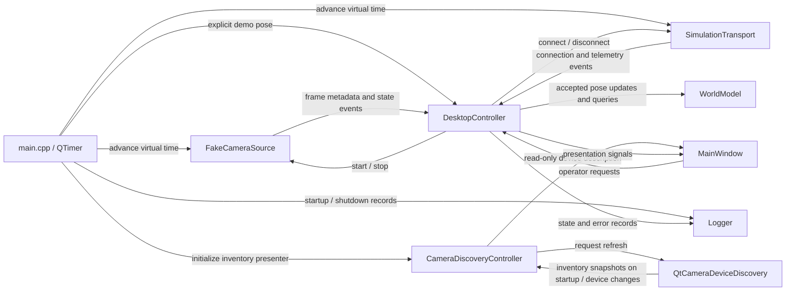

# Current architecture by milestone

This document maps the implemented desktop source to the
[M1–M8 roadmap](../planning/MILESTONES.md). **M1 is partially implemented**;
the later milestones remain planned. A foundation type or interface does not
establish completion of the capability that will eventually use it. This is a
source-based architecture assessment, not a live GitHub issue-status report.

Early Ubuntu compatibility is part of M1 under
[AGENTS.md](../../AGENTS.md) and the [Linux catalog](../planning/linux_compatibility_issues.md).
Windows remains a project target with deployment work assigned to M8.

## Milestone status

| Milestone | Current source state | Remaining capability |
| --- | --- | --- |
| M1 — Application Foundation & Camera Infrastructure | Partial: C++20/Qt/CMake shell, common types, camera/transport contracts, deterministic fakes, authoritative robot pose storage, read-only system camera discovery, application logging, configuration loading, recorded-video replay, tests, macOS CI. | USB discovery/hotplug acceptance, camera selection/capture/preview, source recovery implementation, and Ubuntu build/GUI validation. |
| M2 — Vision, Calibration & Robot Localization | Planned; metric Pose2D and timestamped frames are prerequisites already supplied by M1. | AprilTag detection, intrinsic/workspace calibration, image-to-world conversion, tracking, freshness/quality estimates, and localization measurements. |
| M3 — Robot Communication & Manual Safety Control | Planned; IRobotTransport and semantic commands/telemetry are M1 prerequisites. | Wire protocol/GATT, physical BLE, RobotManager, manual motion controls, E-stop, reconnect, and hardware communication measurements. |
| M4 — External-Vision Closed-Loop Robot Control | Planned; a stored demo pose is not closed-loop feedback. | Kinematics, supervisory scheduler/controller, target selection, command limits, tracking/connection safety transitions, and control experiments. |
| M5 — Operator Path Drawing, Trajectory Generation & Tracking | Planned; no path or trajectory domain types exist. | World-space editor, simplification/smoothing, timing, Pure Pursuit, execution controls, and tracking metrics. |
| M6 — Obstacles & Autonomous Single-Robot Path Planning | Planned; WorldModel currently stores robots only. | Obstacle/workspace storage, occupancy grid, footprint inflation, A*, route post-processing, obstacle observations, and planner evaluation. |
| M7 — Multi-Robot Coordination & Collision Avoidance | Planned; independent registry entries and fake transport sessions are foundation support. | Multi-robot tracking/task execution, collision prediction, reservations/prioritized planning, coordination UI, and experiments; optional CBS/ORCA. |
| M8 — Cross-Platform & Advanced Sensor/Communication Extensions | Planned; portable boundaries exist, but Windows deployment is unverified. | Windows CI/deployment/device validation and optional Zigbee, multiple-camera fusion, onboard video, depth/LiDAR, semantics, and task allocation. |

## M1 — Implemented foundation

### Modules and dependencies

The [source map](source-map.md) links every implemented header/source and lists
exact target dependencies from [src/CMakeLists.txt](../../src/CMakeLists.txt).
The current layers are:

- `micro_robot_common`: header-only identity, units, pose, and steady-clock types.
- `micro_robot_camera_api` / `micro_robot_transport_api`: Qt-free asynchronous
  interfaces and event values, including the separate device-discovery boundary,
  depending only on common types.
- `micro_robot_camera_discovery`: concrete Qt Multimedia system-inventory adapter,
  depending on the camera API and linked only by composition code.
- `micro_robot_camera_replay`: OpenCV local-file decoding behind the camera API,
  driven on an acquisition worker/test thread by supplied virtual time.
- `micro_robot_world`: private robot registry and timestamp-aware pose storage,
  depending only on common types.
- `micro_robot_logging`: Qt-free, thread-safe application logger with per-module
  channels and stream/file sinks, depending only on common types.
- `micro_robot_configuration`: Qt-free INI loading and validation, depending on
  common types and logging; the composition root injects typed settings.
- `micro_robot_simulation`: deterministic implementations of the camera and
  transport interfaces; no Qt, physical hardware, or network dependency.
- `micro_robot_desktop_controller`: Qt Core adapters using interface references;
  DesktopController coordinates the demo/model, while CameraDiscoveryController
  presents device inventories without a Qt Multimedia dependency.
- `micro_robot_ui`: Qt Widgets presentation and operator request signals.
- `micro_robot_desktop`: composition root selecting fake capture/transport and
  the real system device-inventory adapter.

The controller receives interface references; widgets receive the controller.
Neither layer selects a physical device or depends on simulation classes.
The composition root owns the [logger](logging.md) and injects a module channel
into the controller; there is no global logger.

### Current runtime data flow



[main.cpp](../../src/app/main.cpp) owns the backends, model, controller, window,
and the configured simulation timer (100 ms by default). Startup registers the
configured robot ID (1 by default) with an unknown pose and leaves the
camera stopped and transport disconnected. While connected, composition supplies
a static pose (0.25 m, 0.15 m, 0 rad). This happens independently of frame events
and remains active when the fake camera is stopped. Telemetry does not update pose.

The GUI describes frame sequence/dimensions/timing; it does not render pixels.
It also displays a separate system-camera inventory, connection state, fake battery
telemetry, and stored pose. Inventory updates do not select/open a camera. No velocity
command, target, path, calibration, or E-stop UI is present. See the
[desktop demo guide](desktop-demo.md) for controls and lifecycle details.

### Camera and transport boundaries

[ICameraDeviceDiscovery](camera-discovery.md) supplies copied device ID/name
inventories through weak subscriptions. The Qt adapter queries QMediaDevices
video inputs and coalesces change notifications into queued full snapshots.
CameraDiscoveryController formats names/IDs and the zero-device state for plain
text display; MainWindow performs no discovery queries. IDs are hex-encoded Qt
bytes, without a guarantee of persistence across OS/backend changes.


[ICameraSource](camera-source.md) exposes prompt start/stop requests, source
metadata, and state/frame/error events. Frames have local capture timestamps,
increasing sequences, dimensions, packed pixel layout, stride, and immutable
owned storage. `isValidFrame` validates layout/storage without overflow;
sequence/time ordering remains the source's responsibility. The contract allows
terminal failures and recovery. [Recorded-video replay](recorded-video.md)
implements this boundary with deterministic timing and EOF/loop lifecycle; the
desktop composition still uses fake capture.

[IRobotTransport](transport.md) exposes per-ID connect/disconnect, semantic command
submission, and connection/telemetry/error events. Commands contain Stop or
velocity intent with local issue time and positive validity duration. Telemetry
has optional measurements and local receipt time. Submission is not confirmation
of execution. Commands/telemetry reserve a domain schema version and optional
sequence metadata without wire-ordering or acknowledgement semantics. Unsupported
domain command versions report an error; metadata handling stays outside widgets.
Radio identities, packet encoding, protocol sequence allocation, and device
clock conversion belong to future adapters.

### Simulation and authoritative state

[FakeCameraSource and SimulationTransport](simulation.md) execute pending requests
only when composition/tests call `advanceTo`. They use nondecreasing supplied time,
with no clock reads, worker threads, or sleeps. The camera emits at most one 8 by 6
Gray8 frame per advancement, skipping missed intervals. The transport has one
pending command per robot, validates freshness at dispatch, and emits deterministic
3.7 V telemetry with fresh velocity intent or zero velocity. It does not integrate
robot motion or implement a physical watchdog.

[WorldModel](world-model.md) is owned once by the composition root and injected
by reference. It cannot be copied or moved. Explicit registration creates unknown
pose; updates accept finite world coordinates and strictly newer per-robot pose
timestamps, with the first pose allowed at registration time. Queries/snapshots
return detached values. The model performs no filtering, prediction, communication,
or automatic freshness transitions. Unknown, invalid, and stale updates have
explicit results and preserve state.

### Ownership, threading, and shutdown

The standalone replay adapter performs file I/O on its owning acquisition/test
thread and is not wired into the GUI demo. All current application callbacks and
model access are serialized on the GUI thread. Capture, transport, and discovery retain weak event subscriptions;
DesktopController and CameraDiscoveryController own their respective plain C++
event sinks. Discovery refreshes use a context-bound queued timer cancelled on
adapter destruction. Borrowed event values must be copied when retained; immutable
frames may be retained directly. Callbacks must be prompt and non-throwing.

Future camera/transport workers must marshal results onto the owning thread and
use an explicit queued boundary to GUI consumers. Thread safety or a worker queue
is not supplied by the current interfaces. Frame handoffs must remain bounded and
prefer the newest useful frame.

Qt owns widgets through parent relationships. Injected backend/model references
outlive the controller. Shutdown stops the timer, requests stop/disconnect, drains
fake terminal events with one advancement, and then destroys objects in dependency
order. The controller detaches subscriptions on destruction. Future physical
adapters must asynchronously establish quiescence before destruction.

### M1 completion gaps

The application foundation is runnable, but M1 exit criteria are not all met.
System camera enumeration is implemented: the production adapter detected a Mac
internal camera and an exposed iPhone camera on the validation host. USB-camera
visibility and physical hotplug remain unverified. There is no structured
measurement recorder. [Application logging](logging.md) records startup,
shutdown, controller state changes, and errors as human-readable lines; thesis
measurements remain separate. Discovery retains its own Qt logging category,
separate from the application's Logger channels and file sink.
[Configuration](configuration.md) is loaded once by the composition root from an
optional INI file and injected into modules as typed values; per-camera
calibration and workspace profiles are not implemented yet.
Camera selection, live pixel preview, and actual capture-device disconnect/recovery
are not implemented; interface and test-double
support for those events is not physical backend verification.

[Build setup](../development/build.md) and
[Ubuntu setup](../development/linux-setup.md) document current recipes. The
committed build/test workflow runs macOS only. Ubuntu GCC/Clang, Linux X11/Wayland,
Windows builds, packaging, and device behavior require their own executed checks.

## Domain conventions

These M1 contracts apply to all later milestones:

- `RobotId` is an explicit unsigned 32-bit application identity with comparison
  and hashing, independent of hardware addresses. Zero is valid; missing identity
  uses an optional value.
- `Pose2D` uses metres for x/y and radians for heading. In a top-down world view,
  +x is right and +y is up; heading is zero along +x and positive counterclockwise.
  The physical origin will be established by M2 workspace calibration. Image
  coordinates have a separate top-left origin with +u right and +v down.
- `Meters` and `Radians` are explicit value wrappers. They do not normalize
  angles, validate finite values, or provide dimensional arithmetic. Convert
  display/protocol units at boundaries; WorldModel validates accepted poses.
- Timestamp and duration use steady-clock types. Epoch is unspecified and valid;
  it is not wall time, a persisted media offset, or a remote device clock. Missing
  observations use optional timestamps. State timestamps do not imply freshness.

Definitions are in [src/common](../../src/common); all files and their contracts
are linked in the [source map](source-map.md).

## M2–M8 — Planned architectural growth

The intended perception/control chain from [AGENTS.md](../../AGENTS.md) remains:

```text
CameraSource -> Vision / Calibration -> RobotTracker -> WorldModel
            -> Planning / Task -> Trajectory / Supervisory Control
            -> RobotManager -> RobotTransport -> ESP32-C6
```

M1 currently supplies the source/transport interfaces, robot registry, and
simulation/UI shell. Intermediate algorithms and physical endpoints in this
chain are not present. Later work must follow the assigned issue and preserve
these boundaries:

- M2 transforms measurements into the common metric frame before tracking;
  detections are measurements, not permanent authoritative state.
- M3 adds physical communication behind IRobotTransport, with RobotManager owning
  sessions and protocol/safety behavior defined explicitly.
- M4 uses fresh tracked state for outer-loop commands; ESP32-C6 retains low-level
  motor control, command watchdog, and safe stop responsibilities.
- M5 separates path geometry, time-parameterized trajectories, and tracking.
- M6 extends WorldModel/snapshots with issue-scoped workspace/obstacle data and
  introduces replaceable planning; planners never operate on raw image pixels.
- M7 extends independent identities into coordinated task/trajectory execution;
  multi-entry storage alone does not establish collision-safe swarm operation.
- M8 isolates additional adapters and sensors. Depth/LiDAR remains a separate
  pipeline, high-bandwidth video uses an appropriate network channel, and optional
  extensions must not break the baseline system.

Full milestone prerequisites, exit criteria, and required/optional distinctions
remain in the [roadmap](../planning/MILESTONES.md), supplemented by early Linux
M1 work. No future feature should be implemented merely to complete this overview.

## Verification and maintenance

[Tests](../development/testing.md) exercise common types, packed camera frame
validation, abstract interfaces, deterministic backends, pose storage, discovery
inventory presentation, and Qt controller/window integration. Domain targets run without Qt when the desktop is
disabled; offscreen UI tests remain separate. These checks establish implemented
contracts, not physical camera/BLE operation or completion of M2–M8.

Update this overview when source capabilities change: map them to the relevant
milestone, link their guide/source, and distinguish implemented behavior from
remaining acceptance checks. GitHub issue closure and project status remain live
planning data, separate from this source-based assessment.
