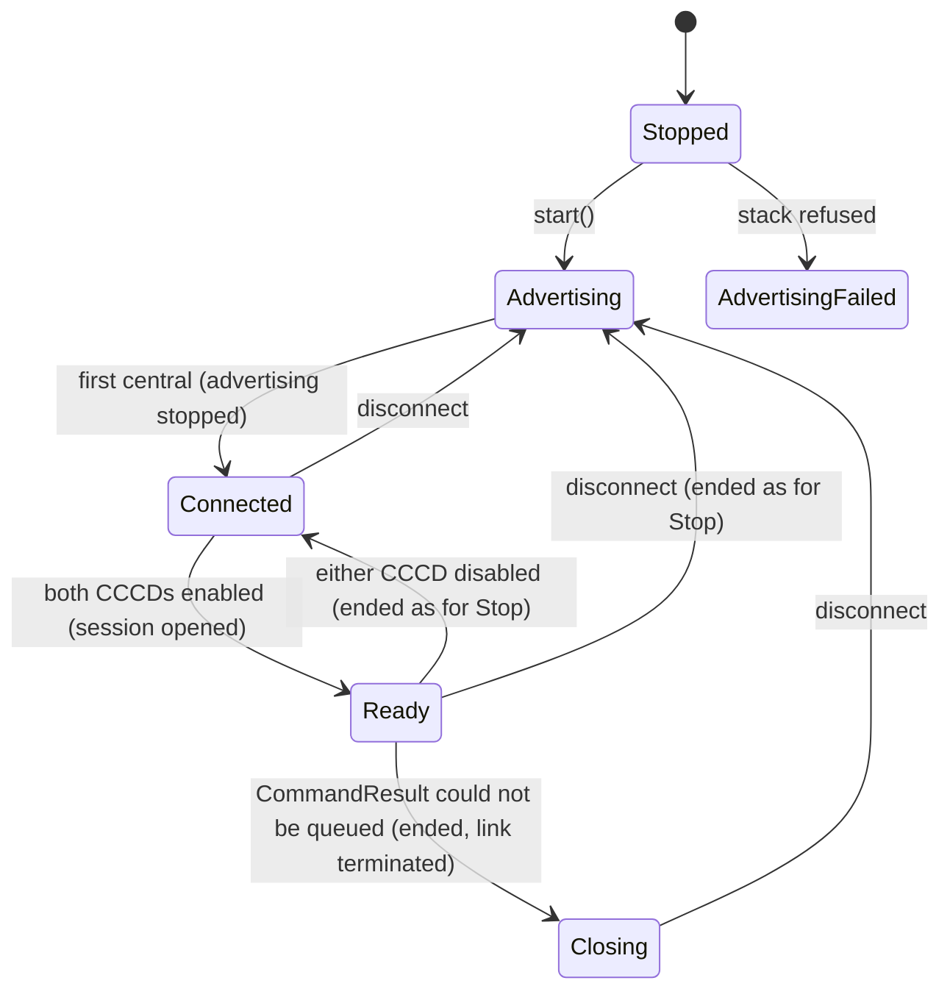

# CodeCell C6 BLE peripheral and session lifecycle

Status: implemented by [#163](https://github.com/Krzys2002/Mini_Robot/issues/163) on top of
the [production runtime](firmware-runtime.md) (#158), [identity provisioning](firmware-provisioning.md)
(#159), the [bounded drive](firmware-drive.md) (#160), the [v1 codec](firmware-protocol.md)
(#161) and [safety enforcement](firmware-safety.md) (#162). It is the robot side of the
[BLE GATT contract](../protocol/ble-gatt.md) (#64), under the restricted-lab v1 profile
proposed by [#157](https://github.com/Krzys2002/Mini_Robot/issues/157) (PR #274, not yet
merged). Final security enforcement is [#165](https://github.com/Krzys2002/Mini_Robot/issues/165),
telemetry publication is [#164](https://github.com/Krzys2002/Mini_Robot/issues/164), the HIL
suite is [#166](https://github.com/Krzys2002/Mini_Robot/issues/166) and powered checks are
[#238](https://github.com/Krzys2002/Mini_Robot/issues/238).

**v1 is not authenticated.** Any central in radio range can connect while the robot
advertises. The only enforceable controls are one central per robot and the readiness
rule below. The operating restrictions of the profile still apply.

## Files

| File | Contents |
| --- | --- |
| [`include/ble/GattProfile.hpp`](../../firmware/codecell-c6/include/ble/GattProfile.hpp) | v1 UUIDs, properties and value lengths, advertising data, scan response, link-parameter hint, Robot Info firmware version |
| [`include/ble/SessionPolicy.hpp`](../../firmware/codecell-c6/include/ble/SessionPolicy.hpp) | `restricted-lab-v1` profile and the readiness rule |
| [`include/ble/PeripheralController.hpp`](../../firmware/codecell-c6/include/ble/PeripheralController.hpp) | Portable session lifecycle behind `IPeripheralLink`; host-tested |
| [`src/NimBlePeripheral.hpp`](../../firmware/codecell-c6/src/NimBlePeripheral.hpp) | NimBLE-Arduino 2.3.6 adapter: GATT server, advertising, callbacks into the controller |
| [`scripts/gatt_conformance_host.py`](../../firmware/codecell-c6/scripts/gatt_conformance_host.py) | BlueZ conformance run against a USB-only board |

The controller holds the only `protocol::v1::CommandSession` and calls the single
motion-command authority (`IMotionCommandSink`). No BLE handle, UUID or address reaches the
runtime, and nothing else in the image commands motion.

## GATT layout and advertising

Exactly the [v1 table](../protocol/ble-gatt.md#service-and-characteristic-layout):

| Characteristic | Properties | Maximum value | Notes |
| --- | --- | --- | --- |
| Robot Info `4d520002` | Read | 18 B | Provisioned record; firmware version `0.0.0` until #164 assigns a build version |
| Command `4d520003` | Write, Write Without Response | 512 B | Oversized frames get `MalformedLength`, never an ATT error |
| Emergency Stop `4d520004` | Write, Write Without Response | 512 B | Any write latches |
| Telemetry `4d520005` | Read, Notify (CCCD) | 18 B | Empty until #164 publishes telemetry; no frame is invented |
| Command Result `4d520006` | Notify (CCCD) | 9 B | One per written frame while ready |

- The written characteristics accept the ATT maximum (512 bytes). A longer write would be
  refused by the NimBLE server with an ATT error before any callback. That would let an
  oversized Emergency Stop write skip the latch.
- Writes go straight from the host's write buffer to the controller (`DirectWriteCharacteristic`
  overrides `writeEvent`). NimBLE-Arduino's own path first copies the value into a heap buffer
  that grows on demand. That would be an allocation on the callback path (B15), and it would
  come before the latch.
- Advertising data: Flags `0x06` and the complete list of 128-bit UUIDs with the service
  (21 bytes). Scan response: Complete Local Name `MR-<robotId>`. Connectable, undirected.
- A robot without a validated record has no identity and does not start BLE at all
  (`BLE start=unprovisioned`). A runtime that faulted for any other reason still advertises.
  Its authority refuses motion, and the central sees `RobotFault`.

## Session lifecycle



| Event | Behaviour |
| --- | --- |
| First connection | Becomes the owner. Advertising is stopped explicitly. Link parameters are requested once. |
| Any other connection while an owner exists | Terminated at once. Its Command writes and subscriptions are never applied. Its disconnect changes nothing. |
| Both CCCDs enabled (notification bit) on the owner | `CommandSession::open()`: new #162 session token, `lastAccepted` unset, transmit counter at 0 |
| Either CCCD disabled | `end(NotificationsDisabled)`: stop as for Stop, latch kept, no auto-resume |
| Owner disconnect (any reason) | `end(Disconnected)`, reason and time since the last write recorded (I10), then advertising restarts |
| Repeated connect, subscribe, disconnect or `start()` | Idempotent: no new session, no second end, the counter keeps running |

- Readiness is decided by `sessionMayBeReady()`: the owner, not closing, and both CCCDs.
  Link encryption is deliberately not an input (F6).
- Indications are not part of v1. Only the CCCD notification bit counts.
- NimBLE reports a subscription as ended for each CCCD before it reports the disconnect.
  The session then ends once, on the first of those events. Events for a closed handle are
  foreign and ignored.

### Before readiness

Command writes still go through the v1 session, with no CommandResult, because there is no
notification channel yet (v1):

- Stop and EmergencyStop take effect.
- Velocity and ClearEmergencyStop carry no ready token, so the authority refuses them. No
  motion and no result.
- Writes from a connection that does not own the link are never applied.

## Emergency Stop path

- Every write to the Emergency Stop characteristic calls `emergencyStop()` first, whatever
  its length or content. Before that call, the controller only checks whether an answer
  channel exists (two comparisons). The payload is not looked at. The drive is disabled when
  the call returns (B8).
- While ready, the answer is one CommandResult: type `0x03`, `Accepted`, the frame's sequence
  for a well-formed v1 EmergencyStop and `0` otherwise.
- A write that arrives before readiness, or from a connection that does not own the link,
  latches without an answer.
- **Firmware choice, please confirm:** #157 F1 says the writes of a second connection are
  not applied, and F4 says any Emergency Stop write latches. The controller latches on an
  Emergency Stop write from any connection (fail-safe; at worst a denial of service, which
  any central in range can already cause), and applies nothing else from a non-owner.

## Command results and overload

- While ready, exactly one CommandResult per Command or Emergency Stop write, queued from
  inside the callback to the owner, on the session's one robot transmit counter (B11).
- If the stack cannot queue a result (NimBLE `notify()` fails, for example when its buffers
  are exhausted), the #156 overload policy applies: the session ends as for Stop
  (`ResultQueueExhausted`, counted as `session_overload`), then the link is terminated. The
  state is `Closing` until the disconnect: no result is buffered or retried, CCCD changes
  cannot revive the session, and Emergency Stop still latches.
- A larger negotiated MTU is never used for longer or concatenated frames. Every frame is
  at most 20 bytes.

## Link parameters

After each owner connection the robot requests 7.5–30 ms, latency 0 and 400 ms supervision
timeout (`kLinkParameterRequest`). These are hints only. The request outcome
(`link_request=requested|refused`) and the values the stack reports for the owner
(`negotiated=interval_us=… latency=… timeout_ms=… in_request=…`) are printed on the `BLE`
status line, and so is the ATT MTU. Nothing depends on them. The command validity window and
the stop on disconnect bound motion whatever is negotiated.

## One central per robot (F1) on this build

#157 F1 asks for `CONFIG_BT_NIMBLE_MAX_CONNECTIONS=1`. That is not possible on the pinned
toolchain. The Arduino-ESP32 3.3.7 libraries are prebuilt, and their `sdkconfig.h` defines
`CONFIG_BT_NIMBLE_MAX_CONNECTIONS 3` (and every NimBLE role on). NimBLE-Arduino 2.3.6 reads
its configuration from that header on ESP platforms, so a `-D` build flag is redefined and
has no effect. The build showed exactly that, as a redefinition warning in every file.
Changing it would need a custom sdkconfig, and with it a rebuilt framework.

Exclusivity is enforced by the controller instead:

- advertising is stopped when the owner connects and restarted only after its disconnect was
  processed;
- any other connection the stack reports is terminated without applying its writes.

The boot line states both values: `BLE ... accepted_centrals=1 stack_max_connections=3`.

## Security settings

- Restricted-lab v1 (`profile=restricted-lab-v1` on the boot line): no pairing requirement,
  no encryption, no authorization on any characteristic.
- Stated explicitly rather than inherited: `setSecurityAuth(false, false, false)` and
  NoInputNoOutput. Without bonding no keys are stored, so BLE writes no flash while motion is
  possible (#162 watchdog note). A central can still obtain unauthenticated Just Works
  encryption; no behaviour depends on it.

## Threading and resources

- Every controller callback runs in `nimble_host` (priority 21, below the supervisor). It
  never logs, blocks or allocates. A host test counts zero allocations across 1,000 complete
  lifecycle cycles.
- The initial `start()` runs from `setup()` in `loopTask`, after the host is running. It
  publishes `advertising` before advertising starts, so a connection that the host task
  processes before `startAdvertising()` returns keeps its `connected`/`ready` state; a
  failure becomes `advertising_failed` only if nothing changed the state meanwhile.
- All BLE heap is allocated in `setup()`: NimBLE initialization, the GATT database and the
  two written characteristics. The controller lives in static storage.
- `loopTask` prints a `BLE` line on a link change (at most once per second) and with every
  periodic status line, about 330 B (B13).
- The production image grew from 355,362 B to 808,134 B of flash (61.7 % of the app
  partition) and uses 29,472 B of static RAM. That is NimBLE.
- The ATT MTU is read from the stack at connect, because NimBLE can report the central's
  MTU exchange before the connect callback (seen on the bench in most connections).
- For the same reason a CCCD write can be reported before the connect callback. The
  controller holds such changes per connection handle (`early_cccd` in the `BLE` line, also
  counted in `foreign`) and adopts them when that handle becomes the owner, so a central that
  subscribed early is ready at connect. They are dropped when the handle disconnects or is
  refused as a second central. NimBLE reports subscriptions only for connections it holds.

## Serial lines

Recorded on the bench (BlueZ 5.85 central):

```text
BLE start=started profile=restricted-lab-v1 accepted_centrals=1 stack_max_connections=3 name=MR-7
BLE state=ready cccd_result=1 cccd_telemetry=1 mtu=256 link_request=requested negotiated=interval_us=30000 latency=0 timeout_ms=400 in_request=1 last_disconnect=none connections=1 rejected_centrals=0 sessions=1 results=0 result_failures=0 unanswered=1 estop_writes=1 foreign=0 adv_failures=0 terminate_failures=0
```

`start` is one of `started`, `unprovisioned`, `robot_info_unencodable` or `stack_failed`.
`state` is one of `stopped`, `advertising`, `advertising_failed`, `connected`, `ready` or
`closing`. An advertising failure is reported and not retried. The robot is then unreachable
until reset, with its outputs unaffected.

## Not in this issue

- Telemetry publication, its rate limits and the shared counter's use from the telemetry
  task: #164. The Telemetry characteristic exists, can be subscribed and is read empty.
  `CommandSession` is not thread-safe, so #164 must produce telemetry in the host context
  or synchronize with it.
- Final F1–F11 enforcement and the AT-01…AT-15 attack tests, a second physical central:
  #165.
- HIL conformance with stopping measurements: #166. Powered checks: #238.

## Verification

Host tests (`core` label, [`tests/`](../../firmware/codecell-c6/tests/BlePeripheralTest.cpp)):

- `BleGattProfileTest`, `BleSessionPolicyTest`: UUIDs, properties, CCCDs, value lengths,
  default-MTU fit, advertising and scan-response bytes, link-parameter units, Robot Info
  bytes from the provisioned record, and the readiness truth table.
- `BlePeripheralTest`, with a fake link and the real runtime behind the controller:
  - advertising start and stop, an advertising failure;
  - a second central: terminated, no effect on the owner's session, counter or advertising;
  - readiness in either CCCD order, idempotent lifecycle events;
  - Velocity ignored before readiness, while Stop and E-stop act;
  - one result per frame on one counter, the shared #64 vectors over the GATT path;
  - E-stop for every payload kind behind a 24-write backlog: latched and disabled on return;
  - result-queue exhaustion: session ended before termination, nothing buffered;
  - disconnect, CCCD disable and host callback order: stop, no retained intent, fresh
    sequences, advertising only after the session ended, latch kept until an explicit clear;
  - link-parameter hint, refusal and reporting;
  - 1,000 lifecycle cycles with zero allocations and no state left over.

Bench check, 2026-11-15 (USB only, no battery, no motors, one CodeCell C6 Drive; Ubuntu
26.04.1, kernel 7.0.0-43, BlueZ 5.85 on the built-in adapter). Commanded state and radio
behaviour only. No pin was measured, and the only accepted Velocity was 0 mm/s, 0 mrad/s.

1. Took a full 8 MB backup of the board (it ran the `ble-lifecycle` fixture, ID 1).
2. Flashed the production image. Unprovisioned boot: `BLE start=unprovisioned ... name=none`,
   `state=Fault output=disabled fault=ConfigurationUnavailable`. A 15 s BlueZ scan filtered
   on the service UUID found no advertiser.
3. Provisioned the host-test fixture values (`validConfig()`, RobotId 7, 200 ms ceiling; not
   calibration data). The restart reported `BLE start=started ... name=MR-7`,
   `state=advertising`, `start=running ready=1 state=Idle output=disabled`.
4. `scripts/gatt_conformance_host.py --robot-id 7 --max-validity-ms 200 --cycles 20`:
   **46/46 checks passed** on the image before the MTU fix (SHA-256 `884e1118…a3a951`).
   On the final image with the fix (SHA-256 `2d0b24b7…6a16fe`), **45/46** passed: in one of
   the 20 reconnect cycles BlueZ aborted its own connection attempt
   (`le-connection-abort-by-local`). The robot kept advertising, Idle, with no session, and
   the next cycle connected. The checks:
   - discovery by service UUID and name, every property and both CCCDs;
   - the Robot Info bytes `010101070000000000009600b80bc8006400`;
   - with only the Command Result CCCD on, no result for Velocity, and an E-stop that latches;
   - readiness with both CCCDs, then an explicit clear;
   - the shared vectors: `velocity_seq258` → `InvalidValidity`, `stop_seq259` → `Accepted`, the
     older Velocity → `StaleSequence`, `estop_seq260` on Emergency Stop → `Accepted`, latched;
   - a zero Velocity → `Moving`, then watchdog expiry with `expired_flag=1`;
   - E-stop writes of 0, 1, 4, 7, 20 and 64 bytes: each latched, answered with sequence 0;
   - a 40-byte Command → `MalformedLength`, JSON → `UnsupportedVersion`;
   - 50 write-without-response frames → 50 results, and the robot counter had no gap or
     repeat over 71 results;
   - a Telemetry CCCD disable ended the session with no further result, and re-enabling
     started a new one at sequence 0;
   - disconnect → advertising again, and each reconnect a fresh session.
5. Negotiated values reported by the robot: interval 30 ms, latency 0, timeout 400 ms
   (within the request), ATT MTU 256. The 64-byte E-stop write arrived as an ATT long write,
   so the 512-byte path was used.
6. A 100-cycle reconnect soak (connect, subscribe, Stop, E-stop, clear, disconnect) on a
   local, **uncommitted** diagnostic build that also printed the heap (SHA-256 `34f1be26…`):
   0 failures. Free heap while advertising was 340,108 B before and 340,108 B after. The
   minimum free heap stayed at 336,568 B after the first connection, and at 336,536 B at the
   end. The same build showed the MTU event arriving before the connect callback.
7. Restored the original flash in 1 MB chunks. The 8 MB read-back matched the backup's
   SHA-256 (`3685aaf1…8fd1b5`), and the fixture boots again (`id=1 profile=normal`).

**NOT RUN:**

- a second independent central (one adapter only): AT-03, owned by #165;
- the Qt desktop (#65/#66) against this image, and macOS (#166, #187);
- forcing the default 23-byte MTU on BlueZ: it negotiates 256. The 23-byte case is covered by
  the host tests and the frame sizes;
- notification saturation on the radio, and B8/B11 timing on the device (#166);
- any powered, motor or electrical check (#238).
