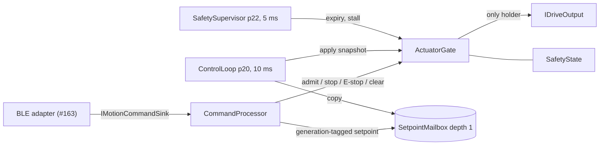

# CodeCell C6 production runtime and threading

Status: implemented by [#158](https://github.com/Krzys2002/Mini_Robot/issues/158) on
top of the #155 build and the proposed [#156 timing budgets](../protocol/timing-budgets.md).
This page describes the structure of the production image in
[`firmware/codecell-c6`](../../firmware/codecell-c6/README.md). It does **not**
establish physical stopping, electrical boot behaviour or protocol interoperability:
those remain with #160–#166 and the powered gate
[#238](https://github.com/Krzys2002/Mini_Robot/issues/238).

## What the production image does today

- Boots with the drive disabled, loads the provisioned configuration (#159), starts
  the safety supervisor and the control task, and reports `Idle` with the output
  disabled. Without a validated record (unprovisioned, corrupt, partial, out of
  version or unreadable) it stays in `Fault` (`ConfigurationUnavailable`) with the
  output disabled; see [identity provisioning](firmware-provisioning.md).
- Accepts only maintenance commands on USB serial (status, provisioning, factory
  reset). Entering maintenance ends motion, clears intent and refuses motion until
  restart.
- Has exactly one motion-command entry point, `FirmwareRuntime::commands()`. No
  code in the image calls it yet: the BLE peripheral that will is #163, and the
  codec that decodes v1 frames for it is #161.
- Uses an inhibited drive adapter. It configures no drive pin and refuses every
  enable, because the CodeCell/DriveCell actuator contract is not validated yet
  (#160). A refused enable puts the runtime in `Fault`.
- Contains no Wi-Fi, access point, HTTP server or client, browser UI, OTA, or
  onboard distance/target execution. The retired T1 controller is not ported.
  A post-link check rejects the image if such code is linked (see
  [production image policy](#production-image-policy)).

## Boundaries

All logic is portable C++20 under
[`include/runtime/`](../../firmware/codecell-c6/include/runtime/FirmwareRuntime.hpp).
It names no Arduino, ESP-IDF, FreeRTOS, CodeCell, DriveCell or radio API. Production
adapters are in [`src/EspRuntimeAdapters.hpp`](../../firmware/codecell-c6/src/EspRuntimeAdapters.hpp)
[`src/EspProvisioningAdapters.hpp`](../../firmware/codecell-c6/src/EspProvisioningAdapters.hpp)
and [`src/main.cpp`](../../firmware/codecell-c6/src/main.cpp), and nowhere else.
Provisioning logic is portable C++20 under
[`include/provisioning/`](../../firmware/codecell-c6/include/provisioning/ConfigStore.hpp).

| Boundary | Type | Production adapter | Owner of the real implementation |
| --- | --- | --- | --- |
| Clock | `IFirmwareClock` (monotonic µs since boot) | `EspFirmwareClock` (`esp_timer`) | #155 |
| Scheduler / RTOS | `IPlatform`: critical section, periodic tasks; every creation checked | `FreeRtosPlatform` (`portMUX`, `xTaskCreate`, `xTaskDelayUntil`) | #158 |
| Drive | `IDriveOutput`: `disable()`, `command(BodyVelocity)` | `InhibitedDriveOutput` | #160 |
| Inertial sensor (optional) | `IInertialSensor` | none wired | #160, if approved |
| Configuration | `IConfigurationSource` + `validate()` | `ProvisionedConfiguration` over `ConfigStore` and `NvsRecordStorage` ([provisioning](firmware-provisioning.md)) | #159 |
| Maintenance | `FirmwareRuntime::enterMaintenance()`, `MaintenanceConsole` | USB serial line reader in `loopTask` | #159 |
| BLE adapter | `IMotionCommandSink` (implemented by `CommandProcessor`) | not attached | #163 |
| Diagnostics | `RuntimeDiagnostics` (atomic counters) + `RuntimeStatus` | serial status line from `loopTask` | #164 (telemetry) |

Domain values cross these boundaries in SI units: `BodyVelocity` is metres per
second and radians per second (positive counter-clockwise), and time is the robot's
monotonic clock in microseconds. Wire units (mm/s, mrad/s, ms) stay in the codec.

## Components and ownership

- **`ActuatorGate`** is the single local safety and actuator authority. It owns the
  only `SafetyState` and is the only holder of `IDriveOutput`. Every drive write and
  every safety transition runs inside one critical section.
- **`SafetyState`** is a pure state machine: `Idle`, `Moving`, `EmergencyStop`,
  `Fault`, plus an internal *ready* flag set only after start-up completed. It keeps
  the receipt-relative deadline (capped by the configured ceiling, expiry at
  `now >= deadline`) and a **generation** counter.
- **`CommandProcessor`** is the only `IMotionCommandSink`. It rejects non-finite
  values and non-positive validity windows, asks the gate to admit Velocity, and
  publishes the admitted setpoint with its generation. Stop, E-stop, ClearEmergencyStop
  and session ends go straight to the gate. It never writes the drive.
- **`SetpointMailbox`** holds one setpoint. The newest admitted setpoint wins and an
  unread one that is replaced is counted (`mailbox_overwrite`). Reads copy without
  consuming.
- **`ControlLoop`** (the actuator update) reads the optional sensor, copies the
  setpoint, reads the clock, and calls `ActuatorGate::apply()` once per period.
- **`SafetySupervisor`** calls `ActuatorGate::supervise()`: deadline expiry and the
  control-stall check, independent of control progress.
- **`FirmwareRuntime`** wires these together and owns start-up.

### Why a stale copy cannot re-enable the outputs

Every transition that ends or replaces motion advances the generation: Stop, expiry,
EmergencyStop, ClearEmergencyStop, any fault, every session end and every newly
admitted Velocity. The gate drives only if all of these hold, inside the critical
section, at the moment of the write:

- the runtime is ready and `Moving`;
- the snapshot's generation equals the current one;
- `now` is before the deadline.

Otherwise it disables the drive. A snapshot that the control task copied before a
Stop, an E-stop or a fault is therefore refused even if it is applied afterwards, and
clearing the latch does not resume the setpoint left in the mailbox. E-stop disables
the drive inside the same critical section before the latch becomes visible, so once
`emergencyStop()` returns no later write can enable the drive for an older setpoint.
The host tests inject each stop-like event exactly between the control task's copy
and its write (`StopLikeEventBetweenSnapshotCopyAndWriteAlwaysWins`).

## Start-up and failure behaviour

`FirmwareRuntime::start()` runs once from `setup()`:

1. Disable the drive.
2. Load the provisioned record (#159) and validate the resulting runtime configuration
   against the budget (`RuntimeConfig.hpp`). The record's `maxCommandValidityMs` becomes
   the validity ceiling; the other values are the budget defaults.
3. Create the handoff critical section.
4. Start the safety supervisor, then the control task.
5. Mark ready.

Commands before step 5 are rejected with `RejectedNotReady`. If any step fails, the
runtime enters `Fault` with the drive disabled, records the first `FaultCode`
(`DriveDisableFailed`, `ConfigurationUnavailable`, `ConfigurationInvalid`,
`SynchronizationUnavailable`, `SupervisorTaskStartFailed`, `ControlTaskStartFailed`),
and never attempts normal motion. Later commands are rejected with `RejectedFault`,
and a supervisor that already runs keeps the outputs off. A configuration error also
keeps its `ConfigError`. Calling `start()` again returns the first result. Faults
are not clearable by the desktop (v1); recovery beyond a reset is #162.

`enterMaintenance()` (the USB maintenance path, #159) is one-way until reset: inside the
gate's critical section it ends motion as for Stop, advances the generation, disables
the drive and clears readiness, so Velocity is rejected with `RejectedNotReady`. The
E-stop latch and faults are kept, and `markReady()` has no effect afterwards.

At run time a refused drive write (`DriveWriteFailed`), a failed disable
(`DriveDisableFailed`) or a control task that stops updating while the drive is on
(`ControlStalled`, B7) also enter `Fault`.

## Scheduling model and handoffs (#156)

| Context | Priority | Period | Work | Budget |
| --- | --- | --- | --- | --- |
| BLE controller (`ble_ll_task`) | 23 | — | Radio | Platform |
| `mr_safety` (`SafetySupervisor`) | 22 | 5 ms | Expiry, control stall | B3, B4, B7, B18 |
| `nimble_host` (BLE callbacks, #163) | 21 | — | `IMotionCommandSink` calls, E-stop first | B8, B9 |
| `mr_control` (`ControlLoop`) | 20 | 10 ms | Sensor, copy setpoint, gated write | B7, B9 |
| Arduino `loopTask` | 1 | 100 ms poll | Serial status line (log drain); USB maintenance console and its NVS writes (#159), only with outputs disabled | B13 |

- Priorities, periods and the stall limit come from `TimingBudget.hpp`. `validate()`
  rejects a configuration slower than the budget periods, a stall limit outside
  [control period, 30 ms], a validity ceiling outside [1 ms, 250 ms], or a priority
  order other than B18.
- Tasks wake on absolute time (`xTaskDelayUntil`), with waits rounded up to whole
  ticks (`ticksAtLeast`). An overrun resynchronizes rather than bursting.
- The only synchronization is one `portMUX` critical section. It is statically
  initialized, so it allocates nothing and cannot fail. Holders copy a few words
  or make a non-blocking drive write, so no timing-critical path waits indefinitely
  and no lock is held across a blocking call. The #156 pilot measured a
  critical-section copy at ≤ 9 µs. `IDriveOutput` implementations must keep this
  contract: no allocation, lock, wait, logging or radio call (#160).
- There is no queue on the motion path apart from the depth-1 mailbox (B12). A
  command flood between two control cycles leaves one setpoint; motion is never
  queued. A CommandResult queue exhaustion is reported by the BLE adapter as
  `sessionEnded(ResultQueueExhausted)`, which stops as for Stop and is counted
  (`session_overload`).
- Diagnostics are lock-free 32-bit counters. Only `loopTask` prints, which keeps
  serial output off the supervisor, control and callback paths (B13). The status
  line is about 160 B every 5 s.
- Heap is allocated only by `xTaskCreate` during start-up (B15). Production
  stack high-water marks (B16), CPU share (B14) and heap minimum have not been
  measured on this image yet (#166).

## Local IMU use

`IInertialSensor` is optional. A missing sensor (`nullptr`) or a failed read does not
block motion or safety; failed reads are counted (`sensor_unavailable`). The control
task keeps the latest sample (a yaw rate, not a pose) for local use only. Nothing is
published, and the desktop `WorldModel` remains the only authoritative world pose. A
read that blocks is caught by the control-stall limit. The production image wires no
sensor, because CodeCell initialization and sensor access timing are unmeasured
(#156 open items).

## Production image policy

[`scripts/production_image_policy.py`](../../firmware/codecell-c6/scripts/production_image_policy.py)
runs after every link of the `esp32-c6-devkitc-1` and `timing-pilot` environments. It
fails the build, and no `firmware.bin` is produced, if the ELF defines the entry points
of the ESP-IDF Wi-Fi, netif, lwIP, HTTP server/client or OTA stacks, or the
Arduino `WiFi*`, `WebServer`, `DNSServer`, `HTTPClient`, `ArduinoOTA` or `Update`
classes. ROM addresses and undefined references are ignored. The rule is in
[`scripts/image_policy.py`](../../firmware/codecell-c6/scripts/image_policy.py) and is
unit-tested by `.github/scripts/tests/test_firmware_image_policy.py`. No legacy
experiment environment is retained. The `timing-pilot` image is the only other
environment; it has no actuator path at all. A future experiment must be a separate
environment that goes through the same `ActuatorGate`.

## Verification

Host tests (`core` label) run the orchestration with fakes: `FirmwareRuntimeTest`,
`RuntimeComponentsTest` and, for provisioning and maintenance, `ProvisioningRuntimeTest` in
[`tests/`](../../firmware/codecell-c6/tests/FirmwareRuntimeTest.cpp). They cover each
injected start-up failure (no nonzero output afterwards), the single command
authority, stale snapshots past their deadline, stop-like events between copy and
write, a new command racing an old snapshot, latch and clear, command floods,
result-queue exhaustion, drive refusal, the control-stall bound and a blocked sensor
read. See the [firmware guide](../../firmware/codecell-c6/README.md) for the commands.

Bench boot (USB only, no battery, motors disconnected, 2026-11-15, #158 image with
compiled configuration): status lines at 5 s, 10 s and 15 s uptime reported
`start=running ready=1 state=Idle output=disabled fault=None`. Since #159 the same
result requires a provisioned record; an unprovisioned board reports `start=faulted
state=Fault fault=ConfigurationUnavailable` ([provisioning bench check](firmware-provisioning.md#verification)). Afterwards the board's previous `ble-lifecycle` image was restored and
read back with the same SHA-256. This shows the commanded state only; the electrical
pin state was not measured (#238).
