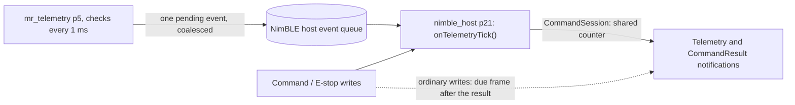

# CodeCell C6 telemetry and local diagnostics

Status: implemented by [#164](https://github.com/Krzys2002/Mini_Robot/issues/164) on top of
the [BLE peripheral](firmware-ble.md) (#163) and the proposed
[timing budgets](../protocol/timing-budgets.md) (#156). The robot publishes the complete v1
surface: Robot Info, one CommandResult per frame, and Telemetry, periodic and on state
change, on one shared robot transmit counter. Local diagnostics go to USB serial through a
bounded, rate-limited log. The v1 frames are unchanged, and no field or counter was added to
them. HIL and powered checks remain with [#166](https://github.com/Krzys2002/Mini_Robot/issues/166)
and [#238](https://github.com/Krzys2002/Mini_Robot/issues/238).

## Review status (2026-11-16)

The [latest PR #283 follow-up](https://github.com/Krzys2002/Mini_Robot/pull/283#issuecomment-6923061596)
distinguishes completed code corrections from evidence still required:

| Item | Status |
| --- | --- |
| Mandatory telemetry task startup | Corrected and host-tested: failure inhibits motion with `TelemetryTaskStartFailed`; no reliance on a desktop silence timer |
| Early spacing and write-burst scheduling | Corrected and host-tested: ≥ 20 ms frame spacing, 99 ms periodic eligibility, millisecond checks and due frames after ordinary write results |
| Session-security integration | Hooks and restricted-lab pass-through implemented and host-tested; the mock is unauthenticated and unencrypted, not cryptographic validation |
| B10 corrected-image bench evidence | **Pending:** rerun burst/stress cases on the corrected C6 image against 100 ± 2 ms and spacing ≥ 20 ms; previous 10.6–14.0 ms deviations remain unresolved evidence |
| B3 supervisor lateness | **Open:** investigate the 2.09 ms observation against ≤ 2 ms and perform a long idle rerun |
| Timing-budget approval | **Pending:** #156/PR #276 retains its proposed bounds; no relaxation is approved |

Acceptance criterion 2 (within the #156 timing budget) remains unresolved. Host models
cannot close either hardware finding. If any bound changes, explicit #156/#276
approval and recalculation of affected guarantees and desktop freshness assumptions are
required. Physical/electrical stopping is not established, and these checks do not
authorize powered motor tests.

The approved [F1 decision in PR #274](https://github.com/Krzys2002/Mini_Robot/pull/274#issuecomment-6922939151)
and its policy text are included in this branch. Desktop companion
[PR #287](https://github.com/Krzys2002/Mini_Robot/pull/287) remains an integration dependency.
One accepted application-controller connection per robot is not authentication;
the second-independent-central hardware test remains unverified.

## What the robot publishes

**Robot Info** carries firmware version **0.1.0** (`ble::kRobotInfoFirmwareVersion`). It is
the first image that publishes the whole v1 surface. The version is diagnostic only: it
promises no compatibility beyond protocol v1, and nothing on the desktop may depend on it.
The exact image is named by its ELF SHA-256, which the robot prints as `build=` and the build
writes to `firmware-provenance.json` (`elf.sha256`, schema 3).

**Telemetry** (18 bytes, [robot-protocol.md](../protocol/robot-protocol.md#telemetry-0x80)):

| Field | Source | Unit | Availability |
| --- | --- | --- | --- |
| `state` | Runtime status at the moment the frame is built | v1 state | Always |
| `commandExpired` (bit 0) | Runtime status (#162) | — | Set when the watchdog ended motion, cleared by the next accepted Velocity or Stop |
| `batteryLow` (bit 1) | Battery policy | — | Default image: never set. `battery-bench` image: set at ≤ 3350 mV, cleared at ≥ 3450 mV (provisional, #309); informational only |
| `hasAcceptedCommand` (bit 2), `lastAcceptedSequence` | The session's own sequence state | — | Always |
| `uptimeMs` | Robot monotonic clock, modulo 2³² | 1 ms | Diagnostic only; wraps after about 49.7 days |
| `batteryMillivolts` | Battery policy | 1 mV | Default image: **unknown, `0xFFFF`**. `battery-bench` image: CodeCell GPIO4 reading when fresh and within 3000–4400 mV (provisional, #309); otherwise unknown |
| `measuredLinear` | — | 1 mm/s | **Unknown, `0x8000`**: no wheel encoders or speed sensors |
| `measuredAngular` | — | 1 mrad/s | **Unknown, `0x8000`**: the IMU is not wired (#158) and its axes are unverified (#238) |

A commanded setpoint, a PWM duty, an assumed wheel speed or an integrated IMU acceleration is
never reported as measured velocity. The desktop's WorldModel stays the only source of
measured motion. The table is also in
[`telemetry/TelemetryInputs.hpp`](../../firmware/codecell-c6/include/telemetry/TelemetryInputs.hpp).

**One counter.** Telemetry and CommandResult take their sequence from the same per-session
counter. Both are built and queued in the BLE host context (`nimble_host`), so a frame of one
kind can never overtake a frame of the other. The counter restarts at 0 with every session and
wraps from 65535 to 0. A telemetry frame the stack could not queue still spent its sequence,
so the desktop sees the loss as a gap, which it counts as a lost notification.

**Read value.** A Read of the Telemetry characteristic returns the latest queued frame of the
current session, with its original sequence. It is empty outside a session.

## Schedule (#156 B10)



- The telemetry task checks every millisecond (`kTelemetryTickPeriod`, one scheduler tick).
  It posts one static event to the NimBLE host's own queue every 5 ms
  (`kTelemetryRoutinePostPeriod`). In between, it posts only when the lock-free
  `PeripheralController::telemetryMayBeDue()` says a frame could be due, which happens at most
  a millisecond early; the host still decides exactly. At most one event is pending, so ticks
  coalesce while the host is busy and nothing accumulates. The task never touches the session or the drive. It posts
  nothing from the supervisor, the control task or the host itself, since NimBLE's put may
  wait for queue space.
- In the host, `PeripheralController::onTelemetryTick()` reads the runtime status once and
  asks the [scheduler](../../firmware/codecell-c6/include/telemetry/TelemetryScheduler.hpp):
  - **session start**: the first frame of a ready session goes out at the first tick;
  - **state change** (the state byte, `commandExpired` or `batteryLow`): at the first tick
    that sees it, but never closer than 20 ms to the previous frame. Changes in between
    coalesce to the latest state, so a state shorter than a tick can be missed (its
    CommandResult still reports it);
  - **periodic**: once 99 ms (`kTelemetryPeriodicEligibility`) have passed since the previous
    frame.
- **Write bursts (#283 review).** A burst of writes keeps `nimble_host` busy, and the
  priority-5 task can then neither run nor get its event ahead of the queued writes. So every
  ordinary Command write callback also publishes a due periodic or state-change frame, after
  that write's CommandResult is queued. The session's first frame stays on the task's check.
- Every check uses the unchanged proposed B10 values on the robot clock (#283 review). Earlier versions
  allowed half a tick, which admitted a state change after 17.5 ms and a periodic frame after
  97.5 ms. With one check per millisecond, frames can be at any phase, including frames sent
  from a write. The bounds:
  - no two frames are ever less than 20 ms apart, so at most 50 frames per second, inside
    B10's 60, across sessions too;
  - in the host model, a periodic frame becomes eligible at 99 ms, and the next check or
    write comes at most one millisecond plus the assumed 2 ms scheduling lateness later.
    Every modeled periodic gap is therefore within 99–102 ms, inside 100 ± 2 ms,
    whatever the phase of the previous frame. During a modeled burst, the next write
    comes within one callback. Corrected-image bench conformance is still pending;
  - a state change goes out at the first check or write at least 20 ms after the previous
    frame: at most 20 ms plus one check and the lateness after that frame.

  The checks are `TelemetrySchedulerTest.TickAndWriteModelMeetsEveryB10BoundAtOnce`,
  `AnOffGridFrameIsFollowedByAPeriodicFrameWithinB10`, `BoundariesAreTheApprovedB10Values`,
  `TelemetryPublicationTest.GatedMillisecondChecksPublishExactlyWhatUngatedChecksDo` and
  `WriteBurstThatStarvesTheTickKeepsTheB10Deviation`:
  - the first checks all four bounds together. It merges millisecond checks with random,
    alternating, ramp and step lateness, off-grid sparse writes, and bursts that starve the
    checks entirely. Run with 5 ms checks instead, it fails with a 105 ms gap;
  - the second is the off-grid case that broke the first attempt;
  - the gated host publishes exactly the frames an ungated one does, with under a third of
    the wake-ups.

  The compile-time checks in `TimingBudget.hpp` keep the relations: eligibility ≥ period −
  deviation, eligibility + check + allowance ≤ period + deviation, and the 19.2 ms queue
  allowance below the 20 ms spacing.
- The budgets the review named stay unchanged:
  - B11: each CommandResult is still queued first, inside its callback.
  - B8: the Emergency Stop callback never publishes telemetry.
  - The E-stop wait: frames are at least 20 ms apart, and a full inbound queue drains in at
    most 19.2 ms. At most one telemetry frame, from the task or a write, is therefore ever
    handled ahead of an E-stop. The existing composition already counts that frame
    (`kRobotStackQueueAllowance + kTelemetryHandlerAllowance + 1 ms ≤ 25 ms`, `static_assert`).

  An ordinary write callback that publishes now takes up to one result plus one telemetry
  frame. That is the cost the review named for this option, and the maintainer still has to
  accept it. B14 (CPU share) is not measured, including the millisecond check.
- Telemetry, results and diagnostics never extend a deadline, and safety does not depend on
  telemetry.
- The telemetry task is a checked start-up step of `FirmwareRuntime::start()` (#283 review).
  If it cannot start, the runtime faults with `TelemetryTaskStartFailed` before it is ready,
  and the boot line says `TELEMETRY start=failed`. A central can still connect, but every
  Velocity and Clear is refused (`RobotFault`), so no motion-ready endpoint is published
  (`FailedTelemetryTaskNeverExposesAMotionReadyEndpoint`). Nothing relies on the desktop
  noticing the missing telemetry. When an earlier start-up step fails, the runtime still starts
  the telemetry task, so a faulted robot keeps reporting `Fault`
  (`AFaultedRuntimeStillStartsTelemetrySoItCanReportTheFault`).
- Every Telemetry frame passes the session-security `protectOutgoing()` hook before it is
  queued ([BLE guide](firmware-ble.md#session-security-extension-points-157-review)). The
  restricted-lab pass-through returns it unchanged; a refused frame is dropped and counted.

### Congestion

| Situation | Behaviour |
| --- | --- |
| The stack cannot queue a Telemetry notification | Dropped and counted (`notify_failures`); the session continues; its sequence is spent |
| Repeated failures | A failed attempt counts for the spacing: a state change is eligible again after 20 ms, a periodic frame after 99 ms. At most 50 attempts per second, no queue, no burst |
| A CommandResult cannot be queued | Unchanged #156 policy: the session ends as for Stop and the link is terminated |
| The host is busy (write burst) | Ticks coalesce in the one pending event; the next frame carries the newest state |
| A value equals its sentinel | Not sent and counted (`encode_failures`); no sequence is spent |

## Battery

[`telemetry/BatteryMonitor.hpp`](../../firmware/codecell-c6/include/telemetry/BatteryMonitor.hpp)
publishes a voltage only with evidence: a plausible range, low thresholds and a maximum sample
age. The default image (`esp32-c6-devkitc-1`) has no evidence and no sensor: it never reads
the battery ADC, sends `0xFFFF` and never sets `batteryLow`, as before #309.

The separate `battery-bench` PlatformIO image (`pio run -e battery-bench`,
`CODECELL_PROVISIONAL_BATTERY=1`, #309) wires the CodeCell battery sensor
([`src/CodeCellBatterySensor.hpp`](../../firmware/codecell-c6/src/CodeCellBatterySensor.hpp)):
one ADC conversion on GPIO4 per telemetry period, converted as the pinned CodeCell 2.0.4
library does (`2 × ADC + 65 mV`). The conversion runs in the telemetry task after the BLE host
wake, so it never delays the wake; a frame uses the previous sample. One discarded
conversion in `setup()`, before the tasks start, performs the driver's lazy ADC setup and
calibration (boot line `BATTERY image=battery-bench warm_up=read|failed`). Arduino returns 0
when the ADC setup, calibration or conversion fails, so 0 counts as a failed read
(`read_failed`, `battery_read_failures`), not as 65 mV. The image uses the **provisional**
evidence in
[`telemetry/CodeCellBattery.hpp`](../../firmware/codecell-c6/include/telemetry/CodeCellBattery.hpp):

| Value | Provisional setting | Source |
| --- | --- | --- |
| Plausible range | 3000–4400 mV | Single-cell LiPo floor; covers the 4.2 V charge voltage and the library's 4190 mV USB indication |
| `batteryLow` enter / exit | 3350 / 3450 mV | CodeCell `MIN_BATTERY_VOLTAGE`, plus 100 mV hysteresis |
| Maximum sample age | 500 ms (five telemetry periods) | Tolerates one or two late samples |

The operator approved publishing these on the bench (2026-11-20). They are **not** the
reference-meter evidence the [hardware record](../testing/codecell-c6-hardware-154.md) asks
for: the conversion has not been compared with a multimeter at the battery leads (#238), the
pack's protection is unresolved, and the reading is a single unaveraged conversion.
`batteryLow` is informational: neither the firmware nor the desktop acts on it, and the
firmware has no low-battery protection. With USB connected the battery node reads the USB
rail (about 4.42 V on the bench), above the plausible range, so the image reports `unknown`
(`implausible`). Voltage is published only on the LiPo with USB unplugged, which is why its
conformance pass is BLE-only (`gatt_conformance_host.py --battery-present`).

The quality and telemetry value in each case:

| Quality | When | Telemetry |
| --- | --- | --- |
| `not_validated` | No approved evidence (production) | Unknown, never low |
| `no_sensor` / `no_sample` | Nothing wired, or nothing read yet | Unknown, never low |
| `read_failed` | The latest read failed | Unknown, low cleared |
| `stale` | Older than `maxSampleAge` (wrap-safe) | Unknown, low cleared |
| `implausible` | Outside the approved range, or equal to `0xFFFF` | Unknown, low cleared |
| `valid` | Fresh and plausible | The value; low set at or below the enter threshold and cleared at or above the exit threshold |

## Local diagnostics

Every serial line goes through one [log ring](../../firmware/codecell-c6/include/diagnostics/LogRing.hpp)
(B12, 2048 B), drained only by the Arduino `loopTask` (priority 1, B13):

- A line that does not fit whole is dropped and counted (`log_dropped_lines`); no caller
  waits. Supervisor, control and BLE callbacks never log: they publish atomic counters.
- The drain writes what a token bucket allows (2048 B/s average, one second of burst) and
  what the USB port has room for. When the port reports no room, the drain calls `flush()`,
  because the driver re-enables its TX interrupt only on a write or a flush. Without that, the
  console stayed silent on the bench once the driver's queue had filled. Writes use a 1 ms TX
  timeout, **not 0**: in Arduino-ESP32 3.3.7, `HWCDC::write()` counts its retries down from
  the timeout, so 0 would underflow into a near-endless loop. That one was found by reading
  the driver, not seen on the bench.
- Without a connected host, lines wait in the ring, newest dropped. A monitor attached later
  still sees the boot lines, except about 256 B that the USB-JTAG driver held and discards
  when the port opens.
- A report round runs every 5 s: `IDENTITY`, `RUNTIME`, `BLE`, `TELEMETRY`, one `TASK` line
  per task, then `RESOURCES`. It emits one line per loop pass and only once the ring has
  drained, so a maintenance reply always finds room. `RUNTIME` also prints at once on a status
  change, and `BLE` on a link change at most once per second.

```text
IDENTITY robot_id=7 firmware=0.1.0 build=0b8f4b49d3306dfd reset=usb session=49 uptime_ms=403105
TELEMETRY session=70 period_ms=100 task=running ticks=104328 not_ready=84349 coalesced=0 sent=1046 session_start=70 state_change=36 periodic=940 notify_failures=0 encode_failures=0 gap_min_us=99218 gap_max_us=100000 periodic_dev_max_us=782 battery_mv=unknown battery_quality=not_validated battery_low=0 battery_sensor=none battery_raw_mv=none battery_read_failures=0 velocity=unknown
TASK name=mr_safety prio=22 period_ms=5 steps=104475 overruns=0 late_max_us=657 late_worst_us=1454 step_max_us=23 step_worst_us=119 stack_free=3724 stack_size=4096 stack_free_pct=90
RESOURCES heap_free=330572 heap_min_free=329012 heap_largest=311284 log_lines=1104 log_dropped_lines=0 log_dropped_bytes=0 log_written=256010 log_high_water=667 log_capacity=2048
```

| Line | Contents |
| --- | --- |
| `BOOT`, `IDENTITY` | Reset reason, firmware version, build (ELF SHA-256 prefix), RobotId, session number (sessions since boot), uptime |
| `RUNTIME` | State, fault, readiness, session, `commandExpired`, reset reason, provisioning, RobotId; accepted/rejected/expired Velocity, mailbox overwrites, E-stops, sessions opened/ended, overloads, blocked stale setpoints |
| `BLE` | Link state, CCCDs, MTU, link-parameter request and negotiated values, last disconnect and time since the last write, connection/result/E-stop/foreign/advertising counters |
| `TELEMETRY` | Frames by reason, notify and encode failures, coalesced ticks, gap extremes and the largest periodic deviation of the window (#156 I11), battery quality and availability, `velocity=unknown` |
| `TASK` | For `mr_safety`, `mr_control` and `mr_telemetry`: steps, overruns, wake lateness against the tick grid (I6) and step wall time (window maximum and worst since boot). For every task including `nimble_host` and `loopTask`: least free stack (B16) |
| `RESOURCES` | Free, minimum free and largest free heap (B15); log lines, drops, bytes written, ring high water |

Counters are 32-bit and wrap. Window maxima reset at each report. Step times are wall time,
including preemption by higher-priority tasks.

**No credentials.** The restricted-lab v1 profile has no controller keys (#157). BLE stores no
bond keys (#163). The image has no Wi-Fi (#158). Lines carry only the fields above, formatted
by [`diagnostics/StatusReport.hpp`](../../firmware/codecell-c6/include/diagnostics/StatusReport.hpp),
and the host tests reject any key outside each line's allowlist.

## Verification

Host tests (`core` label), all with fakes and a fake microsecond clock:

- `TelemetrySchedulerTest`:
  - the session-start frame, then periodic frames exactly 100 ms apart;
  - deviation ≤ 2 ms with every tick late by up to the B3 allowance;
  - state-change spacing and coalescing;
  - flapping state under adversarial lateness that stays ≥ 20 ms and ≤ 60 per second;
  - the B10 boundaries and the lateness model above;
  - congestion without retry bursts;
  - cross-session spacing;
  - the uptime and clock wrap points.
- `BatteryMonitorTest`:
  - no evidence: nothing published and never low, whatever is read;
  - unusable evidence, missing sensor, failed read, stale, implausible and sentinel readings;
  - hysteresis;
  - the age across the millisecond wrap.
- `TelemetryPublicationTest`, with the real runtime and a fake link:
  - exact v1 bytes;
  - no telemetry before readiness;
  - a gap-free shared counter with results, and its 65535 → 0 wrap;
  - the E-stop result before its telemetry, within the spacing;
  - the expiry flag until the next Stop;
  - velocity and battery unknown while the drive is commanded;
  - no deadline extension;
  - notify failure (dropped, counted, gap, session kept) and 10 s of congestion with 0
    allocations;
  - the Read value per session;
  - a validated battery and a low flag change;
  - sentinel refusal and the uptime wrap.
- `DiagnosticsReportTest`:
  - ring drop and wrap;
  - a 20 s overload drained at ≤ 2048 B/s;
  - a congested or absent host that never blocks and only drops counted lines;
  - token-bucket fractions;
  - task lateness against the tick grid and tick wrap;
  - every report line with worst-case values (≤ 482 of 640 B, keys allowlisted, no
    credential words);
  - every maintenance reply fits the ring beside the reporter's lines.

### Bench check, 2026-11-16

Setup: USB only, no battery, no motors, one CodeCell C6 Drive; Ubuntu 26.04.1, BlueZ 5.85 on
the built-in adapter. This checks commanded state, radio and serial behaviour only. No pin was
measured, and the only accepted Velocity was 0 mm/s, 0 mrad/s.

1. Took a full 8 MB backup (two identical reads, SHA-256 `0d65a45f…`) and flashed the image.
   - **Unprovisioned** (an earlier build of this branch, before the serial-drain fixes):
     `TELEMETRY start=no_ble`, `battery=unknown`, `robot_id=none`, and the runtime in `Fault`
     (`ConfigurationUnavailable`). The image after the #283 review reports `start=started`
     here: the runtime starts the task even after that fault, and with no BLE peripheral its
     ticks do nothing.
   - **Provisioned** with the host-test fixture values (RobotId 7, 200 ms ceiling; not
     calibration data): `TELEMETRY start=started tick_ms=5 period_ms=100`, every task listed.
2. Ran `scripts/gatt_conformance_host.py --robot-id 7 --max-validity-ms 200`. Besides the #163
   checks, it covered telemetry T1–T5, the shared counter (C8), a 500-frame write flood (C12),
   30 s without reading serial (C13) and the robot's own timing and resource lines (C14).
   Final image (`firmware.bin` `9aed38c8…cc49`, ELF `0b8f4b49…0682`), with the script as it
   was before C14 checked every report window:
   - **73/73** with 20 reconnect cycles;
   - **72/73** with 50 cycles. The failure was 3 cycles in which BlueZ aborted its own
     connection attempt (`le-connection-abort-by-local`, as in #163); the robot advertised
     again each time.

   The previous image, differing only in the report backpressure, passed 73/73 with both 20
   and 50 cycles. Applied to the same logs, the committed script's every-window B10 check fails
   C14 in all four runs (see the open finding below).

   **Pre-review bench image** (`firmware.bin` `66951b47…`, ELF `c5afd4c7…`, before the
   subsequent startup, security-hook and scheduler corrections; it differs from the
   image above only by comment edits), with the committed script and 20
   cycles: **71/73**. Its unprovisioned boot was again `start=faulted`
   (`ConfigurationUnavailable`), `robot_id=none`. The two failures:
   - C14 B10 every window: 11.97 ms in the burst window, the open finding below;
   - C14 B3 worst since boot: **2.09 ms**, 90 µs over the 2 ms bound. It came from the first
     report window, which covered about 75 minutes of idle advertising with no serial host
     attached (the round stalls without one). Every window of the active run stayed
     ≤ 0.73 ms. The cause is not identified; recorded for #166 and #156.

   Observed across the runs:
   - **Robot Info and Read:**
     - Robot Info carries firmware 0.1.0 and a 100 ms period;
     - Telemetry Read is empty before the session and the latest frame during it.
   - **Telemetry frames:**
     - the first frame is sequence 0 and shows the latch from before readiness;
     - battery `0xFFFF` and both velocities `0x8000`, also while `Moving`;
     - periodic deltas on the robot clock were exactly 100 ms;
     - the host's longest telemetry gap was 0.121 s, also during the flood and while serial was
       not read (the desktop threshold is 0.3 s);
     - the E-stop and expiry frames followed their results.
   - **Shared counter and flood:**
     - results and telemetry formed one gap-free counter in every session;
     - 500/500 flood frames were answered;
     - `notify_failures=0`.
   - **Timing and resources:**
     - `mr_safety` worst wake lateness 1.454 ms in runs 4–7 (B3 ≤ 2 ms), and 2.09 ms once in
       the idle window before run 8 (above);
     - least free stack 60–90 % (B16 ≥ 25 %);
     - minimum free heap 329,012 B and flat across the run (B15 ≥ 64 KiB);
     - no log line dropped while a host was reading.
   - **Control task:** worst wake lateness 7.7 ms and worst step 3.1 ms wall time, both under
     BLE load. Not a budget of this issue; recorded for #166.
3. Restored the original flash in 1 MB chunks. The 8 MB read-back matched the backup's
   SHA-256.

**Open B10 finding.** The robot-side periodic deviation stayed ≤ 1.45 ms in every report
window except the one containing the C7/C8 write bursts. That window measured 10.6–14.0 ms in
all five full runs, and run 5 had two such windows:

- **Cause.** The telemetry task runs at priority 5 (B18) and is preempted while `nimble_host`
  (21) works through a burst of queued writes. Its own step took up to 14.5 ms, so the tick
  was late before it was posted.
- **Context, not conformance.** The values are within the 19.2 ms that #156 derives for
  the host draining its 24 inbound buffers (`kRobotStackQueueAllowance`), and host-side
  gaps stayed ≤ 0.121 s. Neither fact satisfies the independent B10 deviation bound.
  The desktop's proposed silence response is not a substitute for robot-side timing
  conformance or a proven implemented safeguard.
- **Fix (#283 review), host-tested only.** Ordinary write callbacks publish a due frame after
  their result, and the telemetry task checks every millisecond (see
  [Schedule](#schedule-156-b10)). A first version that kept 5 ms checks was withdrawn: a frame
  sent from a write lands off a 5 ms grid. Example: a frame at 22.5 ms made the 120 ms tick
  refuse at 97.5 ms elapsed and send at 125 ms, which breaks B10 in normal operation. The
  millisecond check removes that case. The B10 values and the B8/B11 bounds are unchanged.
  **The bench stress and idle cases must be rerun on a C6** before this finding, and
  acceptance criterion 2, can be closed. No board was attached on 2026-11-16. The
  conformance check evaluates every window, so a rerun reports any remaining failure.

**Fixed during the bench check.** After about two minutes of BLE testing, the console went
silent while BLE and the runtime kept running. Changing the 0 ms TX timeout to 1 ms (for the
underflow above) did not cure it. Re-arming the driver with `flush()` when it reports no room
did. Every later run kept the console alive throughout, including after 30 s without reading.

**NOT RUN.** These belong to #166 and #238:

- corrected-image burst/stress reruns for B10 (100 ± 2 ms and spacing ≥ 20 ms);
- B3 root-cause investigation and a long idle rerun against ≤ 2 ms;
- second-independent-central hardware validation (AT-03, also owned by #165);
- battery against a reference meter;
- a battery sensor failing on a powered board;
- powered and motor-connected checks;
- macOS and Qt-desktop centrals;
- CPU share (B14).

## Not in this issue

- **Battery accuracy.** Replacing the provisional #309 evidence with reference-meter
  evidence needs the #238 multimeter comparison and a reviewed hardware record. Until then
  the default image reports the battery as unknown.
- **Frame changes.** Any extension of the frozen v1 frames, such as counters or a fault reason
  in Telemetry. That would need a new protocol version, and none is proposed here.
- **Desktop.** Desktop consumption of telemetry: #66. Communication metrics: #72.
