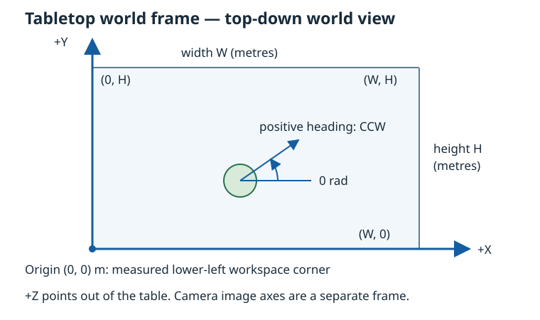

# Tabletop workspace and calibration model

Issue [#56](https://github.com/Krzys2002/Mini_Robot/issues/56) defines the shared
physical frame for localization, planning and supervisory control. It extends the
[authoritative world model](world-model.md) without changing pose-update semantics.

## Physical coordinate convention

- Mark and measure the **lower-left corner in the intended top-down world view**
  as the physical origin `(0, 0)` metres. “Lower-left” refers to this world view,
  not to a camera image: a rotated or oblique camera does not redefine the table.
- +X runs along the bottom edge to the right; +Y runs along the left edge upward.
  The tabletop is `z = 0`; +Z points out of the table. This is right-handed.
- Heading is zero along +X and positive counterclockwise toward +Y: right = 0,
  up = π/2, left = π (or equivalent −π), down = −π/2 radians.
- Internal positions and dimensions use `Meters`; headings use `Radians`.
  `Pose2D` permits unwrapped angles; `normalizeAngle` supplies (−π, π] when needed.
  Display-only conversions may use millimetres/degrees at the UI boundary.
- The workspace is the closed rectangle `[0, W] × [0, H]`. W and H must be finite
  and strictly positive metres. No assumed/default table size is supplied.

`WorkspaceBounds` validates dimensions on construction and includes the border in
`contains(WorldPoint2D)`. Non-finite and outside points are rejected. A bounds check
is not robot-footprint clearance, obstacle inflation or a control safety policy.
Poses outside the table may still be stored as measurements; changing bounds does
not clamp/reinterpret robot poses or silently move the physical origin.

Sources: [Workspace.hpp](../../src/world/Workspace.hpp),
[Workspace.cpp](../../src/world/Workspace.cpp),
[Pose2D.hpp](../../src/common/Pose2D.hpp).

## Authoritative state and UI/overlay convention

`WorldModel::setWorkspaceBounds(optionalBounds)` sets or clears the current table
bounds on the model's owning thread. `WorldSnapshot::workspace` is a detached
optional copy; absence explicitly means **dimensions not configured**. No second
workspace registry is created. `workspaceBounds()` reads those dimensions without
copying the robot registry.

A profile is saved calibration data, not a second live world authority. The #57
application service installs accepted `profile.bounds` in WorldModel on the owning
thread. Dimension/input changes invalidate the transform and clear active bounds;
a loaded transform is never paired with another table size. The calibration
service retains H; conversion of robot observations remains #58.

The main window always shows the lower-left origin, +X/+Y, SI units, zero heading
and CCW convention. `DesktopController::setWorkspaceBounds` publishes measured
width/height from the same authoritative world model; the UI continues to say
camera-to-world calibration is not established. Dimension configuration is not a
camera calibration. This issue supplies the model/service boundary, not a table
measurement wizard or guessed production dimensions.

For future world-view overlays, draw +X right and +Y up, with origin at the
lower-left of the viewport. Use `workspaceToView` / `viewToWorkspace` for normalized
presentation coordinates: top-left = `(u=0, v=0)`, bottom-right = `(1,1)`.
`u = x/W`, `v = 1 − y/H`; scale/offset into the viewport after conversion. Preserve
aspect ratio with padding; a physical metre must have the same display scale on
both axes. Inputs outside the bounds are rejected rather than clamped. These
functions do **not** map camera pixels to metres.

Raw images keep their own top-left pixel origin, +u right and +v down. A world-axis
legend over a camera image must use its calibrated transform; do not simply draw
world +Y along image up or treat a world-view fraction as a detector pixel.

## Version 1 workspace-calibration structure

[WorkspaceCalibration.hpp](../../src/calibration/WorkspaceCalibration.hpp) and
[WorkspaceCalibration.cpp](../../src/calibration/WorkspaceCalibration.cpp) define
`WorkspaceCalibrationProfile`, separately from the existing lens
[intrinsic calibration/profile](calibration-profiles.md):

| Field | Meaning |
| --- | --- |
| `version` | `WorkspaceCalibrationProfileVersion`, currently 1; unknown versions rejected |
| `workspaceId` | Non-empty identity of the physical table/frame |
| `bounds` | Validated metric W/H and the fixed origin/axes above |
| `intrinsics` | Owned intrinsic snapshot: camera/device identity, delivered width/height, K, distortion and quality metadata |
| `imageCoordinates` | Only `UndistortedNativeCameraMatrix`: undistorted pixels using the bound K, native size, no crop/resize/mirroring |
| `homography` | Optional row-major 3×3 image-to-world matrix; absent means no workspace transform |

For an estimated H, `[x′, y′, w′] = H [u, v, 1]`, with world metres
`(x′/w′, y′/w′)`. Profile validation checks finite, numerically nonsingular optional
matrix storage and valid intrinsic metadata. It does not solve correspondences,
check mapping accuracy or authorize robot control. Compatibility rejects any
camera identity, resolution, K or distortion change without silently resizing a
transform. Moving a camera/lens/table also requires new workspace calibration;
identity/metadata equality cannot detect physical motion.

Profiles intentionally require explicit bounds at construction. A #57 loader
should parse and validate dimensions first, then construct the aggregate; it must
not introduce guessed default dimensions. K and distortion compare exactly, so
persistence must preserve doubles losslessly (for decimal text, use
`std::numeric_limits<double>::max_digits10`) and test save/load compatibility.

Workspace serialization, filesystem storage and estimation are now implemented by
[tabletop homography calibration](tabletop-homography.md) (#57). The application
installs accepted profile bounds in WorldModel and clears them on invalidation.
Metric robot pose conversion and tracking remain #58 and later issues. A draft profile with
no H remains uncalibrated; lens intrinsics alone never establish a table transform.

## Verification

[WorkspaceTest](../../tests/world/WorkspaceTest.cpp) covers metric dimensions,
closed borders, invalid values, corner and aspect-ratio round trips, CCW heading
presentation, authoritative ownership and unchanged robot poses.
[WorkspaceCalibrationTest](../../tests/calibration/WorkspaceCalibrationTest.cpp)
covers versions, pixel-domain enums, camera/resolution/optical compatibility,
uncalibrated drafts, matrix finiteness/singularity and homogeneous scaling. Both
suites run without Qt/OpenCV. Desktop integration tests verify visible convention,
measured dimensions and explicit uncalibrated status; GUI scaling checks include
the new labels.

Before physical use, mark the origin and axes on the measured table, verify W/H in
metres, and commission image-to-world calibration with independent points under
#57/#58. No physical camera/table accuracy is established by this issue's tests.

Homography estimation, point acquisition, residuals and workspace-profile persistence
are implemented by [tabletop homography calibration](tabletop-homography.md) (#57).
Physical placement/accuracy still require commissioning; detection-to-pose conversion
remains #58.
