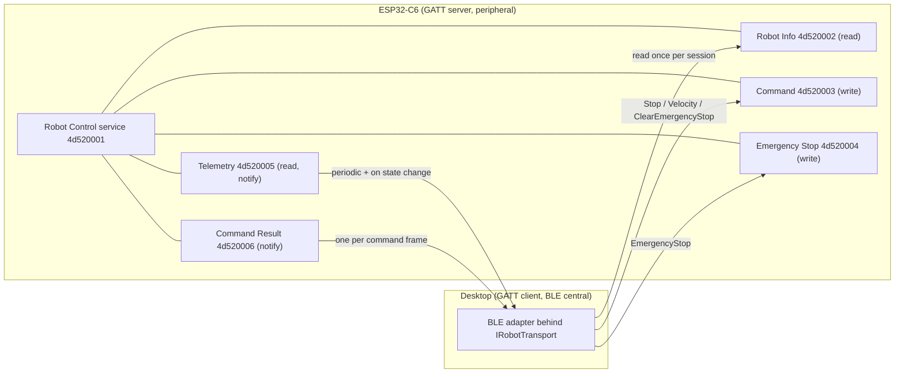

# BLE GATT contract, protocol version 1

Status: specification for [issue #64](https://github.com/Krzys2002/Mini_Robot/issues/64).
The desktop [BLE lifecycle](../overview/ble-connection.md) implements discovery,
identity/service validation and notification setup. Desktop
[message handling](../overview/ble-messages.md) implements command writes and
validated notifications; physical command delivery remains unverified. No production
firmware implementation is provided here. A connection-only
[CodeCell bench fixture](../../firmware/ble-lifecycle/README.md) supports #187;
it does not implement the command/safety protocol below.

This contract defines how [robot message protocol](robot-protocol.md) frames are
carried over Bluetooth Low Energy. The ESP32-C6 is the GATT server (peripheral),
and the desktop is the GATT client (central). BLE handles, UUIDs, addresses, and
platform peripheral identifiers stay inside the desktop BLE adapter. Planning,
control, `RobotManager`, and widgets see only `RobotId` and `IRobotTransport`.

## Service and characteristic layout

All UUIDs share one project base, and only the first 32-bit field differs. These
values are fixed for protocol version 1.

| Name | UUID | Properties | Payload |
| --- | --- | --- | --- |
| Robot Control service | `4d520001-1f2a-4032-8415-63a5fef8a0dc` | Primary service | — |
| Robot Info | `4d520002-1f2a-4032-8415-63a5fef8a0dc` | Read | [Robot Info record](robot-protocol.md#robot-info-record), 18 bytes |
| Command | `4d520003-1f2a-4032-8415-63a5fef8a0dc` | Write, Write Without Response | Stop, Velocity, ClearEmergencyStop (and EmergencyStop) frames |
| Emergency Stop | `4d520004-1f2a-4032-8415-63a5fef8a0dc` | Write, Write Without Response | EmergencyStop frame; any write latches |
| Telemetry | `4d520005-1f2a-4032-8415-63a5fef8a0dc` | Read, Notify | Telemetry frame, 18 bytes |
| Command Result | `4d520006-1f2a-4032-8415-63a5fef8a0dc` | Notify | CommandResult frame, 9 bytes |

UUIDs `4d520007-…` to `4d5200ff-…` with the same base are reserved for this
service. Telemetry and Command Result each have a Client Characteristic
Configuration Descriptor (CCCD).

### Characteristics

- **Robot Info** is static for the lifetime of the firmware image, and a Read
  returns the record. The desktop reads it once per session before enabling
  notifications.
- **Command** accepts one frame per write. Both write types are processed
  identically. Write Without Response should be used for periodic Velocity
  frames, to reduce latency. Write With Response should be used for Stop and
  ClearEmergencyStop. A GATT write response confirms receipt only. Acceptance
  arrives on Command Result. The GATT layer must not return an ATT error for
  protocol-level rejection. The rejection is reported through Command Result,
  so that the frame is answered exactly once.
- **Telemetry** notifies one frame per notification. A Read returns the most
  recent telemetry frame, which carries its original sequence.
- **Command Result** notifies one CommandResult per frame written to Command or
  Emergency Stop.

### Emergency Stop characteristic

- Any write of any length or content latches the robot into `EmergencyStop`
  immediately. This includes zero-length writes, malformed frames, and
  unsupported versions.
- This is a deliberately permissive safety path. Parsing must never prevent a
  stop.
- The robot then answers on Command Result:
  - for a well-formed version 1 EmergencyStop frame: `commandType = 0x03`,
    the frame's sequence, and `Accepted`;
  - for any other payload: `commandType = 0x03`, `commandSequence = 0`, and
    `Accepted`, because the latch was still applied.
- The desktop should always write a well-formed EmergencyStop frame, normally with
  Write With Response. It must use this characteristic, not Command, for E-stop,
  so that the request does not depend on the Command queue or parser.
- An EmergencyStop frame received on Command is also honoured. This is redundant
  and must not be relied on.

## Advertising and discovery

- While no client is connected, the robot advertises as connectable. The
  advertising packet contains the Flags field and the complete list of 128-bit
  service UUIDs with the Robot Control service UUID, which totals 21 bytes. The
  scan response contains the Complete Local Name `MR-<robotId in decimal>`, for
  example `MR-7`.
- The desktop filters scan results by the service UUID. It uses the name only as a
  display and selection hint. After connecting, the Robot Info `robotId` is
  authoritative. The adapter must disconnect and report an error when it differs
  from the `RobotId` that was requested.
- If two advertisers claim the same `robotId` name during one scan, the adapter
  should report the ambiguity rather than choose one.
- The robot accepts one connection at a time. It stops advertising while it is
  connected.

## Session establishment

The desktop must not publish the domain `Connected` state, or send any Command
frame, until all these steps succeed:

1. Connect and discover the Robot Control service and all five characteristics.
   A missing characteristic is a failure.
2. Read Robot Info. Validate the format, the version range (it must include 1),
   the length, the limits, and `robotId` against the requested `RobotId`.
3. Enable notifications on Command Result, then on Telemetry.
4. Reset desktop sequence state and discard commands queued for any earlier session.
5. If the desktop safety state is in E-stop, write EmergencyStop and wait for its
   result before publishing `Connected`.

Any failure in steps 1–5 ends the connection attempt. The adapter reports a
`TransportError` for `Connect` (with `UnsupportedVersion` for version or format
problems), publishes `Fault` or `Disconnected` as defined by the
[transport contract](../overview/transport.md), and disconnects.

The robot treats a session as **ready** only while both CCCDs are enabled. Before
ready, it ignores Velocity frames without moving and without a result, because
no notification channel exists to report one. Stop and EmergencyStop still take
effect. If notifications are disabled later, the robot stops as for Stop and
leaves the ready state.

## Session safety

| Event | Robot behaviour | Desktop behaviour |
| --- | --- | --- |
| Velocity expires (watchdog) | Stop, `Idle`, set `commandExpired`, telemetry now | Observe the flag. Do not resend stale intent. |
| BLE disconnect, any cause, including supervision timeout | Stop immediately, keep any E-stop latch, reset sequence state, resume advertising | Publish the disconnect. Drop queued commands. The safety layer decides recovery. |
| Telemetry silent for 3 × `telemetryPeriodMs` | — | Treat the link as stale and hand over to the safety layer ([#70](https://github.com/Krzys2002/Mini_Robot/issues/70)) |
| E-stop requested by the operator | Latch on any write to Emergency Stop | Write it immediately, outside any task or control queue. Retry until confirmed or disconnected. |
| E-stop clear requested by the operator | Release the latch only via ClearEmergencyStop | Send only on an explicit operator action, never automatically after a reconnect |
| Reconnect | Starts as a new session. The latch persists unless the robot reset. | Run session establishment again. Re-assert E-stop first if the desktop is in E-stop. |
| Robot reset or brownout | Boots `Idle`, outputs off, latch cleared | Detect it by the disconnect. A lower `uptimeMs` after reconnect confirms it. Re-assert E-stop if needed. |

Connection loss is never the only safeguard. The validity window, capped by
`maxCommandValidityMs`, stops the robot even if the BLE stack is slow to report a
lost link.

## Link parameters

- After connecting, the robot should request: connection interval 7.5–30 ms,
  peripheral latency 0, and supervision timeout 400 ms. The central may refuse,
  and macOS manages its own parameters. Safety must not depend on these values.
- All version 1 payloads fit the default 23-byte ATT MTU. A larger negotiated MTU
  is allowed, but it must not be used to send concatenated or longer frames.
- Version 1 uses no pairing or encryption, for laboratory bring-up. Any central
  in radio range can connect while the robot advertises. This is an accepted
  limitation for the thesis prototype. A later version may require bonding.

## Implementation checklist

ESP32-C6 firmware:

- [ ] GATT layout, properties, and CCCDs as in the table, with robotId from non-volatile storage.
- [ ] Advertising with the service UUID and `MR-<robotId>` scan response; one connection at a time.
- [ ] Frame validation order, result codes, and one CommandResult per received frame.
- [ ] Sequence rules, ready-state gating, and Velocity deadline from receipt time.
- [ ] Emergency Stop latch on any write; stop on expiry, disconnect, or CCCD disable.
- [ ] Telemetry every `telemetryPeriodMs` and immediately after a state change.

Desktop BLE adapter ([#65](https://github.com/Krzys2002/Mini_Robot/issues/65),
[#66](https://github.com/Krzys2002/Mini_Robot/issues/66)):

- [x] Service UUID filtering and session establishment steps 1–5.
- [x] Encoding with remaining-validity computation, range checks, and wire sequence allocation.
- [x] Decoding with exact lengths, version and type rejection, and newer-than filtering.
- [x] Domain mapping and `TransportError` codes as in the [protocol](robot-protocol.md#domain-mapping).
- [x] Encoder and decoder tests using the [example frames](robot-protocol.md#example-frames).
- [x] Logging of wire sequences and desktop timestamps for latency measurement
  ([#72](https://github.com/Krzys2002/Mini_Robot/issues/72)).
