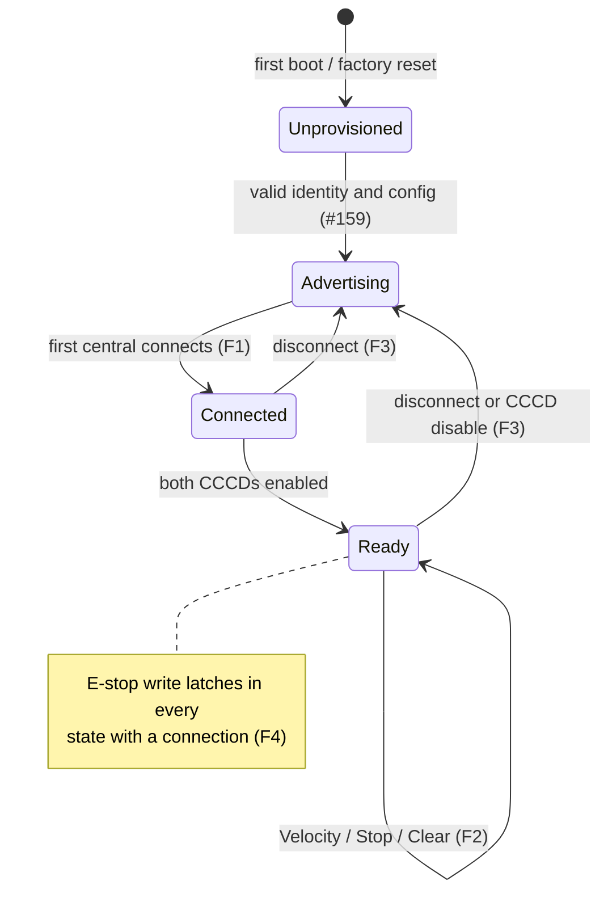

# BLE security profile: restricted-lab v1

Status: threat model and controller policy for
[issue #157](https://github.com/Krzys2002/Mini_Robot/issues/157). It is a
documentation and policy decision. No firmware in this repository enforces it
yet. [#165](https://github.com/Krzys2002/Mini_Robot/issues/165) owns enforcement,
[#163](https://github.com/Krzys2002/Mini_Robot/issues/163) owns the GATT
peripheral, [#158](https://github.com/Krzys2002/Mini_Robot/issues/158) owns
removal of legacy control paths, and
[#159](https://github.com/Krzys2002/Mini_Robot/issues/159) owns identity
provisioning. Physical powered tests remain gated by the
[CodeCell C6 hardware profile](../testing/codecell-c6-hardware-154.md) and
[#238](https://github.com/Krzys2002/Mini_Robot/issues/238). This profile does not
authorize them.

Key words: **must**/**must not** are mandatory for firmware, desktop builds and
operating procedures that claim this profile; **should** is a recommendation
whose deviation must be justified in the implementing PR.

## 1. Decision

The maintainer selected **restricted-lab protocol v1** on 2026-11-07 (recorded
in the #157 issue body). This profile:

- keeps the unpaired, unencrypted [v1 wire format](robot-protocol.md) and
  [GATT contract](ble-gatt.md) unchanged;
- does **not** introduce pairing, bonding, encryption, controller keys or
  authenticated ownership, and nothing may describe it as authenticated;
- restricts *where and how* v1 robots are operated, and lists the firmware
  behavior that keeps those restrictions enforceable;
- accepts the residual risks in [section 7](#7-accepted-residual-risks) for the
  thesis laboratory only.

The conflict between "v1 is intentionally unpaired" and "controller security is
required" is resolved as follows: in this profile **no radio-level or
protocol-level controller authorization exists**. The only enforceable control
is *session exclusivity* (one connected central at a time) plus physical and
procedural supervision. `robotId`, the advertised name, BLE addresses, macOS
peripheral UUIDs and sequence counters are identifiers, not authentication.

Any later secure profile needs a separate compatibility decision, a new protocol
version or explicitly reviewed GATT security change, and separately approved
desktop work ([section 9](#9-future-secure-profile-not-approved)). Approval of
the backlog that created #157/#165 is not approval of an insecure deployment
outside the conditions below.

## 2. Assets, actors and trust boundaries

| Asset | Why it matters |
| --- | --- |
| Robot motion | Physical safety: unexpected wheel motion, collision, falls from the table |
| Emergency-stop latch | The primary software means of stopping a robot |
| Robot identity/config in NVS | Wrong `robotId` or limits mislead the desktop and the vision association |
| Firmware image | Whoever controls it controls every safety rule |
| Experiment data | Thesis validity; not confidential |

| Actor | Capability assumed |
| --- | --- |
| Operator with the desktop | Authorized by the laboratory, physically present, can cut robot power |
| Nearby unauthorized central | Any phone/laptop/SDR in radio range: scan, connect, read, write, subscribe |
| Passive observer | Records all BLE traffic in range |
| Active radio attacker | Jams, forces disconnects, impersonates a robot, or relays between desktop and robot |
| Person with physical USB access | Reflashes, reads flash, uses the serial console |
| Local user/process on the desktop host | Uses the same Bluetooth adapter (on Linux any local user may call `org.bluez`; see [Linux setup](../development/linux-setup.md#bluetooth-and-ble)) |

Trust boundaries: the radio link (untrusted), the USB port (trusted only under
physical custody), the desktop host (trusted, out of scope for hardening), the
build machine and dependency sources (trusted after review and pinning).

Out of scope: cloud services, OTA, Zigbee, onboard video Wi-Fi, desktop OS
hardening and hardware fault tolerance. None of them is part of v1.

## 3. Threat matrix

"v1 effect" is what the unchanged protocol allows. "Restricted-lab mitigation"
lists what this profile requires and who enforces it (F = firmware rule in
[section 5](#5-enforceable-firmware-rules), D = existing desktop behavior,
O = operating rule in [section 4](#4-operating-restrictions)). Test IDs refer to
[section 8](#8-attack-test-cases).

| ID | Threat | v1 effect | Restricted-lab mitigation | Residual risk | Tests |
| --- | --- | --- | --- | --- | --- |
| TM-01 | Unauthorized central connects while the robot advertises (no session) | Full control: Velocity, Stop, E-stop, ClearEmergencyStop | O1–O4 (supervision, powered only when needed, keep the operator session connected); F1, F2 (only the single session may command) | Any central that connects first controls the robot (R1) | AT-01, AT-02 |
| TM-02 | Second central during an active session | Cannot discover or connect: the robot stops advertising and accepts one connection | F1 enforces one link and no advertising while connected | None beyond TM-08 (forced disconnect, then reconnect race) | AT-03 |
| TM-03 | Spoofed robot (impostor advertises the service UUID, `MR-<id>` and the same Robot Info `robotId`) | Desktop may connect to the impostor; the operator's commands and E-stop do not reach the real robot | D: duplicate advertisers in one scan are reported as ambiguous and refused; O5 (operator checks that the physical robot reacts) and O6 (physical power cut is the authoritative stop) | Undetectable if the real robot is off, out of range or silent (R3) | AT-09 |
| TM-04 | Spoofed controller identity | Not applicable: v1 has no controller identity, every central is equivalent | Same as TM-01 | Same as R1 | AT-01 |
| TM-05 | Passive observation | All frames, `robotId`, limits, telemetry and battery values are readable in clear | F7: no secrets are ever sent over v1; nothing sent is confidential | Traffic analysis and recording (R4) | AT-11 |
| TM-06 | Replay across sessions | A recorded Velocity or ClearEmergencyStop replayed in a *new* session is accepted, because the first frame of a session is accepted without sequence comparison and sequences restart at 0 | F2: each replayed Velocity runs only until its own `validForMs`, capped by `maxCommandValidityMs`; nothing carries over between sessions | Replay gives no more than TM-01 already gives: an attacker who can connect can command directly (R1, R2) | AT-04 |
| TM-07 | Replay inside one session | Older or equal sequence: Velocity/ClearEmergencyStop rejected with `StaleSequence`; Stop is always safe | F2 (existing v1 sequence rules) | An attacker who *is* the session can send fresh sequences (R1) | AT-05 |
| TM-08 | Reconnect hijacking: attacker forces a disconnect (jamming, supervision timeout) and connects first | Robot stops, keeps the E-stop latch, resumes advertising. The attacker's new session may send ClearEmergencyStop and Velocity | F3, F4 (stop and keep latch on disconnect; no auto-resume); D: desktop never clears automatically and reports connection failure; O7 (unexpected reconnect failure while powered means cut power) | Attacker can clear the latch and drive in its own session (R2) | AT-06 |
| TM-09 | Active relay / man-in-the-middle between desktop and robot | Relay may drop E-stop writes, forge `Accepted` results and telemetry, inject commands | F2 watchdog stops motion if the relay stops forwarding; O6 physical power cut | BLE E-stop is **not** reliable against an active attacker (R5) | AT-10 (documented, not reproduced) |
| TM-10 | Malformed or flooded GATT traffic from the connected central | Rejected per the v1 validation order; one CommandResult per frame | F5: bounded queues and overload policy from [#156](https://github.com/Krzys2002/Mini_Robot/issues/156); the dedicated E-stop write latches before parsing and before any queue | CPU/link saturation may delay telemetry (R6) | AT-07 |
| TM-11 | Pairing requests, connection-request or advertising floods, jamming | No pairing defined; jamming disconnects | F6: pairing state never grants anything and no bonds are stored; F3 stop on disconnect | Denial of control (fails safe, R6) | AT-08 |
| TM-12 | Physical USB access | Reflash any image, rewrite `robotId`/limits, read flash, use serial console | O8 physical custody; F8 (no motion over USB serial; maintenance only with outputs disabled); firmware hashes recorded | Full compromise by anyone holding the robot (R7) | AT-12 |
| TM-13 | Credential exposure | Profile has no controller credentials | F7; [section 6.3](#63-credential-handling). The retired legacy prototypes contain hard-coded Wi-Fi AP passphrases and the ESP32-S3 prototype prints its passphrase to serial; these are disclosed by repository history | Legacy passphrases are permanently compromised (R8) | AT-11 |
| TM-14 | Legacy AP/HTTP control bypass | Retired T1 images run an open-CORS HTTP server with GET motion and clear endpoints behind a shared AP passphrase | F9: production image contains no Wi-Fi, AP, HTTP or target mode ([#158](https://github.com/Krzys2002/Mini_Robot/issues/158)); O9 legacy images are never flashed onto a robot used with production firmware procedures | None once F9 is verified in the built image | AT-13 |
| TM-15 | Untrusted or drifting dependencies, unreviewed images | Unpinned platform/library sources change silently | F10 pinned platform/library versions and recorded image hash ([#155](https://github.com/Krzys2002/Mini_Robot/issues/155)) | Upstream compromise of a pinned release (R9) | AT-14 |
| TM-16 | Configuration or identity corruption | Wrong ID/limits, or a partial record | F11: invalid config cannot arm outputs ([#159](https://github.com/Krzys2002/Mini_Robot/issues/159)) | None for motion; robot unavailable until reprovisioned | AT-15 |

## 4. Operating restrictions

These conditions define the laboratory. Firmware cannot verify them; the
operator and the person responsible for the bench must.

- **O1** Operate only in the supervised thesis laboratory. Do not operate v1
  robots at demonstrations, in shared/public spaces or anywhere an untrusted
  person is expected within radio range, unless the maintainer separately
  accepts that location.
- **O2** A motor-powered robot is never left unattended. Disconnect the battery
  (and any motor supply) when the operator leaves or the experiment ends.
- **O3** Power motors only for the duration of an experiment; an advertising,
  motor-powered robot with no operator session is the TM-01 exposure.
- **O4** Connect the operator's desktop immediately after power-up, keep the
  session connected for the experiment, and confirm `Connected` for the expected
  `robotId` before any motion.
- **O5** Confirm physically that the robot reacts to Stop/E-stop at the start of
  each session (for example, an E-stop before the first motion). A robot that does
  not react is treated as possibly impersonated.
- **O6** The physical power disconnect is the authoritative emergency stop. BLE
  E-stop is the primary *software* path, but it is not trusted against an active
  radio attacker (R5).
- **O7** Treat an unexplained disconnect, a failed reconnect while the robot is
  still powered, an ambiguous identity, or unexpected telemetry/state as a
  possible hijack: cut robot power, then investigate. Do not clear E-stop to
  "see what happens".
- **O8** Keep robots, USB cables and the flashing machine under laboratory
  custody. Flash only images built from reviewed commits with pinned
  dependencies, and record the image hash.
- **O9** Do not flash retired T1 HTTP/AP images onto robots used for production
  experiments. Their passphrases must not be reused for any other system.
- **O10** The powered bench gates of the
  [hardware profile](../testing/codecell-c6-hardware-154.md#5-safe-wheels-raised-bench-procedure-current-limited)
  still apply. This profile adds no permission.

## 5. Enforceable firmware rules

Every rule is compatible with v1 bytes and GATT layout. #163 and #165 implement
and test them in `Mini_Robot/firmware/codecell-c6/`. The connection-only
[`ble-lifecycle` fixture](../../firmware/ble-lifecycle/README.md) is not changed
by this profile and does not implement it.

- **F1 Session exclusivity.** Configure the BLE host for at most one connection
  (`CONFIG_BT_NIMBLE_MAX_CONNECTIONS=1`): the pinned NimBLE-Arduino 2.3.6
  defaults to 3 in
  [nimconfig.h](https://github.com/h2zero/NimBLE-Arduino/blob/2.3.6/src/nimconfig.h),
  so relying on the library default is not compliant. Stop advertising while
  connected and restart it only after the disconnect is fully processed. If the
  stack ever reports a second connection, disconnect the newcomer without
  reading or applying its writes. A peripheral that is not advertising cannot
  receive a new connection, so this is what prevents an active session from
  being taken over.
- **F2 Session-bound intent.** Motion and ClearEmergencyStop are processed only
  from the current, ready session (both CCCDs enabled, as specified in
  [BLE session establishment](ble-gatt.md#session-establishment)). Sequence state,
  `lastAccepted`, pending Velocity, deadlines and queued frames belong to that
  session and are discarded when it ends. No frame received before a session
  started can act after it.
- **F3 Disconnect stops.** Any disconnect or CCCD disable stops motion as for
  Stop, keeps the RAM E-stop latch, and never resumes motion automatically.
- **F4 Prompt and permissive E-stop.** Any write to the Emergency Stop
  characteristic, from the connected central, latches before parsing, before
  queueing, and before any session, readiness, sequence or authorization check.
  No future authorization code may be placed on this path. E-stop is also
  honoured before readiness. Clear and motion are the only gated operations.
- **F5 Bounded input.** Writes are copied into bounded storage; overload follows
  the #156 policy (for example, reject or disconnect), never unbounded buffering
  and never blocking the E-stop path or the watchdog.
- **F6 Pairing grants nothing.** Production firmware must not enable bonding or
  persist bond keys and must not mark any characteristic as requiring
  encryption, authentication or authorization. State the security settings
  explicitly (`NimBLEDevice::setSecurityAuth(false, false, false)` and
  NoInputNoOutput IO capability) rather than inheriting them silently.
  NimBLE-Arduino 2.3.6 `NimBLEDevice::init()` already sets exactly these values
  (NoInputNoOutput, no bonding, no MITM, no Secure Connections) in
  [NimBLEDevice.cpp](https://github.com/h2zero/NimBLE-Arduino/blob/2.3.6/src/NimBLEDevice.cpp),
  so a central that requests pairing obtains at most LE Legacy Just Works
  encryption: unauthenticated and recoverable by a passive observer of the
  pairing exchange. No behavior may depend on it; it is not authorization.
- **F7 No secrets.** The profile has no keys, passkeys or passwords. Firmware
  must not contain, log or advertise any credential. Logs may contain `robotId`,
  connection handles, BLE addresses and frame contents; none is a secret.
- **F8 USB serial is maintenance only.** The production image accepts no motion,
  clear or JSON command input on USB serial. Maintenance commands (identity and
  configuration provisioning, factory reset, status) run only with outputs
  disabled and active intent cleared ([#159](https://github.com/Krzys2002/Mini_Robot/issues/159)).
  JSON remains the log/fixture mirror described in
  [robot protocol](robot-protocol.md#json-bring-up-representation).
- **F9 No legacy bypass.** The production image links no Wi-Fi, SoftAP, HTTP
  server, browser page, target/distance mode or OTA update code. Any retained
  experiment is a separate build environment with the same safety gate (#158).
- **F10 Identifiable, reproducible profile.** The production build environment
  defines the profile identifier `restricted-lab-v1` in one place. The boot log
  and diagnostics print it with the firmware version. No secure profile exists,
  so a build that selects any other identifier must fail; there is nothing to
  fall back from or to. Platform and library versions are pinned (#155).
- **F11 Configuration failure is safe.** Missing, corrupt or out-of-version
  configuration cannot arm outputs and cannot change this profile (#159).

Existing desktop behavior that this profile relies on (no desktop edits are
part of #157): service-UUID filtering, authoritative Robot Info identity check,
refusal of ambiguous duplicate advertisers, E-stop on the dedicated
characteristic with retries, re-assertion of E-stop before `Connected` after a
reconnect, and clear only on an explicit operator action
([BLE messages](../overview/ble-messages.md),
[manual robot control](../overview/manual-robot-control.md)).

## 6. Controller lifecycle, provisioning and credentials

### 6.1 Lifecycle

In this profile "authorized controller" means: *the desktop that the operator
connected, holding the robot's only BLE session, under the operating
restrictions*. The robot cannot tell an authorized controller from any other
central; authorization is procedural and lasts exactly one session.

| Event | Policy |
| --- | --- |
| Enrollment | None. No controller record exists. Do not add an allow-list of BLE addresses: addresses are spoofable, and macOS hides them behind per-host peripheral UUIDs, so an allow-list would be both insecure and non-portable. |
| Controller replacement | End the session on the old desktop (Disconnect or quit), confirm the robot advertises again, connect from the new desktop, E-stop first, then clear explicitly when safe. |
| Revocation | Not possible: there is no credential to revoke. A lost or compromised laptop is equivalent to any nearby central (R1). Recovery is procedural: power the robots off and review custody. |
| Safe failure | Every failure (config, provisioning, BLE host, queue overload, disconnect) results in outputs disabled and no motion until a new session sends new intent. |

### 6.2 Provisioning, factory reset and recovery

- **Provisioning** sets only robot identity and validated configuration through
  the USB maintenance path with outputs disabled (#159). No controller secret
  is provisioned.
- **Factory reset** returns the robot to `Unprovisioned`, clears active intent,
  and must also call `NimBLEDevice::deleteAllBonds()` so that no bond record
  written by an earlier image survives. It never restores motion.
- **Recovery** is local: USB maintenance or reflashing under custody. The RAM
  E-stop latch does not survive a reset, but the robot boots `Idle` with outputs
  disabled and moves only after a new session sends new Velocity frames.
- **Interrupted provisioning** leaves the previous valid record or the
  `Unprovisioned` state, as #159 specifies; it never yields a motion-capable
  robot with a partial record.

### 6.3 Credential handling

- No credentials exist in this profile. If any future profile adds one, it must
  never appear in source, configuration dumps, logs, test fixtures, issue bodies
  or PR descriptions; it is provisioned only through the local maintenance path.
- The hard-coded AP passphrases in `T1-ESP-C6/src/robotWebServer.cpp` and
  `T1-ESP-S3/src/main.cpp` are retired-prototype values. They are disclosed by
  repository history and must be treated as public. This document deliberately
  does not repeat them. The production image excludes that code (F9); deleting
  the legacy files is not required for this profile.

### 6.4 Platform, update and dependency review

| Topic | Decision for restricted-lab v1 |
| --- | --- |
| OTA | Not needed and not included. USB flashing under custody is the only update path; no Wi-Fi exists in the production image. |
| USB update trust | Trust rests on custody and reviewed builds: flash from a reviewed commit, record the build's image hash, and keep the pinned platform/library versions. |
| Secure Boot V2 | Supported by the ESP32-C6 (RSA-3072 or ECDSA P-256, keys in eFuse) per [Espressif Secure Boot V2](https://docs.espressif.com/projects/esp-idf/en/stable/esp32c6/security/secure-boot-v2.html). **Deferred**: it burns eFuses, changes the USB download path and needs signing-key custody; Arduino/pioarduino support for a signed bootloader was not confirmed. It must not be enabled on lab boards without a separate maintainer decision. |
| Flash encryption | Supported (XTS-AES-128, on-chip key) per [Espressif flash encryption](https://docs.espressif.com/projects/esp-idf/en/stable/esp32c6/security/flash-encryption.html). **Deferred**: no secrets exist on the device to protect; release mode restricts reflashing and is effectively one-way. |
| NVS encryption | Available, including an HMAC/eFuse scheme on the C6 without flash encryption, per [Espressif NVS encryption](https://docs.espressif.com/projects/esp-idf/en/stable/esp32c6/api-reference/storage/nvs_encryption.html). **Deferred**: NVS holds identity and limits only, which are not secret. Required before any future profile stores keys or bonds. |
| JTAG / download mode | Left enabled (development hardware). Covered by R7 and O8. |
| Dependencies | Production pins the platform release and NimBLE-Arduino version (the fixture already pins pioarduino 55.03.37 and NimBLE-Arduino 2.3.6). The legacy T1 projects track a moving platform URL and an unpinned library repository; that is acceptable only for retired prototypes. Review upstream release notes when bumping a pin. |
| Logging | Logs carry no secrets (F7). Serial logs may contain BLE addresses and frame contents; review them before attaching to public issues, as the #187 procedure already advises for hardware reports. |

## 7. Accepted residual risks

The maintainer's 2026-11-07 decision accepts these risks **only under the
operating restrictions in section 4**. Each one is also a reason the profile
must stay labelled restricted-lab.

| ID | Residual risk | Why it remains | Bound |
| --- | --- | --- | --- |
| R1 | Any central that connects first can command an advertising robot | v1 has no authentication | O1–O4; only one session; watchdog ceiling |
| R2 | After a forced disconnect, an attacker's new session can send ClearEmergencyStop and Velocity | v1 allows clear in any ready session; same-session-only clear would be a protocol semantic change | O7; robot stops on every disconnect; desktop never auto-clears |
| R3 | A spoofed robot can absorb the operator's commands and E-stop | Robot Info identity is not authenticated | Duplicate detection; O5, O6 |
| R4 | All traffic is observable | No encryption in v1 | Nothing confidential is transmitted |
| R5 | An active relay can suppress BLE E-stop | No integrity protection | O6 physical power cut; watchdog stops when forwarding stops |
| R6 | Radio denial of service | Inherent to radio | Fails safe: disconnect stops the robot |
| R7 | Physical USB access compromises the robot | No secure boot or flash encryption ([section 6.4](#64-platform-update-and-dependency-review)) | O8 custody |
| R8 | Legacy AP passphrases are public | Committed to history | Not used by production; O9 |
| R9 | A pinned dependency may contain a vulnerability | Supply chain | Pinning, review on update |

## 8. Attack-test cases

Host tests use firmware fakes; HIL tests use the production firmware on a
restrained robot under the hardware profile gates, plus a second central (a
phone BLE tool or a second adapter). All are NOT RUN until #163/#165 provide the
firmware. Expected results are the acceptance criteria for those issues.

| ID | Case | Level | Expected result |
| --- | --- | --- | --- |
| AT-01 | Unauthorized central connects to an advertising robot and sends Velocity | HIL | Accepted (documents R1). Boot log/diagnostics show `restricted-lab-v1`; no document or UI calls the session authenticated. |
| AT-02 | Central connects but does not enable both CCCDs, then sends Velocity and ClearEmergencyStop | Host + HIL | Velocity ignored without motion or result; robot stays latched if latched; E-stop still latches |
| AT-03 | Second central scans and tries to connect while the operator session is active | HIL | Robot not visible in scans; no second connection; operator session unaffected. A fake that injects a second connection callback must see it dropped without applying writes. |
| AT-04 | Replay a recorded Velocity frame (and a ClearEmergencyStop) from a new session | Host + HIL | Accepted as the session's first frame (documents R1/R2); motion ends at `validForMs` ≤ `maxCommandValidityMs`; nothing from the recorded session's state carries over |
| AT-05 | Replay an older/equal sequence inside one session | Host | Velocity/Clear rejected `StaleSequence`; Stop accepted |
| AT-06 | Force the operator disconnect during motion, then connect a different central first | HIL | Robot stops on disconnect, latch preserved, no auto-resume; the operator desktop reports failure; the new session needs explicit Clear and fresh Velocity to move |
| AT-07 | Flood Command with malformed, oversized and max-rate frames, then write a zero-length E-stop | Host + HIL | Latch applied within the #156 bound regardless of backlog; bounded memory; one result per frame or the #156 overload policy |
| AT-08 | Central requests pairing/bonding; repeated pairing and connection attempts | HIL | No bond stored (bond count stays 0); no state or readiness change; robot remains stoppable; behavior identical with or without link encryption |
| AT-09 | Impostor peripheral with the same `robotId` advertises alongside the real robot | HIL | Desktop reports ambiguity and does not connect (existing desktop behavior) |
| AT-10 | Relay/MITM suppresses E-stop | Analysis only | Not reproduced; documents R5 and O6 |
| AT-11 | Search source, build configuration, captured serial logs and advertising data for credentials | Host (scripted) | No key, passkey or password in the production tree or logs |
| AT-12 | USB serial: motion/clear/JSON input in the production image; maintenance while moving | Host + HIL | Motion/clear input rejected; maintenance stops outputs and clears intent first |
| AT-13 | Inspect the production image for Wi-Fi/HTTP/OTA components | Build | Linker map / symbol check shows no WiFi, WebServer, SoftAP or Update symbols |
| AT-14 | Build from a clean checkout twice | Build | Same pinned versions resolved; image hash recorded |
| AT-15 | Corrupt or interrupt the config record; factory reset | Host + HIL | No armed outputs; reset leaves no bonds and no motion |

### 8.1 Traced scenarios

**Unauthorized connect, motion and clear.** The robot is powered and advertising
before the operator connects. A phone connects first (F1 now blocks the
desktop), enables both CCCDs and is *ready*. Its Velocity is accepted and runs
until `validForMs`; its ClearEmergencyStop is accepted. This is R1. The desktop
scan does not find the robot; per O7 the operator cuts power. With O3/O4
followed, the window is the few seconds between power-up and the operator's
connection.

**Cross-session replay.** A passive observer records `01 02 02 01 …` (a
Velocity, sequence 258) from the operator's session. After the session ends,
the observer connects, enables CCCDs and writes the recorded bytes. The robot
accepts it as the first frame of the new session (no `lastAccepted` yet) and
stops at its deadline. Replaying it again in the same session is rejected as
`StaleSequence`. Writing a fresh sequence instead works equally well, so replay
adds no capability beyond R1. Nothing from the old session (deadline, queue,
`lastAccepted`) is reused (F2).

**Controller replacement.** The operator disconnects desktop A; the robot stops,
keeps any latch and advertises. Desktop B connects, re-asserts E-stop if its
safety state demands it, and clears only on an explicit operator action. If
desktop A reconnects instead, it is equally accepted; nothing distinguishes A
from B, which is why replacement and revocation are procedural.

**Factory reset.** Through USB maintenance with outputs disabled, the robot
erases its identity/config record and any NimBLE bond records, reboots
`Unprovisioned`, does not accept motion, and needs reprovisioning before it
advertises as a usable robot (#159). No controller state exists to clear.

## 9. Future secure profile (not approved)

Recorded so that #165 and later work do not overstate what the stacks provide.
"Encryption" below means link confidentiality; "MITM-resistant authentication"
means the peer key exchange is authenticated (numeric comparison, passkey entry
or out-of-band). Just Works pairing gives the first, never the second. LE
Secure Connections Just Works resists passive eavesdropping; LE Legacy Just
Works does not.

| Component | Capability found | Consequence |
| --- | --- | --- |
| ESP32-C6 + NimBLE host | LE Secure Connections supported ([Espressif BLE feature status](https://docs.espressif.com/projects/esp-idf/en/stable/esp32c6/api-guides/ble/ble-feature-support-status.html)) | Encryption is available |
| NimBLE-Arduino 2.3.6 | `setSecurityAuth(bonding, mitm, sc)`, `setSecurityIOCap`, `setSecurityPasskey`, `startSecurity`; `READ_ENC`/`WRITE_ENC`/`*_AUTHEN`/`*_AUTHOR` properties; `onConfirmPassKey`, `onAuthenticationComplete`; `NimBLEConnInfo::isEncrypted/isAuthenticated/isBonded`; bond management (`deleteAllBonds`, default `CONFIG_BT_NIMBLE_MAX_BONDS` 3) with NVS persistence; white list API ([NimBLEDevice.h](https://github.com/h2zero/NimBLE-Arduino/blob/2.3.6/src/NimBLEDevice.h), [NimBLEServer.h](https://github.com/h2zero/NimBLE-Arduino/blob/2.3.6/src/NimBLEServer.h), [NimBLELocalValueAttribute.h](https://github.com/h2zero/NimBLE-Arduino/blob/2.3.6/src/NimBLELocalValueAttribute.h), [nimconfig.h](https://github.com/h2zero/NimBLE-Arduino/blob/2.3.6/src/nimconfig.h)) | Stack mechanics exist. There is no per-request authorization callback for `*_AUTHOR`; runtime semantics were not confirmed |
| CodeCell C6 Drive I/O | No display, keypad or confirmation button is documented in the hardware profile | Robot IO capability is effectively NoInputNoOutput: only Just Works, so no MITM-resistant pairing without inventing hardware. A static passkey shared at provisioning would be a weak substitute and is not accepted. |
| Qt 6 `QLowEnergyController` | No API to request a security level or read encryption state; `AuthorizationError` exists ([Qt docs](https://doc.qt.io/qt-6/qlowenergycontroller.html)) | The desktop cannot require or verify encryption through Qt |
| Qt 6 `QBluetoothLocalDevice` | Pairing request documented; on macOS unpairing is not supported; the Qt 5 pairing-agent signals (PIN/confirmation) were removed without replacement ([Qt docs](https://doc.qt.io/qt-6/qbluetoothlocaldevice.html), [Qt 6 changes](https://doc.qt.io/qt-6/qtbluetooth-changes-qt6.html)) | Passkey/numeric comparison cannot be driven from the application; revocation cannot be automated on macOS |
| macOS / CoreBluetooth | Pairing is OS-mediated when a protected attribute is accessed; bonds belong to the host, not the app ([Apple Core Bluetooth guide](https://developer.apple.com/library/archive/documentation/NetworkingInternetWeb/Conceptual/CoreBluetooth_concepts/BestPracticesForSettingUpYourIOSDeviceAsAPeripheral/BestPracticesForSettingUpYourIOSDeviceAsAPeripheral.html)) | A bond would authenticate a host, not an operator or application |
| Linux / BlueZ | Pairing needs a registered agent with a matching IO capability; `Device1.Pair`, `Adapter1.RemoveDevice` remove bonds ([Agent](https://github.com/bluez/bluez/blob/master/doc/org.bluez.Agent.rst), [AgentManager](https://github.com/bluez/bluez/blob/master/doc/org.bluez.AgentManager.rst), [Device](https://github.com/bluez/bluez/blob/master/doc/org.bluez.Device.rst), [Adapter](https://github.com/bluez/bluez/blob/master/doc/org.bluez.Adapter.rst)) | Requires a platform-specific agent outside Qt; bonds are shared by all local users of `org.bluez` |

The [2026-11-14 non-motor spike](../testing/security-157-spike-2026-11-14.md)
confirmed on Linux BlueZ that the unchanged fixture accepts unpaired
connections and unauthenticated writes. It also showed that any central can
complete Just Works pairing without bonding, and that USB serial provisioning
has no access control.

Unsupported or unverified combinations, therefore:

- MITM-resistant pairing with the CodeCell as built: **unsupported** (no robot
  I/O for numeric comparison/passkey). Out-of-band pairing over USB through
  NimBLE-Arduino: **not confirmed**.
- Application-controlled pairing/unpairing on macOS through Qt: **unsupported**
  for unpairing; pairing UI is OS-owned.
- Passkey/numeric comparison from the Qt application on Linux: **unsupported**
  in Qt 6 APIs; needs an external BlueZ agent.
- Whether Qt's Linux LE central uses the BlueZ D-Bus or kernel backend by
  default: **not confirmed** from documentation.
- Secure Boot / flash encryption through the pioarduino Arduino build:
  **not confirmed**.

A credible secure profile would most likely need application-layer controller
authentication (for example a provisioned per-controller key and a per-session
challenge with authenticated frames). v1 frames are fixed-length and frozen, so
that is a new protocol version with desktop and firmware changes, NVS
encryption for the key, and a revocation path. It needs its own issue,
compatibility decision and approval; nothing in v1 or #165 may anticipate it.

## 10. Hand-off to #165

#165 implements F1–F11 and AT-01…AT-15 for the restricted-lab profile:

- **Desktop integration scope:** none required. Existing desktop behavior is
  sufficient for this profile. Labelling the session "restricted-lab
  (unauthenticated)" in the UI is a recommended, separately approved desktop
  change; it is not a prerequisite.
- **Provisioning mechanism:** identity/config only, through the #159 USB
  maintenance path with outputs disabled; no controller enrollment.
- **Revocation:** not available; procedural (power off, custody review).
- **Safe failure:** every authorization-equivalent failure (no session, session
  not ready, disconnect, config failure, overload) leaves outputs disabled and
  never enables motion; the E-stop path has no authorization check.
- **Replay statement:** within one session, older sequences are rejected;
  across sessions, a recorded Velocity/ClearEmergencyStop is accepted as a new
  first frame and is bounded only by its validity window.

Pairing/encryption, bonding and controller keys are explicitly **not** in #165's
scope while this profile is selected.
