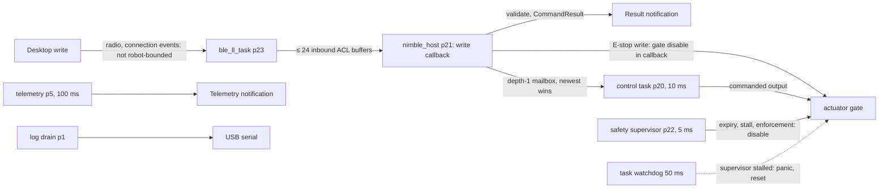

# Firmware timing, resource and stopping budgets

Status: **PROPOSED for [#156](https://github.com/Krzys2002/Mini_Robot/issues/156);
approval is the maintainer's review of the #156 pull request.** Until then no
bound below is an approved requirement. The values are named in
[`TimingBudget.hpp`](../../firmware/codecell-c6/include/TimingBudget.hpp), and the
bench evidence is the [timing pilot record](../testing/timing-pilot-156.md).

This contract keeps [protocol version 1](robot-protocol.md) and the
[BLE GATT contract](ble-gatt.md) unchanged. That includes expiry at
`now >= deadline`, the receipt-relative validity window, the E-stop latch on any
Emergency Stop write, and one CommandResult per received frame while ready. It
chooses the robot's advertised values within the v1 ranges. Implementation
belongs to [#158](https://github.com/Krzys2002/Mini_Robot/issues/158) (runtime and
scheduling), [#162](https://github.com/Krzys2002/Mini_Robot/issues/162)
(watchdog, E-stop and faults) and #163/#164 (protocol and telemetry).
Verification on the physical robot belongs to
[#166](https://github.com/Krzys2002/Mini_Robot/issues/166), and powered physical
checks to [#238](https://github.com/Krzys2002/Mini_Robot/issues/238).
[#72](https://github.com/Krzys2002/Mini_Robot/issues/72) keeps BLE round-trip,
jitter and reconnect analysis.

## Terms and clocks

| Term | Meaning |
| --- | --- |
| Receipt | Entry of the robot's BLE write callback, read from the robot clock. Radio and host-stack delay before it is not subtracted (v1). |
| Commanded output | The value the firmware writes to the drive through its single actuator gate. |
| Electrical disable | The gate has switched the drive outputs off. This is the E-stop action, and the fallback when a stop cannot be completed normally. |
| Physical stop | The wheels are stationary. **No bound here covers it.** Coasting, braking and slip are unmeasured, and the board has no wheel encoders ([hardware profile](../testing/codecell-c6-hardware-154.md)). |

- The robot measures every deadline and interval on `esp_timer` microseconds
  since boot, held as signed 64-bit (`FirmwareClock.hpp`). That counter does not
  wrap within any realistic uptime.
- FreeRTOS ticks are 1 ms (`CONFIG_FREERTOS_HZ = 1000`). They only schedule
  wake-ups, so a deadline comparison is never quantized to a tick. Wait
  durations convert with `ticksAtLeast()`, which rounds up; `pdMS_TO_TICKS`
  truncates and can shorten a timeout.
- `validForMs` and `maxCommandValidityMs` are whole milliseconds. A deadline is
  `receipt + validForMs × 1000 µs`.
- Telemetry `uptimeMs` (uint32, wraps after about 49.7 days) is diagnostic only.
  The robot never uses it, or `millis()`, for safety.
- No clock is synchronized between desktop and robot. The desktop measures
  latency only as round trips on its own monotonic clock. The robot measures only
  intervals on its own clock, such as the time from the last write to a
  disconnect.

## Timing path trace

| Stage | Context and priority | Work | Pilot measurement (USB-only board) | Budget |
| --- | --- | --- | --- | --- |
| Radio and central | Desktop stack, BLE controller | Queueing in the desktop stack, then connection events | Write→result round trip 34–62 ms at a 30 ms interval with 10 Hz writes. Robot inter-arrival follows connection events (90–120 ms for a 100 ms send period). Behind a host backlog: 21.0 s | Not bounded by the robot: requirements D1–D2 |
| Robot host queue | 24 ACL buffers → `nimble_host` (21) | Waiting ahead of the callback | Not observable without HCI stamps | ≤ 19.2 ms (24 × 0.8 ms callback allowance) |
| Write callback | `nimble_host` (21) | Receipt stamp, validation, one CommandResult | Callback 0.18–0.58 ms, notify call 0.16–0.38 ms (wall time, includes `ble_ll_task` preemption) | Callback ≤ 0.8 ms |
| Setpoint handoff | Callback → depth-1 mailbox → control task (20) | Copy the validated setpoint | Receipt→consumer 0.22–0.67 ms. Queue overwrite→receive ≤ 11 µs, critical-section copy ≤ 9 µs, uncontended mutex ≤ 11 µs | ≤ 2 ms |
| Motor update | Control task (20), every 10 ms | Sensor read, mixing, limits, actuator gate write | Not measured: no sensor or driver call was allowed | First write ≤ 15 ms after receipt |
| Safety checks | Supervisor (22), every 5 ms, independent of control | Deadline, control heartbeat, stop enforcement | Wake lateness ≤ 3 µs idle. At priority 22, ≤ 108 µs under every BLE load. At 20, up to 0.801 ms (1.403 ms in a development run) | ≤ 2 ms lateness |
| E-stop | `nimble_host` callback | Gate disable, latch, then result and telemetry | Callback entry→gate stub 1–2 µs (the stub only stamps the time) | ≤ 1 ms in the callback; ≤ 25 ms from stack receipt |
| Disconnect | `nimble_host` callback | Stop as for Stop; keep the latch. The desktop learns of it only from its own stack, because no robot frame can follow a lost link; the robot records reason and time since the last write (I10) | Host-initiated disconnects only (reason 531, remote terminated). Negotiated 30 ms interval, latency 0, 400 ms supervision timeout | Not relied on (B5) |
| Telemetry and results | Telemetry task (5); results from the callback | Periodic and state-change notifications | Robot period deviation p99 ≤ 5 µs, maximum 1.48 ms. Host gaps 83.5–123.9 ms | B10–B11 |
| Logging | Log ring → drain task (1) | Serial output only | `Serial.write` calls take up to 38 ms with the host reading and up to 99.9 ms with it paused. A logging loop above the probe delayed it by up to 0.2 ms (30 ms in development runs); at priority 1, ≤ 18 µs | B13 |
| Supervision | Task watchdog | Panic and reset if the supervisor stops feeding it | Trigger at +1.0–1.3 ms over the timeout, then a ≈ 0.41 s panic dump and ≈ 0.34 s boot to `setup()` | B17 |

Scheduler interference observed on the pilot:

- A control-like load (7 ms busy out of every 10 ms) one priority **below** the
  probe left its lateness at ≤ 2 µs. One priority **above**, the probe was late by
  a whole burst (4.01 ms). The supervisor must therefore sit above every
  application task that does sustained work.
- `nimble_host` (21) runs above application priority 20. A write flood delayed a
  priority-20 probe by up to 0.801 ms, and a development run with 200 Hz
  telemetry plus a backlog reached 1.403 ms. At priority 22 the same loads cost
  ≤ 108 µs. That is the reason the supervisor is placed above `nimble_host`.
- Serial logging is unsafe on any timing path. With the default 100 ms TX
  timeout, a call took up to 38 ms while the host read and 99.9 ms after it
  paused. With the timeout at 0, calls stayed ≤ 0.96 ms, but only 110 of 500
  lines arrived even while the host read: Arduino `HWCDC` drops data whenever it
  considers the host gone. A tight logging loop above the probe delayed it by up
  to 0.2 ms in the archived run and by about 30 ms in two development runs.

## Budget table

Owner is the issue that must implement the bound and show its pass/fail result.
Pass/fail methods use the [instrumentation points](#instrumentation-points) and
[stress conditions](#repeatable-stress-conditions) below.

| ID | Path / quantity | Bound | Owner | Derivation | Uncertainty | Pass/fail method |
| --- | --- | --- | --- | --- | --- | --- |
| B1 | Command validity ceiling, advertised `maxCommandValidityMs` | **250 ms** | #162 enforces; #163 advertises | Must outlast one lost refresh plus a connection interval: ≥ 2 × 100 ms + 30 ms = 230 ms. Equal to the desktop's configured `commandValidity` (250 ms), so the desktop window is not clamped. At the desktop's manual cap (0.1 m/s) the robot travels ≤ 25 mm before a stop decision | The host client was BlueZ, not the Qt desktop. macOS intervals are unmeasured. Speed caps are not approved (#238) | Fake clock: `OneLostOrLateRefreshDoesNotExpireAnActiveCommand`. HIL: S1 with one frame dropped never expires; two dropped expire within B4 |
| B2 | Desktop Velocity refresh while moving | ≤ 100 ms | Desktop (#66/#74); existing `refreshInterval`, `minimumVelocityInterval` | v1 asks for ≤ validity/2 | Desktop timer jitter on Qt is unmeasured (#72) | Desktop log of send times (#72) |
| B3 | Safety check period / wake lateness | **5 ms / ≤ 2 ms** | #158, #162 | Detection resolution well below B1. Whole ticks. Probe cost 0.2 % CPU at 5 ms. Worst lateness archived: 0.801 ms at priority 20, 0.108 ms at 22 (1.403 ms at 20 in a development run) | Supervisor work itself is not yet written; only the wake-up was measured | I6 lateness histogram maximum ≤ 2 ms in S0–S6 |
| B4 | Deadline → expiry decision | ≤ 7 ms (B3 sum) | #162 | A deadline may fall just after a check | — | Fake clock: `ExpiryHappensAtTheDeadlineNotBefore` and the sweep. HIL: I7 − deadline |
| B5 | Receipt of the last valid Velocity → commanded output zero or electrically disabled, **with no disconnect event and with the control task stalled or not** | **≤ 400 ms** (composed 385 ms = 250 + 7 + 120 + 7 + 1) | #162 | B1 + B4 + stop enforcement (B6) + one more check + disable allowance (B8) | The drive-disable write time is unmeasured (1 ms allowance). Physical motion after this point is unknown | Fake clock: sweep, command loss, stall and stale-output cases. HIL: I1 (last accepted) → I5/I8 in S1–S7 |
| B6 | Normal stop (Stop, expiry, disconnect, CCCD disable): commanded ramp | Ramp ≤ 100 ms; zero ≤ decision + 112 ms. Not zero at decision + **120 ms** → supervisor disables, `Fault` | #160, #162 | 10 control steps. At 0.1 m/s the average requested deceleration is ≤ 1 m/s² | Physical deceleration, slip and coasting are UNMEASURED. Without encoders the firmware bounds only the command (#238/#166) | Fake clock: `StopAndDisconnect…`, `StaleNonzeroOutputAfterExpiryIsEnforced`. HIL: final-write trace I5 |
| B7 | Control task stalled while output nonzero (for example a blocked sensor read) → disabled | **≤ 40 ms** (30 ms stall limit + 7 + 1) | #158, #162 | Three missed 10 ms cycles | — | Fake clock: `StalledControlTaskIsDisabledByTheSupervisor`, `…DuringTheStopRamp…`. HIL: S7 |
| B8 | E-stop: callback entry → drive disable returned; stack receipt → disabled | **≤ 1 ms; ≤ 25 ms** (24 × 0.8 ms + 1 ms) | #162 | Disable is the first action in the callback, ahead of parsing and results. The wait ahead of the callback is bounded by the inbound buffers | Driver write unmeasured. HCI receipt is not observable, so the second bound is derived, not measured. Desktop and radio delay are outside it (D2) | Fake clock: `EmergencyStopBehindAParserFlood…`. HIL: I9 → I8 in S0 and S4 |
| B9 | Receipt → validated setpoint in mailbox; → first actuator write | **≤ 2 ms; ≤ 15 ms** | #158 | Measured ≤ 0.67 ms; plus one control period and lateness | Sensor and control compute unmeasured | HIL: I1 → I3, I1 → I5 |
| B10 | Telemetry: period / robot-side deviation / state-change spacing / rate | **100 ms / ≤ 2 ms / ≥ 20 ms / ≤ 60 per s** | #164 | The desktop's 3 × 100 ms silence threshold exceeds the worst host gap seen (123.9 ms) plus two connection intervals. A coalesced state change is never delayed by more than 20 ms | macOS unmeasured | Desktop silence never trips in S1–S6. Robot I11 deviation |
| B11 | CommandResult | Exactly **1** per received frame while ready, queued inside the callback (≤ 0.8 ms) | #163 | No queue between the callback and NimBLE's own buffers. No notify failure in any run, up to 446 processed frames/s | During floods the host received fewer results than the robot queued (4,175 of 4,459). The loss was not attributed; host reader starvation is likely | Result count = write count in S1–S3. Fake notify failure → overflow policy |
| B12 | Queue capacities | Setpoint mailbox **1** (overwrite); inbound **24** ACL buffers (platform, link-layer flow control); telemetry **1** latest-wins slot; log ring **2048 B**; no other queue on the motion path | #158 | Newer accepted setpoints supersede older ones under v1. Writes arriving 2–4 per connection event coalesced as intended (1,001 handoffs for 1,500 writes at 50 Hz) | — | Code review; S4 counters |
| B13 | Logging | ≤ **2048 B/s** average; drain task priority 1; never `Serial` from supervisor, control or BLE callbacks | #158 | See scheduler findings | Behaviour without a USB host is known from source only (drop) | S5: supervisor lateness unchanged with the monitor attached and paused |
| B14 | CPU (non-idle share) | ≤ **50 %** in every supported stress condition | #158, #166 | Pilot non-idle: 1.8 % nominal (S1), 6.4 % with 200 Hz telemetry (S3), 15–20 % in a write flood (S4) | Control and sensor compute unmeasured | FreeRTOS run-time stats over each S-run |
| B15 | Heap | No allocation after initialization on supervisor, control or callback paths; minimum free ≥ **64 KiB** | #158 | Pilot with BLE: minimum free 304,796 B after all stress; BLE start cost 38,084 B | The production image is larger | `heap_caps_get_minimum_free_size` after S1–S7 soak; no downward trend |
| B16 | Stack | Every task high-water ≥ **25 %** free | #158 | `nimble_host` kept 2,920 B free after floods (≥ 57 % of its stack) | Production task stacks are unmeasured | `uxTaskGetStackHighWaterMark` after the soak |
| B17 | Task watchdog | Supervisor subscribed; **50 ms**; panic and reset | #162 | ≥ 4 × B4 so lateness never trips it; < B1 so a stalled supervisor resets before a ceiling expires. Measured trigger +1.0–1.3 ms | During the ≈ 0.41 s panic dump the outputs keep their last state, and the electrical state during reset and boot is UNRESOLVED (#238). Disabling the drive in a task-watchdog ISR hook before the dump is an unverified option for #162 | Inject a supervisor stall (S8); measure the outputs, not the logs |
| B18 | Priorities | Controller 23 (fixed) > supervisor **22** (shares with `esp_timer`; no application `esp_timer` callbacks on critical paths) > `nimble_host` 21 (fixed) > control **20** > telemetry **5** > log drain **1** | #158 | Scheduler findings above | — | Static assert in `TimingBudget.hpp`; task table at boot |
| B19 | Disconnect and CCCD disable | Stop as for Stop on the callback; keep the latch | #162 | v1 session rule | Abrupt radio loss (supervision timeout) NOT RUN | B5 holds without the callback |

The compile-time checks in `TimingBudget.hpp` fail the build if a constant
changes so that a composed bound or the priority order no longer holds.

## Overload policy

| Overload | Finite policy | Never |
| --- | --- | --- |
| E-stop while the host is busy | The callback disables the drive and sets the latch before parsing or results. The latch is the safety event; its CommandResult and telemetry are best effort. Any write to the Emergency Stop characteristic latches (v1) | Queued, parsed first, or discarded |
| Command write flood | Link-layer flow control backpressures the central. The robot holds at most 24 inbound frames. Each frame is validated and answered inside its callback | A motion queue: the mailbox holds one setpoint, so motion is never queued indefinitely |
| CommandResult cannot be queued (notify fails) | Treat as session overload: stop as for Stop, then terminate the connection. v1 allows results to be lost at session end, and the latch persists | A silently missing result while the session continues |
| Telemetry cannot be queued | Drop that sample and count it; the next period sends the newest state | A retry backlog, or delaying results |
| Log ring full | Drop the newest line and count it; report the drop count later | Blocking a caller |
| Supervisor late beyond B3 | Visible through I6. If it stops feeding the watchdog → panic and reset (B17) | A longer validity window |

## Desktop-side requirements (handoff, not implemented here)

The pilot showed what the robot cannot control. These are proposed to
[#66](https://github.com/Krzys2002/Mini_Robot/issues/66),
[#70](https://github.com/Krzys2002/Mini_Robot/issues/70) and
[#74](https://github.com/Krzys2002/Mini_Robot/issues/74). They are not edits to
those issues.

- **D1. Bounded central queue.** BlueZ accepted write-without-response frames far
  faster than the link carried them: about 649 k in 10 s, while the robot
  processed 4,459 in that run. Even a 1 kHz offered rate built a backlog, with
  round trips reaching 7.9 s. A late frame counts as fresh
  for its full window after *receipt*, and v1 gives the robot no way to see its
  age. The desktop must keep at most one unsent Velocity, replacing rather than
  appending, at ≤ 10 Hz.
- **D2. E-stop must not wait behind motion writes.** After 0.2 s of flooding
  (7,548 frames), an Emergency Stop write-with-response completed only after
  21.0 s. If an
  E-stop is not confirmed within its retry period, the desktop should end the
  session, because a disconnect also stops the robot.
- **D3.** Do not assume synchronized clocks. Do not derive robot freshness from
  `uptimeMs`.

## Instrumentation points

Robot-clock stamps in 64-bit µs, kept in fixed buffers (no allocation) and read
out after a run, never streamed from timing paths.

| ID | Point | Records |
| --- | --- | --- |
| I1 | Command write callback entry (receipt) | Stamp, wire sequence, type |
| I2 | CommandResult queued | Stamp, result |
| I3 | Setpoint published to the mailbox | Stamp |
| I4 | Control task picks up a setpoint | Stamp, age since I1 |
| I5 | Actuator gate write | Stamp, per-wheel command |
| I6 | Supervisor wake | Lateness from the tick edge (histogram) |
| I7 | Expiry decision | Stamp, deadline |
| I8 | Drive disable returned | Stamp, cause (E-stop, expiry enforcement, stall) |
| I9 | Emergency Stop callback entry | Stamp |
| I10 | Disconnect / CCCD callback | Stamp, reason, time since I1 |
| I11 | Telemetry notify | Stamp, success, period deviation |
| I12 | Watchdog feed | Stamp |
| I13 | Resource snapshot | Free heap, minimum heap, per-task stack high-water and run time |

The pilot implemented I1, I3/I4, I6, I9/I8 (gate stub), I10, I11 and I13 with
[`LatencyHistogram`](../../firmware/codecell-c6/include/LatencyHistogram.hpp).

## Fake-clock boundary tests

`TimingBudgetTest` (host, `core` label) replays these timelines through a
test-only reference model with a fake microsecond clock:

| Timeline | Test | Checks |
| --- | --- | --- |
| Deadline boundary | `ExpiryHappensAtTheDeadlineNotBefore` | Expiry at `now == deadline`, not 1 µs earlier |
| Phase, validity, lateness sweep | `LastValidCommandIsBoundedForEveryPhaseValidityAndLateness` | B4 and B5 for 1–250 ms windows, 40 phases, zero and maximum lateness |
| Command loss / delay | `OneLostOrLateRefresh…`, `CommandLossWithoutDisconnectEventStillStops` | B1 and B5 with no disconnect event |
| Blocked sensor / stalled control | `StalledControlTaskIsDisabledByTheSupervisor`, `ControlStallDuringTheStopRampIsDisabled` | B7 and B5 |
| Stale output after expiry | `StaleNonzeroOutputAfterExpiryIsEnforced` | B6 enforcement |
| Parser flood + E-stop | `EmergencyStopBehindAParserFloodDisablesWithinItsBound` | B8; the latch rejects later motion |
| Notification pressure | `NotificationPressureLatenessKeepsEveryBound` | B4 and B5 with maximum lateness and connection-event bursts |
| Wraparound | `ResultsDoNotDependOnClockWraparoundPoints` | The uint32 µs and ms wrap points change nothing |
| Tick quantization | `WaitsRoundUpToWholeTicksUnlikeTruncation` | Waits are never shortened |

Sequence-number wrap is a v1 serial-number rule (#163). It does not affect
deadlines, because rejected or stale frames never extend one.

## Repeatable stress conditions

Each run records the board, image hash and provenance, host OS, BlueZ version,
adapter, negotiated connection parameters, offered rate and duration. The pilot
procedure is the template ([record](../testing/timing-pilot-156.md#method)).

| ID | Condition | Pilot status |
| --- | --- | --- |
| S0 | Idle, USB monitor attached | Run |
| S1 | Nominal desktop: 10 Hz write-without-response, 100 ms telemetry, 60 s | Run (BlueZ client) |
| S2 | Fast: 50 Hz writes | Run |
| S3 | Notification pressure: 5 ms telemetry + S1 | Run |
| S4 | Write flood, saturating the central | Run; desktop backlog finding D1/D2 |
| S5 | Serial monitor attached, then reading paused | Run (logging only) |
| S6 | Control-like CPU load below and above the supervisor | Run |
| S7 | Control task stall injection | Host model only; HIL in #162/#166 |
| S8 | Supervisor stall → task watchdog | Run (pilot task, no outputs) |
| S9 | Abrupt radio loss (supervision timeout), CCCD disable, reconnect | NOT RUN |

## Open items and explicit blockers

- Approval of this table (#156 PR review).
- **Integration follow-up (2026-11-16, [PR #276](https://github.com/Krzys2002/Mini_Robot/pull/276#issuecomment-6923047956)).**
  No additional isolated code correction was requested for #156. The table
  remains **proposed**, with no approved relaxation:
  - #164/PR #283 recorded B10 periodic deviations of 10.6–14.0 ms against
    ≤ 2 ms. Its scheduler corrections are host-tested, but burst/stress runs on
    the corrected C6 image must still establish 100 ± 2 ms periodic gaps and
    state-change spacing ≥ 20 ms.
  - B3 reached 2.09 ms against ≤ 2 ms during a roughly 75-minute idle window.
    The cause remains unresolved; investigation and a long idle rerun are
    required.

  Passing host/reference-model tests does not establish production timing
  conformance. The 19.2 ms host-queue allowance does not replace the separate
  B10 bound. Any revised bound needs explicit #156/#276 maintainer approval
  and recalculation of B4/B5/B7/B8 and desktop freshness assumptions as
  applicable. Physical output-disable uncertainty remains unchanged.
- Physical stopping distance and time, DriveCell disable semantics (coast or
  brake), and the actuator write time: powered and gated by #238; HIL in #166.
- Electrical output state during panic, reset and boot: UNRESOLVED (#238).
- BNO085/CodeCell sensor access time and blocking behaviour: not measured,
  because the pilot was not allowed to initialize CodeCell. Until measured, sensor
  reads stay in the control task and B7 covers a blocked read.
- macOS central behaviour, the Qt desktop as client, abrupt link loss and a
  second central (#72/#166).
- The connection-only `ble-lifecycle` fixture still advertises the illustrative
  500 ms ceiling. That is acceptable, because the fixture never moves.
